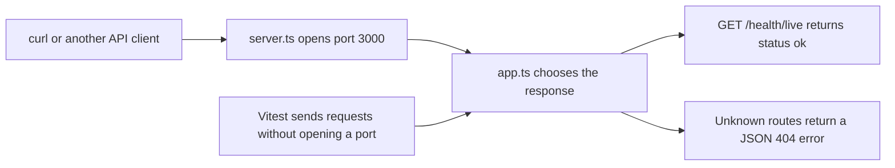

# Hono and Drizzle finance API

A personal finance API built in small, reviewable steps. The first step adds a Hono app, TypeScript checks, linting, and Vitest tests. Accounts, transactions, PostgreSQL, and authentication come in later steps.

See the [approved plan](docs/01-architect-todos.md) and [project map](docs/PROJECT_MAP.md).

## Run the current step

You need Docker with Docker Compose. You do not need Node.js or npm on your computer. In WSL, enable your distro under Docker Desktop's WSL Integration settings.

The temporary `tools` container runs Node.js 24. It mounts your source files and keeps installed dependencies inside the container. Dependencies disappear when the container exits. Gate 3 will add the long-running API and PostgreSQL containers.

Create the dependency lockfile once, or update it after changing dependencies. Commit the resulting `package-lock.json` with the code.

```bash
docker compose -f compose.tools.yaml run --rm tools npm install --package-lock-only
```

Run type checks, linting, tests, and the build:

```bash
docker compose -f compose.tools.yaml run --rm tools
```

Start development with automatic restarts when you edit source files:

```bash
docker compose -f compose.tools.yaml run --rm --service-ports tools sh -c 'npm ci && npm run dev'
```

In a second terminal, check that the API responds:

```bash
curl http://localhost:3000/health/live
```

Expected response:

```json
{"data":{"status":"ok"}}
```

Stop the development container with Ctrl+C. No database or environment file is needed yet.

The container defaults to user ID and group ID `1000` so generated files belong to the usual WSL user. If yours differ, prefix Compose commands with `LOCAL_UID=$(id -u) LOCAL_GID=$(id -g)`.

## How requests reach the app



Tests use the app directly. Importing `app.ts` does not start a server or require a database.

## Available checks

These npm scripts run inside the container. To run one check, replace the final command below with `npm run lint`, `npm test`, or `npm run build`.

```bash
docker compose -f compose.tools.yaml run --rm tools sh -c 'npm ci && npm run typecheck'
```

| Script | Purpose |
| --- | --- |
| `dev` | Run the API and restart after source edits. |
| `build` | Compile application files into `dist/`. |
| `start` | Run the compiled app after a build. |
| `typecheck` | Find TypeScript errors in code, tests, and test configuration. |
| `lint` | Check for common coding mistakes, including promises that callers forgot to handle. |
| `test` | Run the Vitest suite once. |
| `test:watch` | Rerun tests while editing. |
| `check` | Run all checks and compile the app. |
