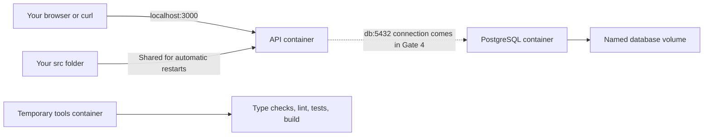

# Hono and Drizzle finance API

A personal finance API built in small, reviewable steps. Hono and PostgreSQL now run in separate Docker containers. The API currently exposes a health route; Drizzle and finance routes come in later gates.

See the [approved plan](docs/01-architect-todos.md) and [project map](docs/PROJECT_MAP.md).

New to Docker? Read [how this project's Docker setup works](docs/docker-guide.md) for file-by-file explanations, diagrams, and command walkthroughs.

## Start locally

You need Docker with Docker Compose. No host Node.js, npm, or PostgreSQL installation is required. In WSL, enable your distro in Docker Desktop's WSL Integration settings.

Copy the example settings, then replace its example password:

```bash
cp .env.example .env.local
```

Start both containers:

```bash
sh scripts/docker.sh local up
```

The first run downloads images and installs dependencies. Later builds reuse unchanged steps. The command waits for PostgreSQL and the API to become healthy.

```bash
curl http://localhost:3000/health/live
```

Expected response:

```json
{"data":{"status":"ok"}}
```

The API starts after PostgreSQL is ready, but it does not query the database yet. Gate 4 adds that connection and database readiness checks. No schema push or seed runs at startup.

## What Docker runs

An image is a prepared environment containing a program and its dependencies. A container runs that image. Compose describes how related containers run together.



The local API shares your `src/` folder, so source edits restart it automatically. Dependencies stay in the image rather than your computer's `node_modules`. After changing dependencies, rebuild with the up command. Tool containers use the same development image, so checks no longer reinstall dependencies on every run.

The empty local `node_modules` folder left by the earlier bootstrap helper is harmless. The main Compose setup does not use it.

PostgreSQL stores data in a named volume, which is storage managed by Docker. Removing a container does not remove this volume. [Docker explains persistent volumes here](https://docs.docker.com/engine/storage/volumes/).

## Everyday commands

```bash
# Stop both services and preserve database data.
sh scripts/docker.sh local down

# Follow API and database logs. Ctrl+C stops following the logs.
sh scripts/docker.sh local logs

# Show container status.
sh scripts/docker.sh local ps

# Build the development image and run all code checks.
sh scripts/docker.sh local check
```

The helper always selects the matching environment file. It clears inherited project settings so another terminal's credentials cannot override that file.

You can also call Compose directly:

```bash
docker compose --env-file .env.local -f compose.yaml up --build --detach --wait
docker compose --env-file .env.local -f compose.yaml down
docker compose --env-file .env.local -f compose.yaml logs --follow api db
docker compose --env-file .env.local -f compose.yaml --profile tools run --build --rm tools
```

Direct Compose commands allow shell variables to override file values. Use the helper when you want the selected file to be the only source of project settings.

The equivalent `docker:up`, `docker:down`, `docker:logs`, and `docker:check` npm scripts are optional host conveniences. Do not run them inside a container; the containers do not contain Docker.

## Environment settings

Keep `.env.local` and `.env.production` private. Git ignores them, and `.dockerignore` excludes them from image builds. Only `.env.example` belongs in Git.

| Setting | Purpose |
| --- | --- |
| `APP_ENV` | `local` for development or `production` for the production setup. Startup rejects a mismatch. |
| `API_PORT` | API port inside Docker and on your computer. Local default is `3000`. |
| `POSTGRES_PORT` | Optional database access from your computer. Local default is `5433`. Container clients always use `db:5432`. |
| `POSTGRES_USER`, `POSTGRES_PASSWORD`, `POSTGRES_DB` | Required credentials supplied to both PostgreSQL and the API. |

Keep passwords containing `#`, `$`, or spaces in single quotes, as shown in `.env.example`. Credentials remain separate connection fields, so URL characters do not need encoding.

Ports bind to `127.0.0.1`, which limits published access to your computer. Changing a database password in the environment file does not change an existing database's password. PostgreSQL uses its initialization settings only when its data volume is empty. Keep the file consistent with the stored credentials.

## Production setup

Create `.env.production` from the example and use separate credentials. Set:

```dotenv
APP_ENV=production
API_PORT=3001
POSTGRES_PORT=5434
```

Then run:

```bash
sh scripts/docker.sh production up
curl http://localhost:3001/health/live
sh scripts/docker.sh production down
```

The direct startup command is:

```bash
docker compose --env-file .env.production -f compose.production.yaml up --build --detach --wait
```

The production image contains compiled JavaScript and production dependencies. It runs as the `node` user rather than root and has no shared source folder. This demonstrates a production build; the example still has no authentication or public hosting setup.

| Setup | Compose project | Database volume |
| --- | --- | --- |
| Local | `hono-drizzle-local` | `hono-drizzle-local_postgres_data` |
| Production | `hono-drizzle-production` | `hono-drizzle-production_postgres_data` |

The different projects also have separate networks. The suggested ports let both run at once. Normal down commands preserve both volumes. Adding `--volumes` to a down command deletes that project's database data.

## Verify Gate 3

```bash
sh scripts/verify-docker.sh
```

This runs the code checks, checks the API through its published port, saves a probe row, stops and restarts local services, and reads the row back. It removes the probe table afterward. It also builds the production image and checks that it runs without root privileges, development tools, or environment files. Local services remain running for inspection.

## Change dependencies

`compose.tools.yaml` remains a bootstrap helper for dependency updates. It uses temporary dependency storage and shares the project folder so changes to `package.json` and `package-lock.json` stay on your computer.

For example, add a package inside Docker:

```bash
docker compose -f compose.tools.yaml run --rm tools npm install package-name
sh scripts/docker.sh local check
sh scripts/docker.sh local up
```

After manually editing `package.json`, refresh the lockfile with:

```bash
docker compose -f compose.tools.yaml run --rm tools npm install --package-lock-only
```

Commit both package files after reviewing dependency changes. The bootstrap container uses user ID and group ID `1000`; if yours differ, prefix its command with `LOCAL_UID=$(id -u) LOCAL_GID=$(id -g)`.

## Application scripts

These run inside the development image. They do not require real environment files for checks or builds.

| Script | Purpose |
| --- | --- |
| `dev:container` | Watch source edits using local settings supplied by Compose. |
| `dev` | Watch source edits using a mounted `.env.local` file. |
| `build` | Compile TypeScript into `dist/`. |
| `start` | Run compiled code with production settings supplied to the container. |
| `start:local`, `start:production:file` | Run compiled code with an explicitly mounted settings file. |
| `typecheck`, `lint`, `test` | Check types, coding mistakes, or behavior. |
| `test:watch` | Rerun tests after edits. |
| `check` | Run all code checks and compile the app. |
