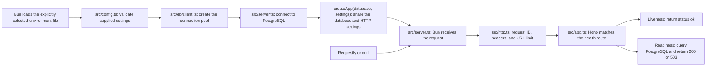

# Finance tracker API

A Bun 1.3.14 and Hono application for learning how to build an API in small steps. The scaffold provides liveness and database-readiness checks at `http://127.0.0.1:3000/health/live` and `/health/ready`.

## Install and run

Check the runtime version:

```sh
bun --version
```

It should print `1.3.14`. Install the locked dependencies in a checkout without environment files:

```sh
bun install --frozen-lockfile
```

Bun 1.3.14's package manager automatically reads default environment files despite `env = false`. For an existing checkout, keep those files outside the checkout during dependency installation and restore them afterward. [Project notes](docs/discoveries.md#environment-files) explain this limitation. Application and check commands respect the setting.

Create `.env.local` if it does not already exist and choose a database password. Start PostgreSQL, then the development server:

```sh
test -f .env.local || cp .env.example .env.local
bun run db:up
bun run dev
```

`dev` explicitly loads `.env.local` and restarts the server when source files change. `APP_ENV` selects the mode, and `API_PORT` selects the port, which is `3000` in the template. Press `Ctrl+C` to stop it.

In another terminal, send a request:

```sh
curl http://127.0.0.1:3000/health/live
```

The response has status `200` and this JSON body:

```json
{"status":"ok"}
```

In Requestly desktop, create a `GET` request with that same URL and select **Send**. Liveness makes no database query. Send `GET http://127.0.0.1:3000/health/ready` to check PostgreSQL too. Readiness runs `SELECT 1` through Drizzle, returning `200` with `{"status":"ok"}` or a common `503` error with code `DATABASE_UNAVAILABLE`. It uses the existing database timeouts without a separate readiness deadline.

The [API guide](docs/api.md) explains error responses, request IDs, and input limits. Try `GET /missing` or `POST /health/live` in Requestly to inspect the current error behavior.

See [the setup guide](docs/setup.md) for the separate PostgreSQL commands and environment identities.

## Understand startup settings

[src/config.ts](src/config.ts) has a small Valibot schema for the values supplied by Bun. Startup requires these settings:

| Settings | Accepted values |
| --- | --- |
| `APP_ENV` | `local`, `test`, or `production`. |
| `API_PORT` | A decimal port number from `1` to `65535`, without leading zeros. The schema converts the string into a number. |
| `API_ORIGIN` | The API's exact public origin, such as `http://127.0.0.1:3000`. Production requires HTTPS. |
| `CORS_ORIGINS` | An optional comma-separated list of allowed browser origins. Empty disables CORS. |
| `POSTGRES_PORT` | Uses the same port validation. The local host port is `5433`. |
| `POSTGRES_HOST`, `POSTGRES_USER`, `POSTGRES_DB`, `POSTGRES_PASSWORD` | Required nonblank strings. The connection receives them directly, preserving password characters. |

Invalid settings stop startup before the server listens. Error messages name the affected fields without printing submitted values. Configuration does not read files or guess a database target. In Requestly, write requests need an `Origin` matching `API_ORIGIN`; see [the API guide](docs/api.md#origins-and-browser-access).

[src/db/client.ts](src/db/client.ts) creates the Drizzle database object using Bun's SQL driver. A connection pool reuses open database connections and permits at most five at once. New connection attempts have a five-second timeout, and PostgreSQL cancels queries that run longer than five seconds. Idle connections close after 30 seconds. These limits are explicit options in the client file.

`src/server.ts` opens a connection before starting the HTTP server. If PostgreSQL is unavailable or rejects the credentials, startup exits with a safe error. This step adds no application tables and runs no schema pushes. The stable Drizzle 0.45.4 package includes the [Bun SQL adapter](https://orm.drizzle.team/docs/connect-bun-sql); the project uses an explicitly supplied client.

## Follow a request through the code



[src/server.ts](src/server.ts) validates settings, connects to PostgreSQL, and passes the database and HTTP settings to `createApp(database, settings)` in [src/app.ts](src/app.ts). Route handlers share its pool. Local and test modes listen on loopback; production mode listens on all interfaces so a container can receive requests. Importing either `app.ts` or `db/client.ts` alone starts no server and opens no connection.

On `Ctrl+C` or a termination signal, the server stops accepting connections, lets active requests finish, and closes the pool. Shutdown has a five-second limit before forcing exit. Fatal process errors use the same cleanup path with a nonzero exit status. See [the setup guide](docs/setup.md) for the flow.

## Check and build

| Command | Purpose |
| --- | --- |
| `bun run typecheck` | Check TypeScript types without writing JavaScript. |
| `bun run lint` | Check source and configuration with ESLint. |
| `bun run test` | Test configuration choices and failure cases with Bun. No database is needed. |
| `bun run build` | Bundle the server for Bun into `dist/server.js`. |
| `bun run check` | Run type checking, lint, unit tests, and build in that order. |

To run the built server after stopping the development server:

```sh
bun run build
bun --env-file=.env.local dist/server.js
```

`bun run start` runs the built bundle with settings supplied by its caller. To explicitly load the private production file for a host run, use `bun --env-file=.env.production run start`. Its `APP_ENV=production` value selects production mode. The retained production image still needs validation in its planned phase.

For application commands, `bunfig.toml` disables automatic environment-file loading. `dev` explicitly selects `.env.local`; build and check commands run without environment files. Unit tests supply invented settings directly to the validator.

See [PROJECT_MAP.md](PROJECT_MAP.md) for project rules and [the implementation plan](sessions/001_fresh_start/01-architect-todos.md) for the next approval gate.
