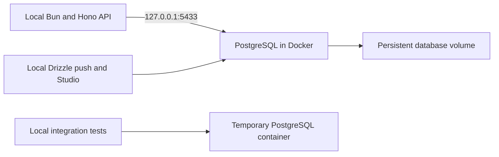

# Bun, Hono, and Drizzle finance API

A personal finance API built in reviewable gates. Users, accounts, categories, and tags are defined; transactions and business routes come next. See the [implementation plan](docs/01-architect-todos.md), [database guide](docs/database-guide.md), and [Docker walkthrough](docs/docker-guide.md).

Develop locally with Bun 1.3.14. PostgreSQL runs in Docker. The API, Drizzle, type checking, lint, and tests run directly on your machine. In WSL, install Bun in the distro and enable Docker Desktop's WSL Integration for it.

## First setup

```bash
bun install --frozen-lockfile
cp .env.example .env.local
```

Replace the example password, then:

```bash
bun run db:up
bun run db:push
bun run dev
```

The last command watches source edits and keeps running. In another terminal:

```bash
curl http://127.0.0.1:3000/health/ready
```

Expected response:

```json
{"data":{"status":"ready"}}
```

Schema pushes remain explicit and reviewed. Startup never pushes or seeds. The four current tables can be empty. VS Code uses the local TypeScript installation through `.vscode/settings.json`.



## Moving from the previous container development setup

Run `bun run db:down` once before starting the local API. It removes the old API/Studio containers as orphans, freeing their ports while preserving the existing database volume. Then follow the startup commands above. Keep the existing database name, credentials, and port in `.env.local`; `POSTGRES_HOST` defaults to `127.0.0.1` if absent.

There is one local dependency installation now. There are no development tooling images to rebuild after dependency changes. Use `bun add package-name`, then `bun run check`, and commit `package.json` with `bun.lock`.

Bun expands `$VARIABLE` in environment-file values, including quoted values. Escape a literal reference as `\$VARIABLE`. In Bun 1.3.14, a dollar sign at the end of the value should remain unescaped. If the old file used an unescaped dollar in a password, adjust its escaping to preserve the actual stored password. Changing a file does not change an existing PostgreSQL user's password. The database commands let Bun load the file before starting Compose, so the API, Drizzle, and PostgreSQL receive the same parsed values.

## Commands

| Command | Purpose |
| --- | --- |
| `bun run dev` | Start the local API with `.env.local` and restart it after source edits. Ctrl+C shuts it down. |
| `bun run db:up` | Start persistent PostgreSQL and wait until it is ready. |
| `bun run db:down` | Stop/remove local database containers and old project orphans; preserve database data. It does not stop local Bun processes. |
| `bun run db:logs` | Follow PostgreSQL logs. Ctrl+C stops following. |
| `bun run db:push` | Review and apply schema differences to the local database. No migration files. |
| `bun run db:studio` | Run Studio locally. Open [Drizzle Studio](https://local.drizzle.studio); Ctrl+C stops its connection server. |
| `bun run check` | Run type checking, lint, fast tests, and the build locally. No database is required. |
| `bun run test:integration` | Run real PostgreSQL tests using an isolated temporary database/container, then clean up. |
| `bun run test:watch` | Rerun fast tests after edits. |
| `bun run build` | Bundle application code into `dist/`; type checking remains a separate check. |
| `bun run start` | Run built production code using supplied environment settings. |
| `bun run docker:build` | Build the production API image for CI or deployment checks. It does not start a container. |

`typecheck`, `lint`, and `test` can also be run individually. Old `docker:up`, `docker:check`, `docker:rebuild`, Studio lifecycle, and test-cleanup shortcuts are removed. Their daily equivalents are `db:up`, `dev`, `check`, and Ctrl+C. Integration cleanup is automatic.

## Environment settings

Commands select `.env.local` explicitly through Bun. `bunfig.toml` disables automatic loading of other environment files. `config.ts` validates `process.env`; it never reads files or guesses whether it is inside Docker. Exported terminal values take precedence over file values.

| Setting | Purpose |
| --- | --- |
| `APP_ENV` | `local` during development; `production` for built production code. Startup rejects a mismatched mode. |
| `API_PORT` | API listening port, default `3000`. Local mode binds only to `127.0.0.1`. |
| `POSTGRES_HOST` | Database address, default `127.0.0.1`. The deployment Compose example explicitly supplies `db` to its API container. |
| `POSTGRES_PORT` | Database connection port, default `5433`. Local Compose publishes this host port to PostgreSQL's internal `5432`. |
| `POSTGRES_USER`, `POSTGRES_PASSWORD`, `POSTGRES_DB` | Required database credentials shared by local commands and PostgreSQL. |

Keep real environment files private. Only `.env.example` belongs in Git; `.dockerignore` excludes environment files from images. Connection fields stay separate, so passwords do not need URL encoding.

## Studio

Studio now listens locally on `127.0.0.1:4983`; it needs no container or port forwarding. If the port is occupied, stop an existing Studio process or terminal session. The one-time transition cleanup above handles the old container.

If the browser keeps connecting, allow **Apps on device** or the local/loopback network permission for `local.drizzle.studio`, then reload. Browser labels vary. [Chrome local network permissions](https://developer.chrome.com/blog/local-network-access)

## Checks and database tests

Use `bun run check` during development. After schema changes, also run `bun run test:integration`.

The integration runner starts PostgreSQL in a uniquely named Docker project, uses an available loopback port, creates a generated test database, pushes the schema, and runs the tests in local Bun. It checks database identity before clearing fixtures or dropping that database, then removes its container/network. Local and production data volumes stay separate. See the [database guide](docs/database-guide.md#how-database-tests-stay-separate).

## Health and shutdown

`/health/live` checks whether the API process responds. `/health/ready` runs a database query with a three-second deadline and returns a safe `503` during an outage or shutdown. Docker database startup alone does not prove the local API is ready.

The API pool allows ten connections, with bounded connection/query waits. On Ctrl+C or SIGTERM, Bun stops accepting connections, waits for active requests, closes the pool, and exits. Shutdown has a ten-second deadline.

## Production containers and CI

The Dockerfile now prepares only the production API image. It contains built JavaScript, runtime dependencies, and Bun; it runs as the non-root `bun` user. Development does not use it.

A CI pipeline can run locked installation, `check`, `test:integration`, and `docker:build`. Docker must be available for the latter two commands. No deployment or CI provider is configured yet.

`compose.production.yaml` remains an optional local production-build example. Copy `.env.example` to `.env.production`, choose separate credentials, and set `APP_ENV=production`, `API_PORT=3001`, and `POSTGRES_PORT=5434`. Then run:

```bash
bun --env-file=.env.production run docker compose -f compose.production.yaml up --build --detach --wait
curl http://127.0.0.1:3001/health/ready
bun --env-file=.env.production run docker compose -f compose.production.yaml down
```

The API container explicitly connects to `db:5432`, while a host tool uses the published port. Schema pushes remain separate. If needed, select the production file explicitly with `bun --env-file=.env.production --bun run drizzle-kit push --config=drizzle.config.ts` and review the target and changes.

The production example has its own `hono-drizzle-production_postgres_data` volume. The development volume remains `hono-drizzle-local_postgres_data`. Normal shutdown preserves both; adding `--volumes` deletes stored data. This example does not configure public hosting or authentication.
