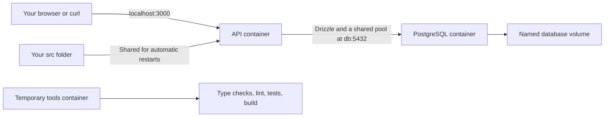

# Hono and Drizzle finance API

A personal finance API built in small, reviewable steps. Hono and PostgreSQL now run in separate Docker containers. Drizzle now connects the API to PostgreSQL. Finance tables and routes come in later gates.

See the [approved plan](docs/01-architect-todos.md) and [project map](docs/PROJECT_MAP.md).

Read the [Docker setup guide and instruction walkthrough](docs/docker-guide.md) for the complete local startup flow, configuration explanation, Dockerfile instructions, and Compose settings.

## Start locally

Use Node.js 24 and npm in your WSL project for editor support, and Docker with Docker Compose to run the API, database, and checks. Docker uses Node.js 24.22.1. In WSL, enable your distro in Docker Desktop's WSL Integration settings.

Copy the example settings, then replace its example password:

```bash
cp .env.example .env.local
```

Install local editor dependencies, build the development images, and start both containers:

```bash
npm run docker:rebuild
```

In VS Code, open this project through WSL and choose **TypeScript: Select TypeScript Version → Use Workspace Version** if prompted. `.vscode/settings.json` points the editor to the project's TypeScript installation.

For later startups with unchanged dependencies, use `npm run docker:up`.

The first run downloads images and installs dependencies. Later builds reuse unchanged steps. The command waits for PostgreSQL and the API to become healthy.

```bash
curl http://localhost:3000/health/ready
```

Expected response:

```json
{ "data": { "status": "ready" } }
```

The API starts after PostgreSQL is ready. Its readiness route uses Drizzle to execute `SELECT 1`; it does not require finance tables or seed data. No schema push or seed runs at startup.

## What Docker runs

An image is a prepared environment containing a program and its dependencies. A container runs that image. Compose describes how related containers run together.



The local API shares your `src/` folder, so source edits restart it automatically. Local `node_modules` supplies editor types; each development image has its own installed dependencies. The containers do not share host `node_modules`, and `.dockerignore` excludes it from image builds. Both installations use the same lockfile. Tool containers reuse the development image's dependencies.

PostgreSQL stores data in a named volume, which is storage managed by Docker. Removing a container does not remove this volume. [Docker explains persistent volumes here](https://docs.docker.com/engine/storage/volumes/).

## Docker command reference

Run these commands from your WSL project terminal. Each uses `.env.local`, except the commands ending in `:production`, which use `.env.production`.

| Command | Purpose | Effect on containers |
| --- | --- | --- |
| `npm run docker:up` | Normal startup. Build the local API image if needed, then wait for API and database health checks. | Start services or update changed containers. |
| `npm run docker:rebuild` | After dependency changes: run local `npm ci`, build API, check tools, and database tools images, then wait for service health checks. Does not run code checks. | Start services or update changed containers; preserve database data. |
| `npm run docker:check` | Run TypeScript checking, ESLint, Vitest tests, and compilation using the development image and current shared code. | Build if needed, run a temporary tools container, then remove it. Does not inspect the running API or production image. |
| `npm run docker:check-config` | Validate Compose settings and required environment values without printing resolved credentials. Does not check application code. | Do not build images or start containers. |
| `npm run docker:build` | Build local API and tools development images only. Also used by `docker:rebuild`. | Do not start or replace running containers. |
| `npm run docker:ps` | Show local service status, including health information when available. | Observe existing containers. |
| `npm run docker:logs` | Follow API and database logs. Ctrl+C stops following the logs. | Leave services running. |
| `npm run docker:down` | Stop and remove local service containers and their network. | Preserve the named database volume and its data. |
| `npm run docker:up:production` | Build the production runtime image if needed and start the separate production setup. | Start or update production services and wait for health checks. |
| `npm run docker:down:production` | Stop and remove production service containers and their network. | Preserve the production database volume. |
| `npm run docker:logs:production` | Follow production API and database logs. | Leave production services running. |

For everyday work, use `docker:up`, `docker:logs`, and `docker:check`. Use `docker:rebuild` after dependency changes. `docker:check-config` answers whether Docker settings are valid; `docker:check` answers whether the code checks pass inside the development environment.

Each shortcut contains its Compose command directly in `package.json`.

You can also call Compose directly:

```bash
docker compose --env-file .env.local -f compose.yaml up --build --detach --wait
docker compose --env-file .env.local -f compose.yaml down
docker compose --env-file .env.local -f compose.yaml logs --follow api db
docker compose --env-file .env.local -f compose.yaml --profile tools run --build --rm tools
```

Both npm shortcuts and direct Compose commands use standard precedence: matching terminal variables override values in the selected environment file. Unset exported project variables when you want the file values. There is no command dispatcher or automatic environment clearing.

`docker:check` builds the development tools image if needed and runs type checking, linting, tests, and compilation in a new temporary container. It reads your current shared source and tests; it does not inspect the running API container or verify the production image.

`docker:up`, `docker:down`, `docker:logs`, `docker:check`, and `docker:rebuild` run from your computer. Do not run these shortcuts inside a container; the containers do not contain Docker.

## Environment settings

Keep `.env.local` and `.env.production` private. Git ignores them, and `.dockerignore` excludes them from image builds. Only `.env.example` belongs in Git.

| Setting                                             | Purpose                                                                                                       |
| --------------------------------------------------- | ------------------------------------------------------------------------------------------------------------- |
| `APP_ENV`                                           | `local` for development or `production` for the production setup. Startup rejects a mismatch.                 |
| `API_PORT`                                          | API port inside Docker and on your computer. Local default is `3000`.                                         |
| `POSTGRES_PORT`                                     | Optional database access from your computer. Local default is `5433`. Container clients always use `db:5432`. |
| `POSTGRES_USER`, `POSTGRES_PASSWORD`, `POSTGRES_DB` | Required credentials supplied to both PostgreSQL and the API.                                                 |

Keep passwords containing `#`, `$`, or spaces in single quotes, as shown in `.env.example`. Credentials remain separate connection fields, so URL characters do not need encoding.

Ports bind to `127.0.0.1`, which limits published access to your computer. Changing a database password in the environment file does not change an existing database's password. PostgreSQL uses its initialization settings only when its data volume is empty. Keep the file consistent with the stored credentials.

## Production setup

Create `.env.production` from the example and use separate credentials. Set:

```dotenv
APP_ENV=production
API_PORT=3001
POSTGRES_PORT=5434
```

Then run:

```bash
npm run docker:up:production
curl http://localhost:3001/health/ready
npm run docker:down:production
```

The direct startup command is:

```bash
docker compose --env-file .env.production -f compose.production.yaml up --build --detach --wait
```

The production image contains compiled JavaScript and production dependencies. It runs as the `node` user rather than root and has no shared source folder. This demonstrates a production build; the example still has no authentication or public hosting setup.

| Setup      | Compose project           | Database volume                         |
| ---------- | ------------------------- | --------------------------------------- |
| Local      | `hono-drizzle-local`      | `hono-drizzle-local_postgres_data`      |
| Production | `hono-drizzle-production` | `hono-drizzle-production_postgres_data` |

The different projects also have separate networks. The suggested ports let both run at once. Normal down commands preserve both volumes. Adding `--volumes` to a down command deletes that project's database data.

## Database commands

Run these from your host terminal. They build and start optional database-tool containers; the PostgreSQL service starts first if needed.

| Command | Purpose |
| --- | --- |
| `npm run db:push` | Compare the TypeScript schema with the local database and review/apply changes directly. No migration files are generated. |
| `npm run db:studio` | Start or update one background Studio service on `127.0.0.1:4983`. Open `https://local.drizzle.studio/?host=127.0.0.1`. Repeated runs reuse the service. |
| `npm run db:studio:stop` | Stop Studio and free port 4983 while leaving the API and database running. |
| `npm run db:studio:logs` | Follow Studio logs. Ctrl+C stops following logs; Studio keeps running. |
| `npm run db:push:production` | Use the production Compose project and `.env.production` for an explicitly reviewed push. |

[drizzle.config.ts](drizzle.config.ts) reads the container's supplied settings through the same validation function as the API. API and tooling both connect to `db:5432` with separate credential fields, without building a password-containing URL. Drizzle explicitly uses `ssl: false` because the bundled PostgreSQL containers do not configure SSL encryption. A future externally hosted database may require different SSL settings.

The [schema file](src/db/schema.ts) is intentionally empty until Gate 5. A fresh empty database should have no schema changes to apply. Pushes use strict review and do not include automatic destructive-confirmation flags. Review any proposed changes before confirming, especially against an existing database. Database commands do not run at API startup.

Studio listens on `0.0.0.0` inside its container so Docker can forward connections, but Docker publishes it only on `127.0.0.1` on your computer. The root address on port 4983 is the connection server, not the browser UI. `docker:down` includes all optional services and removes orphan containers from this Compose project, so it also cleans up Studio and leftovers from older tooling commands. Use the browser URL above even if Drizzle logs a URL containing `host=0.0.0.0`; that address is only for listening inside Docker. The production API image does not include Drizzle Kit; an optional development tooling image handles production pushes. [Drizzle Studio documentation](https://orm.drizzle.team/docs/drizzle-kit-studio)

### Studio connection troubleshooting

If Studio keeps connecting, open `https://local.drizzle.studio/?host=127.0.0.1`. In Chrome, open the site information icon beside the address bar and allow **Apps on device** or the local/loopback network permission for this site, then reload. The label depends on the browser version. [Chrome local network permissions](https://developer.chrome.com/blog/local-network-access)

If port 4983 is occupied by an older one-off container, find it with `docker ps --filter publish=4983`. Stop the old project's `db-tools-run` container using `docker stop <container-ID>`, then run `npm run db:studio`. This is a one-time cleanup for sessions created by the earlier command. New sessions use the reusable `studio` service.

## Health checks and shutdown

| Route | Meaning |
| --- | --- |
| `/health/live` | The API process responds, regardless of database availability. |
| `/health/ready` | A real database query succeeds. Returns `503` if the database is unavailable, the check exceeds three seconds, or shutdown has begun. |

Docker checks readiness for the API. A running process can therefore be marked unhealthy during a database outage and recover when the database returns. This does not automatically restart an otherwise running container.

The API uses one pool with at most 10 database connections. Connection waits are limited to two seconds; SQL statements have a two-second database limit and a 2.5-second client wait limit. Readiness has its own three-second overall deadline. These limits prevent a failed database from leaving requests waiting indefinitely.

On SIGTERM or Ctrl+C, the server stops accepting new requests, waits for current HTTP requests, and closes its database pool. Shutdown has a ten-second deadline; Compose allows fifteen seconds before forcing a stop.

## Verify Docker and Gate 4

```bash
sh scripts/verify-docker.sh
```

This runs code checks, verifies database persistence, builds the runtime image, and checks readiness failure/recovery by briefly stopping PostgreSQL. It also starts a temporary Studio server to check its loopback port and a separate compiled API process to verify shutdown on SIGTERM.

The script removes its probe table and temporary containers. Local services remain running. Its temporary Studio server uses an available port on `127.0.0.1`, so it does not need port 4983 to be free. Its earlier `docker:down` step removes the regular Studio service if it was running; restart Studio afterward if needed. It does not push a schema or seed data. The Studio check verifies connectivity, not the external browser UI.

## Change dependencies

Add a package from your WSL terminal, then synchronize the local editor installation and Docker images:

```bash
npm install package-name
npm run docker:rebuild
npm run docker:check
```

After manually editing dependency declarations in `package.json`, run `npm install --package-lock-only` before the rebuild command. `npm ci` requires an up-to-date lockfile; it does not update one.

`docker:rebuild` runs these steps in order:

1. `npm ci` installs exact locked dependencies locally for your editor.
2. Docker builds the local API, check tools, and database tools images, reusing unchanged build steps.
3. Compose starts or updates local services and waits for health checks. Database storage is preserved.

A failed step stops the command. Code checks remain a separate `npm run docker:check` command. Rebuilding starts services too, so `.env.local` must already exist.

Commit `package.json` and `package-lock.json` after dependency changes. Do not commit `node_modules`. `compose.tools.yaml` remains available as an optional Docker-based dependency-update helper.

## Application scripts

These run inside the development image. They do not require real environment files for checks or builds.

| Script                      | Purpose                                                               |
| --------------------------- | --------------------------------------------------------------------- |
| `dev`                       | Watch source edits using local settings supplied by Compose.          |
| `build`                     | Compile TypeScript into `dist/`.                                      |
| `start`                     | Run compiled code with production settings supplied to the container. |
| `typecheck`, `lint`, `test` | Check types, coding mistakes, or behavior.                            |
| `test:watch`                | Rerun tests after edits.                                              |
| `check`                     | Run all code checks and compile the app.                              |
