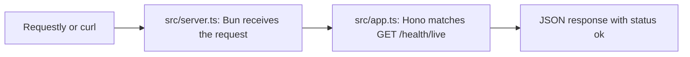

# Finance tracker API

A Bun 1.3.14 and Hono application for learning how to build an API in small steps. The current scaffold serves one liveness endpoint at `http://127.0.0.1:3000/health/live`.

## Install and run

Check the runtime version:

```sh
bun --version
```

It should print `1.3.14`. Install the locked dependencies in a checkout without environment files:

```sh
bun install --frozen-lockfile
```

Bun 1.3.14's package manager automatically reads default environment files despite `env = false`. For an existing checkout, keep those files outside the checkout during dependency installation and restore them afterward. [Project notes](docs/discoveries.md#environment-files) explain this limitation. Application and check commands respect the setting.

Create `.env.local` if it does not already exist, then start the development server:

```sh
test -f .env.local || cp .env.example .env.local
bun run dev
```

`dev` explicitly loads `.env.local` and restarts the server when source files change. The scaffold's address is fixed in [src/server.ts](src/server.ts). Press `Ctrl+C` to stop it.

In another terminal, send a request:

```sh
curl http://127.0.0.1:3000/health/live
```

The response has status `200` and this JSON body:

```json
{"status":"ok"}
```

In Requestly desktop, create a `GET` request with that same URL and select **Send**. A successful response means Bun and Hono can handle a request. It does not check a database connection.

## Follow a request through the code



[src/server.ts](src/server.ts) starts the HTTP server on the loopback address, which makes it reachable from this machine. It passes requests to the Hono application in [src/app.ts](src/app.ts). The route there returns the JSON response. Importing `app.ts` alone does not start a server.

## Check and build

| Command | Purpose |
| --- | --- |
| `bun run typecheck` | Check TypeScript types without writing JavaScript. |
| `bun run lint` | Check source and configuration with ESLint. |
| `bun run build` | Bundle the server for Bun into `dist/server.js`. |
| `bun run check` | Run type checking, lint, and build in that order. |

To run the built server after stopping the development server:

```sh
bun run build
bun --no-env-file dist/server.js
```

For application commands, `bunfig.toml` disables automatic environment-file loading. `dev` explicitly selects `.env.local`; build and check commands run without it.

See [PROJECT_MAP.md](PROJECT_MAP.md) for project rules and [the implementation plan](sessions/001_fresh_start/01-architect-todos.md) for the next approval gate.
