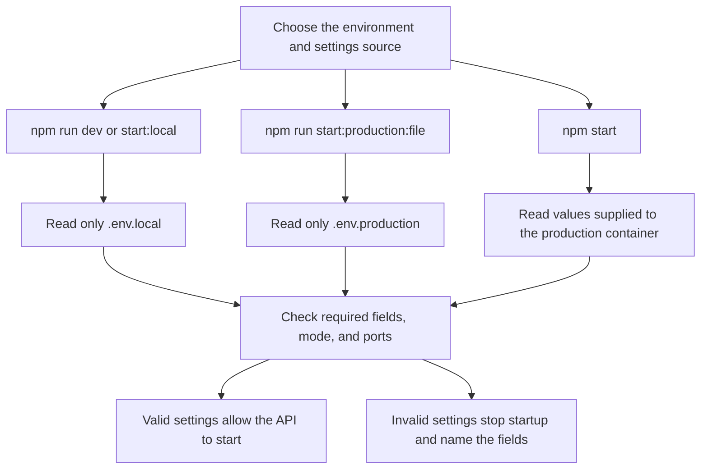
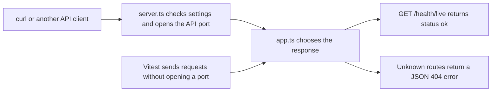

# Hono and Drizzle finance API

A personal finance API built in small, reviewable steps. It currently includes a Hono app, validated settings, TypeScript checks, linting, and Vitest tests. Accounts, transactions, PostgreSQL, and authentication come in later steps.

See the [approved plan](docs/01-architect-todos.md) and [project map](docs/PROJECT_MAP.md).

## Run the current step

You need Docker with Docker Compose. You do not need Node.js or npm on your computer. In WSL, enable your distro under Docker Desktop's WSL Integration settings.

The temporary `tools` container runs Node.js 24. It mounts your source files and keeps installed dependencies inside the container. Dependencies disappear when the container exits. Gate 3 will add the long-running API and PostgreSQL containers.

Create the dependency lockfile once, or update it after changing dependencies. Commit the resulting `package-lock.json` with the code.

```bash
docker compose -f compose.tools.yaml run --rm tools npm install --package-lock-only
```

Run type checks, linting, tests, and the build:

```bash
docker compose -f compose.tools.yaml run --rm tools
```

Before starting the API, copy the example settings and replace the example password:

```bash
cp .env.example .env.local
```

Start development with automatic restarts when you edit source files:

```bash
docker compose --env-file .env.local -f compose.tools.yaml run --rm --service-ports tools sh -c 'npm ci && npm run dev'
```

In a second terminal, check that the API responds:

```bash
curl http://localhost:3000/health/live
```

Expected response:

```json
{"data":{"status":"ok"}}
```

Stop the development container with Ctrl+C. Database credentials are checked at startup, but PostgreSQL is not connected yet. The tests and build do not require an environment file.

The container defaults to user ID and group ID `1000` so generated files belong to the usual WSL user. If yours differ, prefix Compose commands with `LOCAL_UID=$(id -u) LOCAL_GID=$(id -g)`.

## Environment settings

An environment file holds settings for one setup. Keep `.env.local` and `.env.production` private. Git ignores them, and `.dockerignore` keeps them out of future image builds. Only `.env.example` belongs in Git.

| Setting | Purpose |
| --- | --- |
| `APP_ENV` | Must match the selected mode, `local` or `production`. |
| `API_PORT` | API port inside Docker and on your computer. Defaults to `3000`. |
| `POSTGRES_PORT` | Port for optional database access from your computer. Defaults to `5433`. Container clients always use `db:5432`. |
| `POSTGRES_USER`, `POSTGRES_PASSWORD`, `POSTGRES_DB` | Required credentials shared by PostgreSQL and the API once the database is added. |

Keep passwords containing `#`, `$`, or spaces in single quotes, as shown in `.env.example`. The application preserves those characters and passes credentials as separate connection fields.



File-based startup ignores inherited settings. It never fills a missing production value from a local file. Configuration errors name the fields without printing their values.

To try production settings in the tooling container, create `.env.production` with `APP_ENV=production` and separate credentials, then run:

```bash
docker compose --env-file .env.production -f compose.tools.yaml run --rm --service-ports tools sh -c 'npm ci && npm run build && npm run start:production:file'
```

This is still the local example API. Gate 3 will add the production image and pass settings directly to its container. Do not publish this unauthenticated example to the internet.

## How requests reach the app



Tests use the app directly. Importing `app.ts` does not start a server or require a database.

## Available checks

These npm scripts run inside the container. To run one check, replace the final command below with `npm run lint`, `npm test`, or `npm run build`.

```bash
docker compose -f compose.tools.yaml run --rm tools sh -c 'npm ci && npm run typecheck'
```

| Script | Purpose |
| --- | --- |
| `dev` | Run the API and restart after source edits. |
| `build` | Compile application files into `dist/`. |
| `start` | Run the compiled app with production settings supplied to its container. |
| `start:local` | Run the compiled app using `.env.local`. |
| `start:production:file` | Run the compiled app using `.env.production`. |
| `typecheck` | Find TypeScript errors in code, tests, and test configuration. |
| `lint` | Check for common coding mistakes, including promises that callers forgot to handle. |
| `test` | Run the Vitest suite once. |
| `test:watch` | Rerun tests while editing. |
| `check` | Run all checks and compile the app. |
