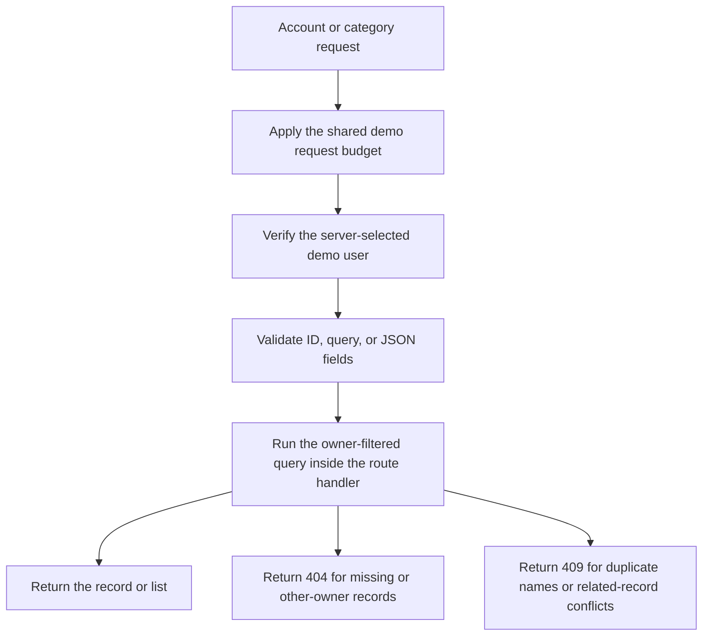

# Accounts and categories

Gate 9 adds the first business endpoints. They use the seeded demo owner selected by the server. Run `bun run db:up`, `bun run db:push`, `bun run db:seed`, and then `bun run dev` before trying the examples.

The shared [HTTP guide](http-guide.md) explains request IDs, errors, body limits, and demo ownership. Login is still outside this phase.

## Endpoints

Both resources support the same operations:

| Method | Accounts | Categories | Result |
| --- | --- | --- | --- |
| `GET` | `/api/v1/accounts` | `/api/v1/categories` | List this owner's records. |
| `POST` | `/api/v1/accounts` | `/api/v1/categories` | Create a record; return `201` and a `Location` header. |
| `GET` | `/api/v1/accounts/:id` | `/api/v1/categories/:id` | Return one record, including an archived record. |
| `PATCH` | `/api/v1/accounts/:id` | `/api/v1/categories/:id` | Rename, archive, or restore a record. Accounts also allow type changes. |

There are no delete routes. Archiving hides a record from the default list and preserves its history.

## Create and update records

Create an account:

```bash
curl -i http://127.0.0.1:3000/api/v1/accounts \
  -H 'Content-Type: application/json' \
  -d '{"name":"Travel cash","type":"cash"}'
```

Account `type` is required and accepts `checking`, `savings`, or `cash`. `currency` is optional and accepts only `USD`; it cannot be changed through PATCH.

Create a category:

```bash
curl -i http://127.0.0.1:3000/api/v1/categories \
  -H 'Content-Type: application/json' \
  -d '{"name":"Dining out"}'
```

Names have surrounding whitespace removed, must be nonempty, and can contain at most 100 characters. Control characters are rejected. Names retain their chosen letter case, but uniqueness ignores case within the owner's records. Another owner can use the same name. Accounts and categories have separate name lists.

Successful single-record responses use `{ "data": { ... } }`. Common fields are `id`, `name`, `archivedAt`, `createdAt`, and `updatedAt`. Accounts also return `type` and `currency`. Dates are UTC timestamp strings; an active record has `archivedAt: null`. Owner IDs are server-controlled and are not returned as resource fields.

Use the ID returned by creation in later requests:

```bash
curl -X PATCH http://127.0.0.1:3000/api/v1/accounts/ACCOUNT_ID \
  -H 'Content-Type: application/json' \
  -d '{"name":"Holiday cash","archived":true}'
```

Restore it with `{"archived":false}`. The server supplies the archive timestamp. Repeating `archived:true` keeps the original timestamp. Every accepted PATCH updates `updatedAt` and leaves `createdAt` unchanged.

PATCH requires at least one supported field. Unknown fields, `ownerId`, direct timestamps, and attempts to change currency are rejected. Renaming to an existing name returns `409`, including when that name belongs to an archived record. Archived records remain editable and readable by ID.

## List, paginate, and sort

```bash
curl 'http://127.0.0.1:3000/api/v1/accounts?page=1&limit=10&sort=name&direction=asc&includeArchived=true'
```

| Query field | Default | Accepted values |
| --- | --- | --- |
| `page` | `1` | Positive whole number within the supported numeric range. |
| `limit` | `25` | Whole number from `1` through `100`. |
| `sort` | `name` | `name`, `createdAt`, or `updatedAt`. |
| `direction` | `asc` | `asc` or `desc`. |
| `includeArchived` | `false` | `true` includes both active and archived records. |

Unknown or repeated query fields are rejected with `422`. Name sorting ignores letter case. Every sort adds an ID tie-breaker so equal timestamps still produce stable pages. The same ordering is required across page requests; edits between requests can move rows between pages.

List responses include:

```json
{
  "data": [],
  "pagination": { "page": 1, "limit": 25, "hasMore": false }
}
```

`hasMore` comes from fetching one extra row. The API does not run a separate total-count query. A page past the end returns an empty list.

## Ownership, conflicts, and request limits



The database also enforces name uniqueness, so competing creates cannot bypass it. Driver failures are translated to controlled errors: unavailable connections and query timeouts return `503`, known value constraints return `422`, and unexpected errors remain sanitized `500` responses.

Feature routes share a limit of 120 requests per 60-second window per API process. Excess requests return `429` with `Retry-After` in seconds. All demo callers share this budget; it is not a per-user or distributed limiter. Restarting the API resets it. Health checks remain available outside this limit.

## Code and verification

`src/api.ts` mounts two feature routers. Each feature keeps its schemas, route handlers, queries, and response construction together:

- [src/modules/accounts.ts](../src/modules/accounts.ts) implements accounts.
- [src/modules/categories.ts](../src/modules/categories.ts) implements categories.

Read a handler from top to bottom: get the server owner, validate input, run the query, and return the response. List handlers also select known sort columns and calculate pagination directly. There are no controller or service files.

The app's existing error handler translates database failures centrally through `src/lib/database-errors.ts`. Individual queries do not need error-handling callback wrappers. Shared JSON parsing and safe validation errors remain in `src/lib/validation.ts`.

`bun run check` verifies input rejection and shared request behavior without PostgreSQL. `bun run test:integration` exercises the actual account/category endpoints against the temporary test database. It covers creation, renaming, duplicate names, archive/restore behavior, other-owner isolation, stable pagination, and preserved financial history.

Transaction creation and reversal endpoints arrive in Gate 10. Their handlers will enforce the rule that archived accounts/categories cannot receive new transactions. Archiving now preserves existing transactions; it does not rewrite or delete them.
