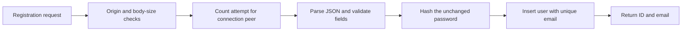
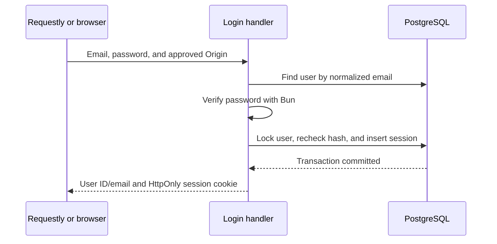
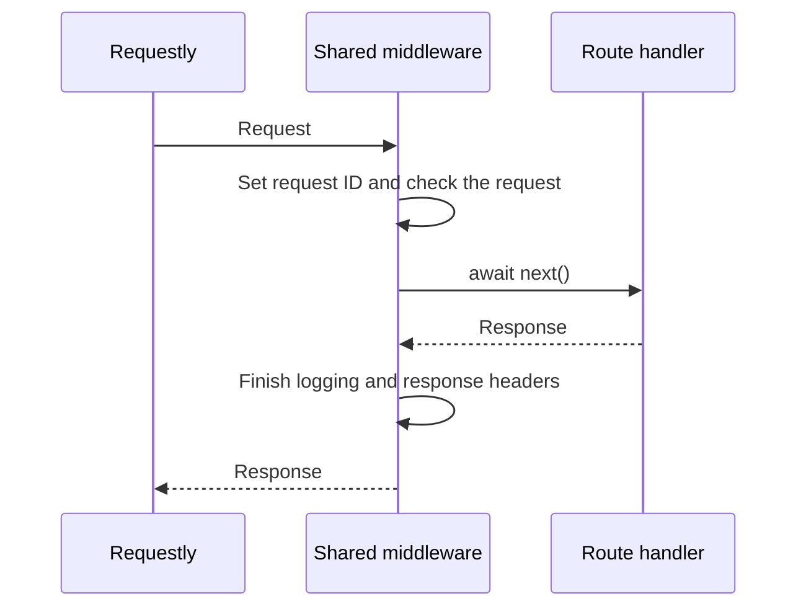
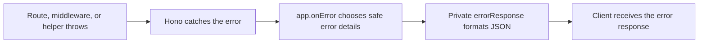

# API guide

Use `http://127.0.0.1:3000` with the local settings. Start the API in your terminal as described in [setup](setup.md). Registration and login are available. Session validation, logout, and finance endpoints come later.

## Health requests

| Request | Response |
| --- | --- |
| `GET /health/live` | `200` with `{"status":"ok"}`. Makes no database query. |
| `GET /health/ready` | Runs `SELECT 1` through Drizzle. Returns the same success body, or `503` with error code `DATABASE_UNAVAILABLE`. |
| `HEAD` on either health URL | Uses the GET behavior and returns headers without a body. |

Readiness uses the existing database timeouts. It has no separate deadline or connection-reservation logic.

## Register a user

Send `POST /api/v1/auth/register` with `Origin: http://127.0.0.1:3000`, `Content-Type: application/json`, and exactly these fields:

```json
{"email":"learner@example.test","password":"choose your own long passphrase"}
```

Email is trimmed, lowercased, checked for a valid format, and limited to 254 characters. Dots and `+` suffixes remain part of the address. Passwords must contain 15–128 Unicode code points. A code point is a Unicode value, so one emoji may count as one even though JavaScript's string length counts two. Passwords keep their exact spaces and case, with no trimming or normalization.

The small local blocklist rejects these passwords regardless of case: `passwordpassword`, `password123456789`, `123456789012345`, `qwertyuiopasdfgh`, and `letmeinletmeinletmein`. It is a limited learning example rather than a comprehensive list of compromised passwords.

Success returns `201` with only the new user's ID and normalized email inside `data`:

```json
{"data":{"id":"4d598d39-dc7a-4ca5-aab6-509ad69080d1","email":"learner@example.test"}}
```

The server stores an Argon2id password hash using Bun's asynchronous password API, with `memoryCost: 19456` and `timeCost: 2`. It never returns the password or hash. Registration does not log in or issue a cookie. A duplicate normalized email returns `409 ACCOUNT_NOT_AVAILABLE`, including when two requests race. Email is an unverified login identifier; this response can reveal that an address is registered. Email verification and public signup protection are deferred.



Each peer IP gets five attempts per fixed one-hour window, starting with its first attempt. Invalid JSON, invalid fields, and duplicate emails count too. The server uses Bun's connection address and ignores forwarded IP headers. Registration and login share a limit of two password operations, including their database work. Capacity errors return `429 RATE_LIMITED` with a `Retry-After` header in seconds. A missing connection address returns a safe `503`.

The limiter stores at most 1,024 peers and removes expired entries on the next registration request. When full, it refuses new peers with `429`. These limits belong to one running app and reset on restart. They are sufficient for this local exercise; multiple API instances would need shared limits.

### Try registration in Requestly

Import [requests/auth.json](../requests/auth.json) through Requestly's **Import → Postman** option. This is a collection format Requestly supports; no Postman installation is needed. See [Requestly's import guide](https://docs.requestly.com/api-client/import-export/import-from-postman).

The collection includes `baseUrl` and `email` variables. Set your email and fill in the blank password in the request body locally. Send the request once for `201`, then repeat it for `409`. The file contains no password or session credential. Keep exports containing your entered password out of Git. After five attempts from your IP, wait for the stated window or restart your local API to clear its in-memory limit.

## Log in

Send `POST /api/v1/auth/login` with the same Origin and JSON headers as registration, and exactly `email` and `password`. Email is normalized the same way as registration. Passwords are checked as supplied, including their spaces and case. Login accepts a nonempty password of at most 128 Unicode code points; the registration blocklist applies when choosing a password, not when verifying an existing one.

Success returns `200` with `{"data":{"id":"...","email":"learner@example.test"}}` and sets a cookie. With local/test HTTP, the cookie has these attributes:

```http
Set-Cookie: session=<random credential>; HttpOnly; SameSite=Lax; Path=/; Max-Age=604800
```

Production adds `Secure`. This choice comes from validated `APP_ENV`, with no separate switch to disable it. The cookie is host-only because no Domain is set. `HttpOnly` keeps it unavailable to page JavaScript. The browser or Requestly cookie jar manages it.

Each successful login generates a fresh 32-byte random credential, encoded as base64url. The session table stores only its SHA-256 hash, the user reference, and timestamps. No session credential or password hash appears in the JSON response or request logs. A preexisting session cookie does not determine the new credential, and separate logins create independent sessions. No refresh-token exchange or extra token-fetch request is involved.

An unknown email and a wrong password both return `401 INVALID_CREDENTIALS` with `Invalid email or password.` Unknown emails still perform Argon2id verification against a public dummy hash to keep password work comparable. After verification, a database transaction locks the user row and rechecks the password hash before inserting the session. If the password changed during verification, login fails. The cookie is set only after that transaction commits.

Login allows 30 attempts per connection peer and 10 attempts per normalized email in fixed 15-minute windows. Invalid input counts toward the peer limit. After input validation, every attempt counts toward the email limit, including successful logins. Success does not clear earlier attempts. Each counter allows new attempts when its window expires. Both maps hold at most 1,024 entries, remove expired entries when that limit is checked, and refuse new entries when full. These limits and the shared password-work limit return `429 RATE_LIMITED` with `Retry-After` in seconds. Registration and login use the same small counter function in `src/features/auth.ts`. Restarting the local API clears its in-memory limits.



In Requestly, use the collection's **Log in** request and enter the same password used during registration. Check the `Set-Cookie` response and cookie jar after a `200`. Keep `baseUrl` set to `http://127.0.0.1:3000` so the hostname matches the cookie. Do not copy the session value into a variable or script. The server now issues sessions; `/api/v1/auth/me`, session expiry validation, and logout are separate later steps.

## Errors

All API errors use this shape:

```json
{
  "error": {
    "code": "NOT_FOUND",
    "message": "The requested resource was not found.",
    "status": 404,
    "requestId": "4d598d39-dc7a-4ca5-aab6-509ad69080d1",
    "timestamp": "2026-10-29T18:30:00.000Z"
  }
}
```

The request ID matches the response header. The timestamp uses UTC. Unexpected failures return a generic message; responses do not include raw exceptions, submitted bodies, or SQL details.

| Status | Code | Meaning |
| --- | --- | --- |
| `400` | `INVALID_INPUT` | The JSON body is empty, malformed, or contains invalid credential fields. |
| `401` | `INVALID_CREDENTIALS` | The login email or password is incorrect, or the password changed during verification. |
| `403` | `ORIGIN_REJECTED` | A write has a missing or unapproved Origin. |
| `404` | `NOT_FOUND` | No resource matches the URL. |
| `405` | `METHOD_NOT_ALLOWED` | The URL exists but does not support that method. `Allow` lists supported methods. |
| `409` | `ACCOUNT_NOT_AVAILABLE` | The normalized registration email is already in use. |
| `413` | `PAYLOAD_TOO_LARGE` | The request body exceeds the size limit. |
| `414` | `URI_TOO_LONG` | The full request URL exceeds the size limit. |
| `415` | `UNSUPPORTED_MEDIA_TYPE` | A JSON reader received a content type other than `application/json`. |
| `429` | `RATE_LIMITED` | An authentication attempt or password-processing limit was reached. `Retry-After` gives seconds before retrying. |
| `500` | `INTERNAL_ERROR` | An unexpected application failure occurred. |
| `503` | `DATABASE_UNAVAILABLE` | The readiness query failed. |
| `503` | `SERVICE_UNAVAILABLE` | A credential endpoint could not determine the connection's peer address. |

In Requestly, send `GET /missing` to see a `404`. To see a `405`, send `POST /health/live` with `Origin: http://127.0.0.1:3000`; that method is unsupported even with an allowed origin. Neither request needs a body. Inspect `X-Request-Id` and, for the method error, `Allow` in the response headers.

## JSON responses and request logs

The API returns JSON with `Content-Type: application/json` regardless of the request's `Accept` header. It supports one response format, so there is no format negotiation.

Each completed request writes one JSON log entry to the terminal:

```json
{"requestId":"4d598d39-dc7a-4ca5-aab6-509ad69080d1","method":"GET","route":"/health/live","status":200,"elapsedMs":1}
```

The route comes from Hono's registered route template. A route such as `/records/:id` logs that template rather than a concrete record ID. Unmatched requests can log `*`; the requested URL is never the fallback. Logs contain only the five fields shown above. Headers, bodies, query strings, SQL, and raw exceptions are omitted.

## Origins and browser access

An origin is a scheme, hostname, and port, such as `http://127.0.0.1:3000`. Paths and trailing slashes are not part of an origin. Configure `API_ORIGIN` and the optional `CORS_ORIGINS` allowlist as described in [setup](setup.md#configuration).

Every POST, PUT, PATCH, or DELETE request must include an `Origin` exactly matching `API_ORIGIN` or an explicitly allowed browser origin. Missing values, `null`, and unlisted values return `403 ORIGIN_REJECTED`. GET and HEAD need no Origin.

For Requestly, leave `CORS_ORIGINS` empty and add the `Origin` header to write requests. CORS means cross-origin resource sharing; browsers use it to decide whether a page may read another origin's responses. Requestly desktop does not need browser CORS permission. Origin checks do not authenticate a caller. Login issues the session cookie; session validation on protected endpoints comes next.

To allow a separate browser frontend, set an explicit list, for example `CORS_ORIGINS=http://127.0.0.1:5173`. Keep the same hostname when using local session cookies. Hono's CORS middleware allows credentials only for listed origins and exposes `ETag`, `Location`, and `X-Request-Id`. It allows GET, HEAD, POST, PUT, PATCH, and DELETE with `Content-Type` and `If-Match` request headers. Wildcard origins are rejected.

Protection against cross-site request forgery uses required exact Origin checks on writes, strict JSON content types where a body is expected, the explicit CORS allowlist, and the host-only SameSite=Lax session cookie. GET, HEAD, and OPTIONS must never perform business mutations. Authenticated requests will use the session cookie without a separate token-fetch request or per-write token header. Reject missing and unapproved write origins even for desktop clients.

A browser preflight is an OPTIONS request with `Access-Control-Request-Method`. When CORS is enabled, Hono returns `204` and includes `Access-Control-Allow-Origin` only for an allowed origin. Without that header, the browser denies access. When CORS is disabled, OPTIONS follows ordinary route and method handling. A successful preflight does not guarantee that the requested endpoint or method exists.

## Middleware order

`src/app.ts` calls `installHttp` in `src/http.ts` before registering routes. Each middleware can return a response immediately or call `await next()` to continue. Code after `await next()` runs when the remaining middleware and handler return. See [Hono's middleware execution order](https://hono.dev/docs/guides/middleware#execution-order).



The following order matches `installHttp`:

| Order | Middleware | Purpose |
| --- | --- | --- |
| 1 | Hono `secureHeaders` | Adds browser security headers, including `nosniff` to prevent content-type guessing and `SAMEORIGIN` to restrict framing. Strict-Transport-Security is disabled for local HTTP. |
| 2 | Request ID, no-store, and logging | Generates a fresh ID and sets `X-Request-Id` and `Cache-Control: no-store`. After `await next()`, writes the final status and elapsed handling time to the log. Client-supplied request IDs are ignored. |
| 3 | URL limit | Rejects a full URL over 8 KiB with `414` before query parsing. |
| 4 | Write-origin check | Requires an allowed Origin for methods other than GET, HEAD, and OPTIONS. Rejects missing or unapproved values with `403`. |
| 5 | Hono `cors`, when configured | Adds browser access headers and handles preflights. This middleware is not registered when the browser allowlist is empty. |
| 6 | Hono `bodyLimit` | Caps request bodies at 64 KiB before a route parses them. Returns the common `413` error when oversized. |
| 7 | Missing URL check | Waits for routing and the method check, then throws `ApiError(404)` for an unmatched URL. Preserves explicit errors from routes. |
| 8 | Hono `methodNotAllowed` | Lets routing run, then throws `ApiError(405)` for an unsupported method on a known URL and supplies its `Allow` header. |

Origin checking and CORS have separate jobs. The origin check rejects unapproved writes on the server; CORS tells browsers whether they may read a response. Neither authenticates a caller.

### Error handlers and JSON helper

Routes, middleware, and helpers throw `ApiError` for expected request failures. They return successful responses normally. If an error needs a header such as `Retry-After`, set it with `c.header()` before throwing. Catch database errors only to translate a known failure into a safe `ApiError`; rethrow unknown failures.

`app.onError` is the only place that calls `errorResponse`, which is private to `src/http.ts`. It preserves an `ApiError`'s status, code, and safe message, and converts unexpected exceptions to a generic `500`. All errors use the same JSON format shown above. `finally` blocks still run, including registration's password-capacity cleanup.



Hono's method check examines its normal routing result before the missing-URL check runs. An unsupported method becomes `405`; an unmatched URL becomes `404`. Both throw `ApiError` and use the same central handler.

`readJson` is a helper called explicitly by a JSON route. It checks `Content-Type: application/json`, allowing a charset parameter, then calls `c.req.json()` with a safe parsing error. Registration and login use it before validating fields with Valibot.
