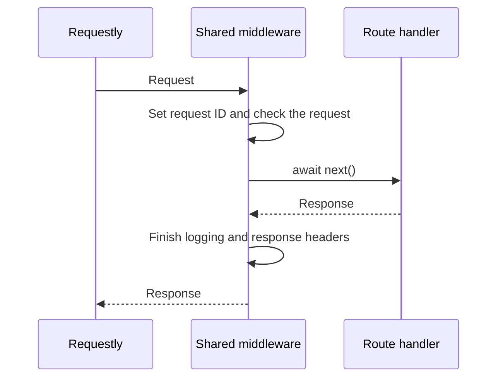

# API guide

Use `http://127.0.0.1:3000` with the local settings. Start the API in your terminal as described in [setup](setup.md). Authentication and finance endpoints do not exist yet.

## Health requests

| Request | Response |
| --- | --- |
| `GET /health/live` | `200` with `{"status":"ok"}`. Makes no database query. |
| `GET /health/ready` | Runs `SELECT 1` through Drizzle. Returns the same success body, or `503` with error code `DATABASE_UNAVAILABLE`. |
| `HEAD` on either health URL | Uses the GET behavior and returns headers without a body. |

Readiness uses the existing database timeouts. It has no separate deadline or connection-reservation logic.

## Errors

All API errors use this shape:

```json
{
  "error": {
    "code": "NOT_FOUND",
    "message": "The requested resource was not found.",
    "status": 404,
    "requestId": "4d598d39-dc7a-4ca5-aab6-509ad69080d1",
    "timestamp": "2026-10-29T18:30:00.000Z"
  }
}
```

The request ID matches the response header. The timestamp uses UTC. Unexpected failures return a generic message; responses do not include raw exceptions, submitted bodies, or SQL details.

| Status | Code | Meaning |
| --- | --- | --- |
| `400` | `INVALID_INPUT` | The JSON body is empty or malformed. |
| `403` | `ORIGIN_REJECTED` | A write has a missing or unapproved Origin. |
| `404` | `NOT_FOUND` | No resource matches the URL. |
| `405` | `METHOD_NOT_ALLOWED` | The URL exists but does not support that method. `Allow` lists supported methods. |
| `406` | `NOT_ACCEPTABLE` | The Accept header does not permit a JSON response. |
| `413` | `PAYLOAD_TOO_LARGE` | The request body exceeds the size limit. |
| `414` | `URI_TOO_LONG` | The full request URL exceeds the size limit. |
| `415` | `UNSUPPORTED_MEDIA_TYPE` | A JSON reader received a content type other than `application/json`. |
| `500` | `INTERNAL_ERROR` | An unexpected application failure occurred. |
| `503` | `DATABASE_UNAVAILABLE` | The readiness query failed. |

In Requestly, send `GET /missing` to see a `404`. To see a `405`, send `POST /health/live` with `Origin: http://127.0.0.1:3000`; that method is unsupported even with an allowed origin. Neither request needs a body. Inspect `X-Request-Id` and, for the method error, `Allow` in the response headers.

## JSON responses and request logs

The API returns JSON. Omit `Accept` or use `Accept: application/json`, `application/*`, or `*/*`. An unsupported value such as `text/html` returns `406 NOT_ACCEPTABLE`. Hono parses the header; the most specific matching range decides whether JSON is allowed. A quality value of zero rejects that range, so `application/json;q=0, */*;q=1` still rejects JSON. CORS preflights remain Hono's responsibility and do not need to accept JSON.

Each completed request writes one JSON log entry to the terminal:

```json
{"requestId":"4d598d39-dc7a-4ca5-aab6-509ad69080d1","method":"GET","route":"/health/live","status":200,"elapsedMs":1}
```

The route comes from Hono's registered route template. A route such as `/records/:id` logs that template rather than a concrete record ID. Unmatched requests can log `*`; the requested URL is never the fallback. Logs contain only the five fields shown above. Headers, bodies, query strings, SQL, and raw exceptions are omitted.

## Origins and browser access

An origin is a scheme, hostname, and port, such as `http://127.0.0.1:3000`. Paths and trailing slashes are not part of an origin. Configure `API_ORIGIN` and the optional `CORS_ORIGINS` allowlist as described in [setup](setup.md#configuration).

Every POST, PUT, PATCH, or DELETE request must include an `Origin` exactly matching `API_ORIGIN` or an explicitly allowed browser origin. Missing values, `null`, and unlisted values return `403 ORIGIN_REJECTED`. GET and HEAD need no Origin.

For Requestly, leave `CORS_ORIGINS` empty and add the `Origin` header to write requests. CORS means cross-origin resource sharing; browsers use it to decide whether a page may read another origin's responses. Requestly desktop does not need browser CORS permission. Origin checks do not authenticate a caller; session authentication and CSRF checks arrive with their own endpoints.

To allow a separate browser frontend, set an explicit list, for example `CORS_ORIGINS=http://127.0.0.1:5173`. Keep the same hostname when using local session cookies. Hono's CORS middleware allows credentials only for listed origins and exposes `ETag`, `Location`, and `X-Request-Id`. It allows GET, HEAD, POST, PUT, PATCH, and DELETE with `Content-Type`, `X-CSRF-Token`, and `If-Match` request headers. Wildcard origins are rejected.

A browser preflight is an OPTIONS request with `Access-Control-Request-Method`. When CORS is enabled, Hono returns `204` and includes `Access-Control-Allow-Origin` only for an allowed origin. Without that header, the browser denies access. When CORS is disabled, OPTIONS follows ordinary route and method handling. A successful preflight does not guarantee that the requested endpoint or method exists.

## Middleware order

`src/app.ts` calls `installHttp` in `src/http.ts` before registering routes. Each middleware can return a response immediately or call `await next()` to continue. Code after `await next()` runs when the remaining middleware and handler return. See [Hono's middleware execution order](https://hono.dev/docs/guides/middleware#execution-order).



The following order matches `installHttp`:

| Order | Middleware | Purpose |
| --- | --- | --- |
| 1 | Hono `secureHeaders` | Adds browser security headers, including `nosniff` to prevent content-type guessing and `SAMEORIGIN` to restrict framing. Strict-Transport-Security is disabled for local HTTP. |
| 2 | Request ID, no-store, and logging | Generates a fresh ID and sets `X-Request-Id` and `Cache-Control: no-store`. After `await next()`, writes the final status and elapsed handling time to the log. Client-supplied request IDs are ignored. |
| 3 | URL limit | Rejects a full URL over 8 KiB with `414` before query parsing. |
| 4 | Write-origin check | Requires an allowed Origin for methods other than GET, HEAD, and OPTIONS. Rejects missing or unapproved values with `403`. |
| 5 | Hono `cors`, when configured | Adds browser access headers and handles preflights. This middleware is not registered when the browser allowlist is empty. |
| 6 | JSON response negotiation | Uses Hono's Accept parser to decide whether the client allows JSON. Returns `406` otherwise. |
| 7 | Hono `bodyLimit` | Caps request bodies at 64 KiB before a route parses them. Returns the common `413` error when oversized. |
| 8 | Hono `methodNotAllowed` | Lets routing run, then turns a missing-method result for a known URL into `405` and supplies its `Allow` header. Unknown URLs remain `404`. |

Origin checking and CORS have separate jobs. The origin check rejects unapproved writes on the server; CORS tells browsers whether they may read a response. Neither authenticates a caller.

### Error handlers and JSON helper

`app.notFound` and `app.onError` are handlers, not middleware entries. The former produces the common `404`; the latter preserves explicit safe `ApiError` responses and turns unexpected exceptions into a generic `500`.

`readJson` is a helper called explicitly by a JSON route. It checks `Content-Type: application/json`, allowing a charset parameter, then calls `c.req.json()` with a safe parsing error. Feature handlers will validate their own fields with Valibot. Only the test POST route uses this helper today; the running app still exposes health routes only.
