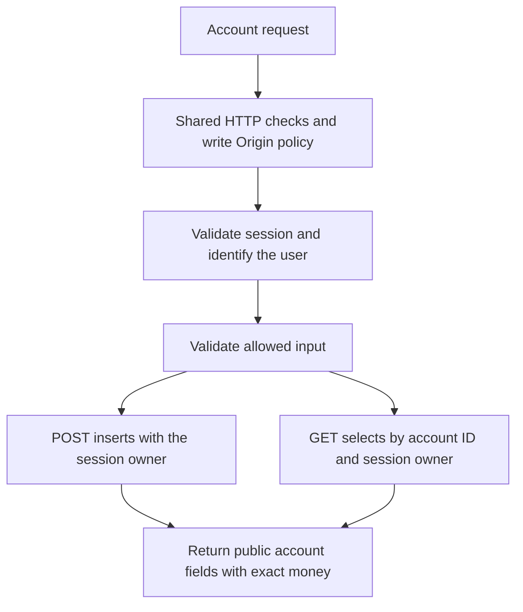
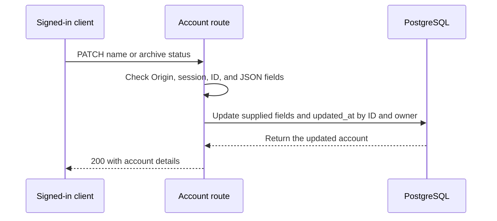
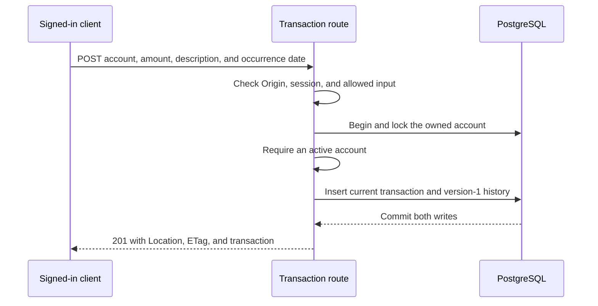
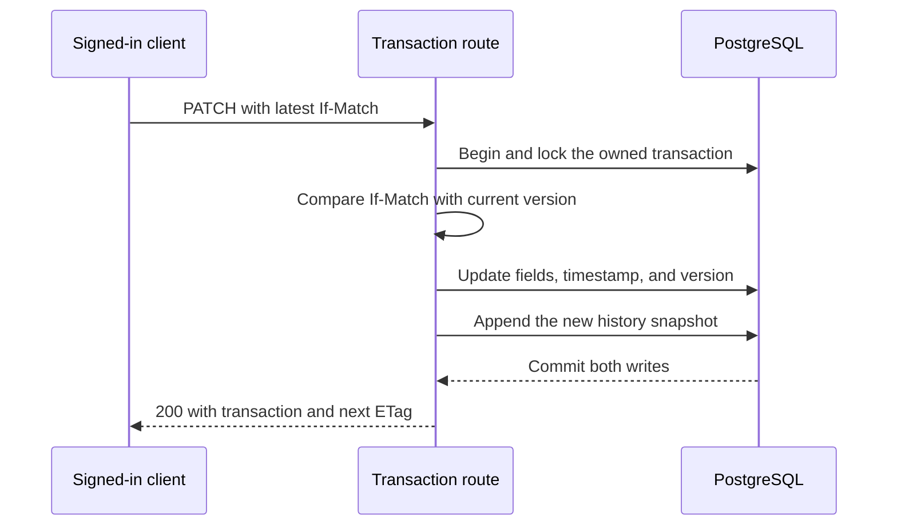
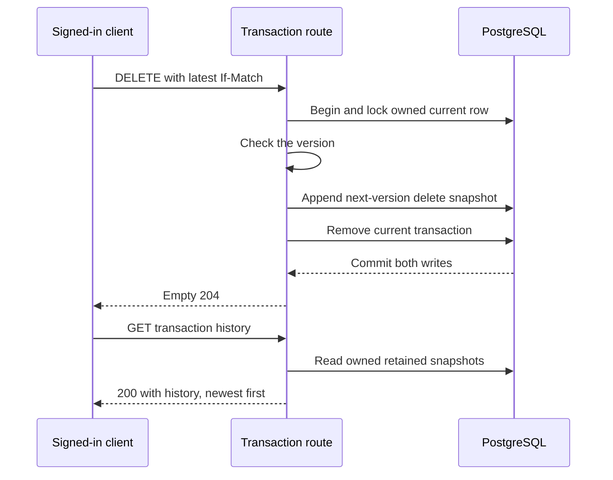
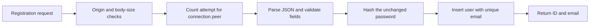
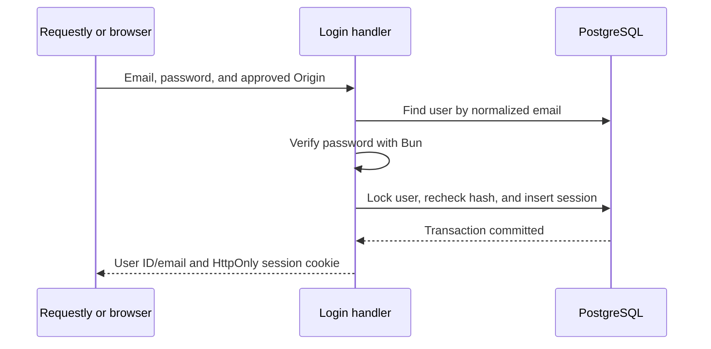
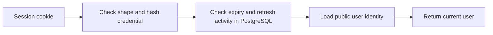
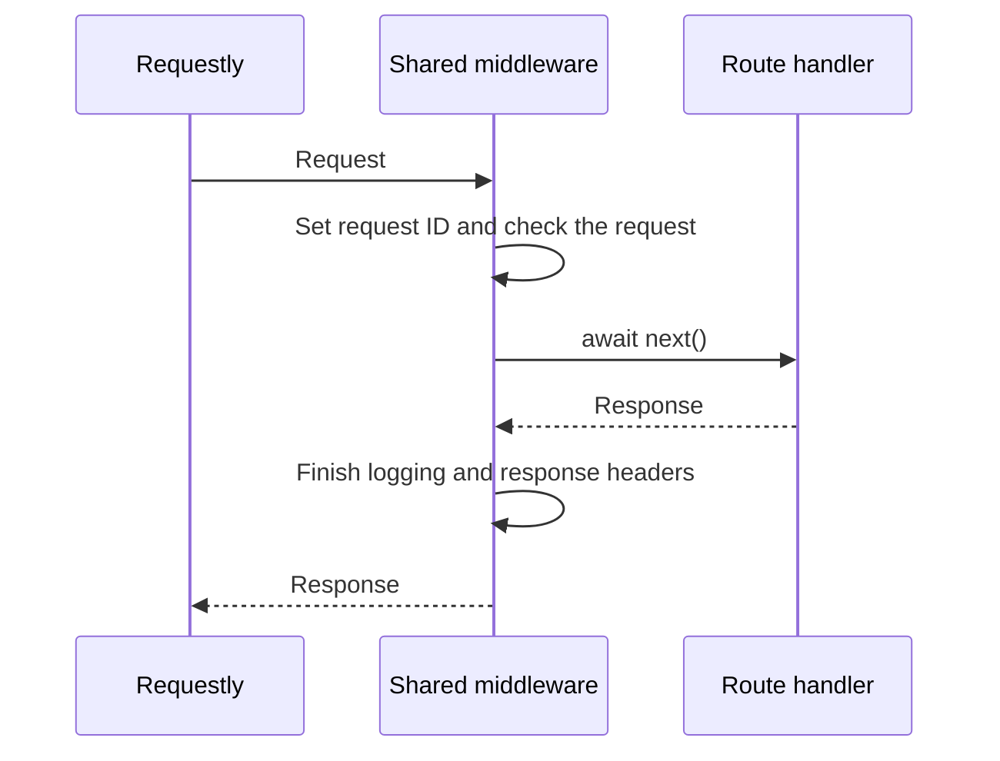
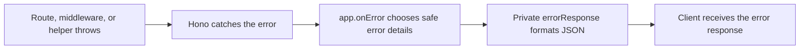

# API guide

Use `http://127.0.0.1:3000` with the local settings. Start the API in your terminal as described in [setup](setup.md). Authentication, account management, and transaction creation/detail are available.

## Create an account and read its details

Log in first, then send `POST /api/v1/accounts` with the session cookie, an approved `Origin`, and `Content-Type: application/json`:

```json
{
  "name": "Daily spending",
  "type": "checking",
  "currency": "USD",
  "openingBalance": "1500.00"
}
```

`name` and `type` are required. Names are trimmed and must contain 1–100 characters. Supported types are `checking`, `savings`, `cash`, `credit`, and `investment`. Investment represents a cash balance without holdings or market prices. Currency must be `USD`, `EUR`, or `GBP` and defaults to `USD`. The opening balance defaults to `"0.00"`.

Supply money as a string with exactly two decimal places and at most sixteen integer digits. Zero and negative opening balances are allowed. For example, `"-24.50"` can represent debt. Numeric JSON values, leading zeros, exponent notation, whitespace, commas, negative zero, and extra fractional digits are rejected. Money remains a decimal string throughout the request, database query, and response.

The server takes the owner from the session. Client-supplied IDs, owner fields, archive status, timestamps, tags, categories, and other unknown fields return `400 INVALID_INPUT`. These two endpoints accept no query parameters.

Success returns `201` with a relative `Location` header such as `/api/v1/accounts/62a9b052-bb8a-49f8-935e-76f56b02e2db` and this response shape:

```json
{
  "data": {
    "id": "62a9b052-bb8a-49f8-935e-76f56b02e2db",
    "name": "Daily spending",
    "type": "checking",
    "currency": "USD",
    "openingBalance": "1500.00",
    "isArchived": false,
    "createdAt": "2026-11-17T20:00:00.000Z",
    "updatedAt": "2026-11-17T20:00:00.000Z"
  }
}
```

Send `GET /api/v1/accounts/:id` with the same session to read the account. It returns `200` with the same shape. The database query checks both the ID and the session's user ID. A missing account and another user's account both return `404 NOT_FOUND` with `The account was not found.` An invalid UUID returns `400 INVALID_INPUT`. Missing or expired sessions return `401 UNAUTHENTICATED`.



For creation, `requireJson` runs before the JSON validator, and Hono parses the body. Validation failures throw `ApiError`; the shared error handler formats responses. An unexpected database failure returns the normal safe `500` error. Account listing, search, renaming, archival, and deletion are described below. Tags and the remaining transaction routes are not available yet.

### Try accounts in Requestly

Create the two requests manually or import [requests/finance.json](../requests/finance.json). Use the same `baseUrl` as your auth requests and log in first so Requestly's cookie jar holds the session. Send **Create account** with `Origin: {{baseUrl}}`. Copy only the returned account ID into the `accountId` variable, then send **Account details**. Do not copy the session credential into variables or request headers. Each successful create makes a separate account, even if its name repeats.

## List and search your accounts

Send `GET /api/v1/accounts` with the session cookie. No request body or Origin header is needed. The list includes only accounts owned by the signed-in user. For example:

```http
GET /api/v1/accounts?q=checking&archived=false&page=1&limit=25
```

| Query field | Behavior |
| ----------- | -------- |
| `q` | Case-insensitive substring search of account names. Trimmed, at most 100 characters. Omitted or blank matches every name. Percent signs, underscores, backslashes, and quotes are literal characters. |
| `archived` | Accepts only `true` or `false`. Omit it to include both archived and active accounts. |
| `page` | Positive integer, starting at 1. Defaults to 1. |
| `limit` | Positive integer from 1 to 100. Defaults to 25. |

Filters combine with AND. Each field may appear only once; repeated fields, unknown fields, malformed integers, and unsupported values return `400 INVALID_INPUT`. Tag filtering is not available yet. Pages that would skip more than 10,000 rows are rejected. For example, `page=101&limit=100` skips exactly 10,000 rows and is allowed; `page=102&limit=100` is rejected.

Results are ordered by account name ascending, then by UUID ascending to keep equal names in a stable order. Each item has the same public fields and exact decimal strings as account detail. The response includes `pagination.page`, `pagination.limit`, and `pagination.total`. The total counts all of the current user's matching accounts before pagination, including when a page is empty:

```json
{
  "data": [],
  "pagination": { "page": 1, "limit": 25, "total": 0 }
}
```

The route validates the session and query before reading accounts. It uses the same owner, name, and archive conditions for both the paged results and the total count. The existing owner index supports selecting one user's accounts. Sorting and substring search use those matching rows; no new index or schema change is needed for the current small dataset. Pagination is not a snapshot; concurrent changes can affect results and totals.

In Requestly, use **List accounts** from [requests/finance.json](../requests/finance.json) or create the GET request manually. Reuse the cookie jar from login. Set `q`, `archived`, `page`, and `limit` in the URL as needed; remove a filter to omit it. Use the PATCH endpoint below to archive or unarchive an account.

## Rename, archive, or unarchive an account

Send `PATCH /api/v1/accounts/:id` with the session cookie, an approved `Origin`, and `Content-Type: application/json`. Supply `name`, `isArchived`, or both:

```json
{
  "name": "Household checking",
  "isArchived": true
}
```

Names use the same trimming and 1–100 character rules as creation. `isArchived` must be a JSON boolean, `true` or `false`, rather than a string. To unarchive an account, send `{ "isArchived": false }`. Omitted fields keep their current values. Empty patches, null values, unknown fields, and query parameters return `400 INVALID_INPUT`.

The owner, ID, type, currency, opening balance, and creation timestamp cannot change through this endpoint. The server sets `updatedAt` on each successful patch. Success returns `200` with the full public account representation, including the unchanged exact decimal opening balance. A missing account and another user's account both return the same `404 NOT_FOUND` response. Missing sessions, unapproved write origins, and malformed JSON use the existing shared errors.

Archiving does not delete the account. Its detail remains readable, and the list route still includes it when `archived` is omitted or set to `true`. Use `archived=false` to list only active accounts.



The handler uses one atomic `UPDATE ... RETURNING` statement. No matching row means the account is missing or belongs to another user, so the route returns 404. PostgreSQL automatically holds a row lock during the update; no preliminary read or explicit transaction wrapper is needed. Only supplied fields are updated, so archiving cannot overwrite a concurrent rename with an older name. If two requests change the same field, the last successful update wins. This endpoint requires no version or `If-Match` header. Future transaction creation will coordinate with archival by locking the same account before checking whether it is active; transaction creation locks that same account before checking whether it is active.

In Requestly, **Rename account**, **Archive account**, and **Unarchive account** in [requests/finance.json](../requests/finance.json) use `{{accountId}}` and the existing cookie jar. You can also create these requests manually. Each write needs `Origin: {{baseUrl}}`. After archiving, try **Account details** and list with `archived=true`; after unarchiving, list with `archived=false`.

## Delete an account

Send `DELETE /api/v1/accounts/:id` with the session cookie and an approved `Origin`. No request body or Content-Type header is needed. Query parameters are rejected, and the account ID must be a UUID.

The handler uses one atomic `DELETE ... RETURNING` statement scoped to both the account ID and the session owner. A successful deletion returns `204` with no body. A missing account, a previously deleted account, and another user's account all return the same `404 NOT_FOUND` response. Missing or revoked sessions return `401 UNAUTHENTICATED`; missing or unapproved origins return `403 ORIGIN_REJECTED` before session or deletion work. Invalid IDs or query fields return `400 INVALID_INPUT`. Unexpected deletion failures use the shared safe `500` response.

Active and archived accounts can be deleted only when they have no current transactions or retained history. Deletion removes the account permanently, so later detail reads and updates return `404`, and the account disappears from lists and totals. Other accounts, users, and sessions remain intact. Archiving is the option that keeps an account available for later use.

The finance schema now includes current transactions and retained history. A reference from either table prevents account deletion and returns `409 RESOURCE_IN_USE` with `This account has transactions or history. Archive it instead.` Removing a current transaction does not remove its history, so an account with retained history remains protected. Account deletion still uses one statement: PostgreSQL enforces the references, and the handler translates only those known reference failures. Transaction creation, detail, corrections, deletion, and history reads are available.

For a Requestly walkthrough, create a temporary account and copy its returned ID into `accountId`. Send **Delete account** from [requests/finance.json](../requests/finance.json) or create the DELETE request manually, including `Origin: {{baseUrl}}`. The cookie jar supplies the session. Expect `204`, then `404` if you read or delete the same account again.

## Create a transaction and read its details

Log in and create an active account first. Send `POST /api/v1/transactions` with the session cookie, an approved `Origin`, and `Content-Type: application/json`:

```json
{
  "accountId": "62a9b052-bb8a-49f8-935e-76f56b02e2db",
  "amount": "-24.50",
  "description": "Weekly groceries",
  "occurredAt": "2026-11-18"
}
```

`accountId`, `amount`, and `occurredAt` are required. The amount uses the account's currency. Positive amounts increase its balance and negative amounts decrease it. Supply a decimal string with exactly two fractional digits and at most sixteen integer digits. Zero, negative zero, numeric JSON values, leading zeros, exponent notation, commas, and whitespace are rejected. Do not supply a separate currency or direction field.

`description` is optional, accepts `null`, and allows up to 2,000 characters. Omitted descriptions are stored and returned as `null`. `occurredAt` must be a real calendar date in `YYYY-MM-DD` format, within years 0001–9999. For example, `"2026-11-19"` is accepted and returned unchanged. Times and timezone offsets are rejected. PostgreSQL stores this field as `date`, so timezone conversion cannot move it to another day. The server manages `createdAt` and `updatedAt` as exact UTC timestamps.

The route accepts only these four fields. Client-supplied owner/transaction IDs, versions, timestamps managed by the server, category/tag fields, transfer IDs, and unknown fields return `400 INVALID_INPUT`. Neither create nor detail accepts query parameters.

Creation locks the account selected by both its ID and the session owner. Missing and foreign accounts return the same `404 NOT_FOUND`; an owned archived account returns `409 ACCOUNT_ARCHIVED`. Archival and creation use conflicting account row locks, so creation rechecks the account's state after a concurrent archive finishes. Existing transactions remain readable after archival.

The route inserts the current transaction and its initial history in one database transaction. A failed history write rolls back the current insert too. Only after commit does it return `201` with `Location: /api/v1/transactions/:id`, `ETag: "1"`, and this shape:

```json
{
  "data": {
    "id": "c8e9a8a6-871b-46f0-95d8-67987eedab56",
    "accountId": "62a9b052-bb8a-49f8-935e-76f56b02e2db",
    "amount": "-24.50",
    "description": "Weekly groceries",
    "occurredAt": "2026-11-18",
    "version": 1,
    "createdAt": "2026-11-18T20:00:00.000Z",
    "updatedAt": "2026-11-18T20:00:00.000Z"
  }
}
```

Send `GET /api/v1/transactions/:id` with the same session to read the transaction. It returns `200`, the same public fields, and the version ETag. Another user's transaction and a missing transaction both return `404 NOT_FOUND` with `The transaction was not found.` An invalid UUID returns `400 INVALID_INPUT`. The response keeps money as a two-decimal string. No `If-Match` header is required for these two endpoints.



The initial snapshot contains the returned transaction fields plus the account's ID, name, and currency at creation. History records operation `create`, version 1, the owner, and the server-generated request ID. It contains no tag/category placeholders. The history endpoint below returns these snapshots.

**POST is not idempotent.** Repeating the same request creates another transaction with a new ID and its own history. The API does not retry writes automatically. Transfers, lists, and balance/summary endpoints remain outside the current API.

In Requestly, use **Create transaction** from [requests/finance.json](../requests/finance.json), or create the request manually. Set `accountId` to an active account you own, and reuse the session cookie jar. Copy only the returned transaction ID into `transactionId` for **Transaction details**; do not copy session credentials into variables or headers.

## Correct a transaction and read its history

Read the transaction first and copy its `ETag` response header, including the quotes. Send `PATCH /api/v1/transactions/:id` with that value in `If-Match`, the session cookie, an approved `Origin`, and `Content-Type: application/json`. For example, use `If-Match: "1"` with:

```json
{
  "amount": "-23.50",
  "description": null,
  "occurredAt": "2026-11-19"
}
```

Supply at least one field. Amount and date follow the creation rules. `description: null` clears the description; omitted fields keep their values. Account, owner, version, server timestamps, tags, categories, and unknown fields cannot be supplied. This endpoint accepts no query parameters. Existing transactions can be corrected after their account is archived.

The route locks the current row selected by transaction ID and session owner, then checks the version. It updates the allowed fields, increments the version, sets `updatedAt`, and appends an `update` snapshot in the same database transaction. `createdAt` stays unchanged. Every accepted patch creates a new version, even if the supplied values equal the current values. Success returns `200` with the full public transaction and its new ETag, such as `"2"`. A failed history write rolls back the fields, timestamp, and version together.

| If-Match condition | Response |
| --- | --- |
| Missing | `428 PRECONDITION_REQUIRED` |
| Malformed, weak, wildcard, or multiple values | `400 INVALID_INPUT` |
| One quoted positive integer that differs from the current version | `412 VERSION_MISMATCH` |
| Matches the current version | Apply the correction and return its next ETag. |

Versions use the database's positive integer range, up to 2147483647. For an otherwise valid request, foreign and missing transaction IDs return the same `404 NOT_FOUND` before any version-header error. If another correction wins first, read the latest transaction, review its changes, and submit an intentional correction with its latest ETag.



Read snapshots with `GET /api/v1/transactions/:id/history?page=1&limit=25`. It requires a session, but no Origin or If-Match header. Results use descending version order. Page defaults to 1 and limit to 25, with a maximum limit of 100. Pages may skip at most 10,000 rows. Unknown fields, duplicate query fields, and invalid bounds return `400 INVALID_INPUT`.

The response is `{ "data": [...], "pagination": { "page": 1, "limit": 25, "total": 2 } }`. Each data entry contains `id`, `transactionId`, `accountId`, `version`, `operation`, `snapshot`, `recordedAt`, and `requestId`. The snapshot contains the public transaction fields and the account's ID, name, and currency when the change was saved. Later account renames do not rewrite earlier snapshots. Owner IDs and authentication fields are excluded. Earlier snapshots are returned as stored, without adding future tag/category fields.

A page beyond the last entry returns an empty data array with the matching total. Foreign IDs return `404`. An owned transaction with no history returns an empty list; if neither the owned current row nor owned history exists, the response is `404`. Reads use the same `Cache-Control: no-store` behavior as the other finance endpoints.

In Requestly, use **Correct transaction** and **Transaction history** from [requests/finance.json](../requests/finance.json). Set `transactionId` and replace the example `If-Match: "1"` with the latest ETag before each correction. The cookie jar supplies the session.

## Delete a transaction and keep its history

Send `DELETE /api/v1/transactions/:id` with the session cookie, an approved `Origin`, and `If-Match` containing the latest transaction ETag, including quotes. No JSON body is needed, and query parameters are rejected. For example:

```http
DELETE /api/v1/transactions/c8e9a8a6-871b-46f0-95d8-67987eedab56
Origin: http://127.0.0.1:3000
If-Match: "2"
```

The route locks the owned current row and applies the same version rules as PATCH. A missing header returns `428 PRECONDITION_REQUIRED`, a malformed header returns `400 INVALID_INPUT`, and a stale version returns `412 VERSION_MISMATCH`. Foreign and missing transaction IDs return `404 NOT_FOUND` before version-header errors. Transactions on archived accounts can still be deleted.

With a matching version, the route appends a final `delete` snapshot at the next version and removes the current row in one database transaction. For example, deleting version 2 produces history version 3. The snapshot preserves the last transaction fields and its original `createdAt` and last `updatedAt`; `recordedAt` tracks when deletion was recorded. Account ID/name/currency reflect the account when deletion was saved. Earlier snapshots stay unchanged. Failure of either write rolls back both.

Success returns an empty `204` with no ETag because there is no current representation. Subsequent detail, patch, or delete requests return `404`. Repeating deletion cannot append another snapshot. The owner can still call `GET /api/v1/transactions/:id/history`, with the same pagination, to inspect the final snapshot and all earlier versions. Other users receive `404`. Retained history continues to block account deletion with `409 RESOURCE_IN_USE`; archive the account instead.



If PATCH commits first, a waiting DELETE with the older version returns `412`. If DELETE commits first, a waiting PATCH returns `404`. Neither losing request writes history.

In Requestly, use **Delete transaction** from [requests/finance.json](../requests/finance.json). Replace its example `If-Match` with the latest ETag. If you already save the ETag as `transactionEtag`, set the header value to `{{transactionEtag}}` without extra quotes. Read **Transaction history** afterward to inspect the retained records.

## Health requests

| Request                     | Response                                                                                                         |
| --------------------------- | ---------------------------------------------------------------------------------------------------------------- |
| `GET /health/live`          | `200` with `{"status":"ok"}`. Makes no database query.                                                           |
| `GET /health/ready`         | Runs `SELECT 1` through Drizzle. Returns the same success body, or `503` with error code `DATABASE_UNAVAILABLE`. |
| `HEAD` on either health URL | Uses the GET behavior and returns headers without a body.                                                        |

Readiness uses the existing database timeouts. It has no separate deadline or connection-reservation logic.

## Register a user

Send `POST /api/v1/auth/register` with `Origin: http://127.0.0.1:3000`, `Content-Type: application/json`, and exactly these fields:

```json
{
  "email": "learner@example.test",
  "password": "choose your own long passphrase"
}
```

Email is trimmed, lowercased, checked for a valid format, and limited to 254 characters. Dots and `+` suffixes remain part of the address. Passwords must contain 15–128 Unicode code points. A code point is a Unicode value, so one emoji may count as one even though JavaScript's string length counts two. Passwords keep their exact spaces and case, with no trimming or normalization.

The small local blocklist rejects these passwords regardless of case: `passwordpassword`, `password123456789`, `123456789012345`, `qwertyuiopasdfgh`, and `letmeinletmeinletmein`. It is a limited learning example rather than a comprehensive list of compromised passwords.

Success returns `201` with only the new user's ID and normalized email inside `data`:

```json
{
  "data": {
    "id": "4d598d39-dc7a-4ca5-aab6-509ad69080d1",
    "email": "learner@example.test"
  }
}
```

The server stores an Argon2id password hash using Bun's asynchronous password API, with `memoryCost: 19456` and `timeCost: 2`. It never returns the password or hash. Registration does not log in or issue a cookie. A duplicate normalized email returns `409 ACCOUNT_NOT_AVAILABLE`, including when two requests race. Email is an unverified login identifier; this response can reveal that an address is registered. Email verification and public signup protection are deferred.



Each peer IP gets five attempts per fixed one-hour window, starting with its first attempt. Invalid JSON, invalid fields, and duplicate emails count too. The server uses Bun's connection address and ignores forwarded IP headers. Attempt-limit errors return `429 RATE_LIMITED` with a `Retry-After` header in seconds. A missing connection address returns a safe `503`.

The limiter stores at most 1,024 peers and removes expired entries on the next registration request. When full, it refuses new peers with `429`. These limits belong to one running app and reset on restart. They are sufficient for this local exercise; multiple API instances would need shared limits.

### Try registration in Requestly

Import [requests/auth.json](../requests/auth.json) through Requestly's **Import → Postman** option. This is a collection format Requestly supports; no Postman installation is needed. See [Requestly's import guide](https://docs.requestly.com/api-client/import-export/import-from-postman).

The collection includes `baseUrl` and `email` variables. Set your email and fill in the blank password in the request body locally. Send the request once for `201`, then repeat it for `409`. The file contains no password or session credential. Keep exports containing your entered password out of Git. After five attempts from your IP, wait for the stated window or restart your local API to clear its in-memory limit.

## Log in

Send `POST /api/v1/auth/login` with the same Origin and JSON headers as registration, and exactly `email` and `password`. Email is normalized the same way as registration. Passwords are checked as supplied, including their spaces and case. Login accepts a nonempty password of at most 128 Unicode code points; the registration blocklist applies when choosing a password, not when verifying an existing one.

Success returns `200` with `{"data":{"id":"...","email":"learner@example.test"}}` and sets a cookie. With local/test HTTP, the cookie has these attributes:

```http
Set-Cookie: session=<random credential>; HttpOnly; SameSite=Lax; Path=/; Max-Age=604800
```

Production adds `Secure`. This choice comes from validated `APP_ENV`, with no separate switch to disable it. The cookie is host-only because no Domain is set. `HttpOnly` keeps it unavailable to page JavaScript. The browser or Requestly cookie jar manages it.

Each successful login generates a fresh 32-byte random credential, encoded as base64url. The session table stores only its SHA-256 hash, the user reference, and timestamps. No session credential or password hash appears in the JSON response or request logs. A preexisting session cookie does not determine the new credential, and separate logins create independent sessions. No refresh-token exchange or extra token-fetch request is involved.

An unknown email and a wrong password both return `401 INVALID_CREDENTIALS` with `Invalid email or password.` Unknown emails still perform Argon2id verification against a public dummy hash to keep password work comparable. After verification, a database transaction locks the user row and rechecks the password hash before inserting the session. If the password changed during verification, login fails. The cookie is set only after that transaction commits.

Login allows 30 attempts per connection peer and 10 attempts per normalized email in fixed 15-minute windows. Invalid input counts toward the peer limit. After input validation, every attempt counts toward the email limit, including successful logins. Success does not clear earlier attempts. Each counter allows new attempts when its window expires. Both maps hold at most 1,024 entries, remove expired entries when that limit is checked, and refuse new entries when full. These limits return `429 RATE_LIMITED` with `Retry-After` in seconds. Registration and login use the same small counter function in `src/features/auth.ts`. Restarting the local API clears its in-memory limits. Registration, login, and password changes have no separate limit on simultaneous password work. Requests within their attempt limits can proceed concurrently.



In Requestly, use the collection's **Log in** request and enter the same password used during registration. Check the `Set-Cookie` response and cookie jar after a `200`. Keep `baseUrl` set to `http://127.0.0.1:3000` so the hostname matches the cookie. Do not copy the session value into a variable or script. After login, send the collection's **Current user** request to verify the cookie. Use **Log out** to revoke that session when finished.

## Current user

Send `GET /api/v1/auth/me` after login. Requestly sends the session cookie from its cookie jar. This GET needs no Origin header or body. Success returns `200` with `{ "data": { "id": "...", "email": "..." } }` for the cookie's owner.

`requireSession` in `src/session.ts` checks the credential shape, hashes it, and conditionally updates the matching session only if its absolute expiry is still in the future and its last accepted use was less than 30 minutes ago. Exactly 30 minutes of inactivity expires it. Successful validation refreshes `last_seen_at` without extending the seven-day absolute deadline or reissuing the cookie. The handler receives the session ID and public user identity through Hono's context.

Missing, malformed, unknown, revoked, or expired credentials return `401 UNAUTHENTICATED` and clear the cookie using matching attributes. A session-store failure returns a safe `503 SERVICE_UNAVAILABLE` and preserves the cookie for retry. Expired rows remain in the database until the later cleanup phase.



Only routes that declare this middleware require a session. Registration, login, health checks, and preflight requests keep their existing access rules.

## Change a password

For how Bun SQL and Drizzle commit or roll back the writes, see [database transactions](database-transactions.md).

Send `POST /api/v1/auth/password` with the session cookie, an allowed `Origin`, and `Content-Type: application/json`:

```json
{"currentPassword":"your current passphrase","newPassword":"your replacement passphrase"}
```

`newPassword` follows the registration password rules and preserves spaces and case. Extra fields are rejected. An incorrect current password returns `401 INVALID_CREDENTIALS`. Invalid input returns `400 INVALID_INPUT`.

After verifying the current password, the handler hashes the replacement, locks the user row, and rechecks the stored hash. It updates the password and `updated_at`, then deletes all that user's sessions in the same database transaction. Login takes the same user-row lock and rechecks its verified hash, preventing an old-password login from creating a session after the change. Other users keep their sessions.

Success returns `204` with no body and clears the current cookie. Log in again with the replacement password. In Requestly, fill in the blank fields of **Change password** locally. The collection contains no passwords or session credentials.

Limits are ten attempts per IP and five validated attempts per user in fixed 15-minute windows. IP throttling runs before session and input validation. Limits return `429` with `Retry-After`. A transaction failure returns a safe error and keeps the cookie; the database transaction prevents a partial password/session change. Email recovery remains deferred.

## Log out

Send `POST /api/v1/auth/logout` with the session cookie and an exact allowed `Origin`, such as `http://127.0.0.1:3000`. No request body is needed. In Requestly, use **Log out** after login; the cookie jar sends the credential.

The existing Origin check runs before session validation. The handler deletes only the current session, clears the cookie with matching attributes, and returns `204` with no body. Other sessions for the same user and other users remain valid. Calling the current-user endpoint or logout again with the revoked cookie returns `401`. Missing or unapproved write origins return `403` before any session-store access.

If deletion fails, the response uses the common safe error format and leaves the cookie intact for retry. Logout revokes subsequent requests; a request that already passed session validation may finish.

## Errors

All API errors use this shape:

```json
{
  "error": {
    "code": "NOT_FOUND",
    "message": "The requested resource was not found.",
    "status": 404,
    "requestId": "4d598d39-dc7a-4ca5-aab6-509ad69080d1",
    "timestamp": "2026-10-29T18:30:00.000Z"
  }
}
```

The request ID matches the response header. The timestamp uses UTC. Unexpected failures return a generic message; responses do not include raw exceptions, submitted bodies, or SQL details.

| Status | Code                     | Meaning                                                                                                          |
| ------ | ------------------------ | ---------------------------------------------------------------------------------------------------------------- |
| `400`  | `INVALID_INPUT`          | The JSON body is empty, malformed, or contains invalid credential fields.                                        |
| `401` | `UNAUTHENTICATED` | A protected route requires a valid, unexpired session. |
| `401`  | `INVALID_CREDENTIALS`    | The login email or password is incorrect, or the password changed during verification.                           |
| `403`  | `ORIGIN_REJECTED`        | A write has a missing or unapproved Origin.                                                                      |
| `404`  | `NOT_FOUND`              | No resource matches the URL.                                                                                     |
| `405`  | `METHOD_NOT_ALLOWED`     | The URL exists but does not support that method. `Allow` lists supported methods.                                |
| `409`  | `ACCOUNT_NOT_AVAILABLE`  | The normalized registration email is already in use.                                                             |
| `413`  | `PAYLOAD_TOO_LARGE`      | The request body exceeds the size limit.                                                                         |
| `414`  | `URI_TOO_LONG`           | The full request URL exceeds the size limit.                                                                     |
| `415`  | `UNSUPPORTED_MEDIA_TYPE` | A JSON route received a content type other than `application/json`.                                              |
| `429`  | `RATE_LIMITED`           | An authentication attempt or password-processing limit was reached. `Retry-After` gives seconds before retrying. |
| `500`  | `INTERNAL_ERROR`         | An unexpected application failure occurred.                                                                      |
| `503`  | `DATABASE_UNAVAILABLE`   | The readiness query failed.                                                                                      |
| `503`  | `SERVICE_UNAVAILABLE`    | Connection information or session verification is unavailable.                                         |

In Requestly, send `GET /missing` to see a `404`. To see a `405`, send `POST /health/live` with `Origin: http://127.0.0.1:3000`; that method is unsupported even with an allowed origin. Neither request needs a body. Inspect `X-Request-Id` and, for the method error, `Allow` in the response headers.

## JSON responses and request logs

The API returns JSON with `Content-Type: application/json` regardless of the request's `Accept` header. It supports one response format, so there is no format negotiation.

Each completed request writes one JSON log entry to the terminal:

```json
{
  "requestId": "4d598d39-dc7a-4ca5-aab6-509ad69080d1",
  "method": "GET",
  "route": "/health/live",
  "status": 200,
  "elapsedMs": 1
}
```

The route comes from Hono's registered route template. A route such as `/records/:id` logs that template rather than a concrete record ID. Unmatched requests can log `*`; the requested URL is never the fallback. Logs contain only the five fields shown above. Headers, bodies, query strings, SQL, and raw exceptions are omitted.

## Origins and browser access

An origin is a scheme, hostname, and port, such as `http://127.0.0.1:3000`. Paths and trailing slashes are not part of an origin. Configure `API_ORIGIN` and the optional `CORS_ORIGINS` allowlist as described in [setup](setup.md#configuration).

Every POST, PUT, PATCH, or DELETE request must include an `Origin` exactly matching `API_ORIGIN` or an explicitly allowed browser origin. Missing values, `null`, and unlisted values return `403 ORIGIN_REJECTED`. GET and HEAD need no Origin.

For Requestly, leave `CORS_ORIGINS` empty and add the `Origin` header to write requests. CORS means cross-origin resource sharing; browsers use it to decide whether a page may read another origin's responses. Requestly desktop does not need browser CORS permission. Origin checks do not authenticate a caller. Login issues the session cookie; the current-user endpoint validates the session cookie.

To allow a separate browser frontend, set an explicit list, for example `CORS_ORIGINS=http://127.0.0.1:5173`. Keep the same hostname when using local session cookies. Hono's CORS middleware allows credentials only for listed origins and exposes `ETag`, `Location`, and `X-Request-Id`. It allows GET, HEAD, POST, PUT, PATCH, and DELETE with `Content-Type` and `If-Match` request headers. Wildcard origins are rejected.

Protection against cross-site request forgery uses required exact Origin checks on writes, strict JSON content types where a body is expected, the explicit CORS allowlist, and the host-only SameSite=Lax session cookie. GET, HEAD, and OPTIONS must never perform business mutations. Authenticated requests will use the session cookie without a separate token-fetch request or per-write token header. Reject missing and unapproved write origins even for desktop clients.

A browser preflight is an OPTIONS request with `Access-Control-Request-Method`. When CORS is enabled, Hono returns `204` and includes `Access-Control-Allow-Origin` only for an allowed origin. Without that header, the browser denies access. When CORS is disabled, OPTIONS follows ordinary route and method handling. A successful preflight does not guarantee that the requested endpoint or method exists.

## Middleware order

`src/app.ts` calls `installHttp` in `src/http.ts` before registering routes. Each middleware can return a response immediately or call `await next()` to continue. Code after `await next()` runs when the remaining middleware and handler return. See [Hono's middleware execution order](https://hono.dev/docs/guides/middleware#execution-order).



The following order matches `installHttp`:

| Order | Middleware                        | Purpose                                                                                                                                                                                                  |
| ----- | --------------------------------- | -------------------------------------------------------------------------------------------------------------------------------------------------------------------------------------------------------- |
| 1     | Hono `secureHeaders`              | Adds browser security headers, including `nosniff` to prevent content-type guessing and `SAMEORIGIN` to restrict framing. Strict-Transport-Security is disabled for local HTTP.                          |
| 2     | Request ID, no-store, and logging | Generates a fresh ID and sets `X-Request-Id` and `Cache-Control: no-store`. After `await next()`, writes the final status and elapsed handling time to the log. Client-supplied request IDs are ignored. |
| 3     | URL limit                         | Rejects a full URL over 8 KiB with `414` before query parsing.                                                                                                                                           |
| 4     | Write-origin check                | Requires an allowed Origin for methods other than GET, HEAD, and OPTIONS. Rejects missing or unapproved values with `403`.                                                                               |
| 5     | Hono `cors`, when configured      | Adds browser access headers and handles preflights. This middleware is not registered when the browser allowlist is empty.                                                                               |
| 6     | Hono `bodyLimit`                  | Caps request bodies at 64 KiB before a route parses them. Returns the common `413` error when oversized.                                                                                                 |
| 7     | Missing URL check                 | Waits for routing and the method check, then throws `ApiError(404)` for an unmatched URL. Preserves explicit errors from routes.                                                                         |
| 8     | Hono `methodNotAllowed`           | Lets routing run, then throws `ApiError(405)` for an unsupported method on a known URL and supplies its `Allow` header.                                                                                  |

Origin checking and CORS have separate jobs. The origin check rejects unapproved writes on the server; CORS tells browsers whether they may read a response. Neither authenticates a caller.

### Error handlers and route validation

Routes, middleware, and helpers throw `ApiError` for expected request failures. They return successful responses normally. If an error needs a header such as `Retry-After`, set it with `c.header()` before throwing. Catch database errors only to translate a known failure into a safe `ApiError`; rethrow unknown failures.

`app.onError` is the only place that calls `errorResponse`, which is private to `src/http.ts`. It preserves an `ApiError`'s status, code, and safe message, and converts unexpected exceptions to a generic `500`. All errors use the same JSON format shown above.



Hono's method check examines its normal routing result before the missing-URL check runs. An unsupported method becomes `405`; an unmatched URL becomes `404`. Both throw `ApiError` and use the same central handler.

Registration and login declare `sValidator('json', schema, hook)` in their route definitions, using `@hono/standard-validator` with the existing Valibot schemas. The hook throws `ApiError` when fields are invalid. Handlers read the validated output with `c.req.valid('json')`, including the normalized email. See [Hono's Valibot example](https://hono.dev/docs/guides/validation#with-valibot).

The order is IP throttling, the `requireJson` content-type guard, schema validation, then the handler. `createIpAttemptLimit` in `auth.ts` builds each route's IP middleware. It gets the connection address from Bun, checks that it exists, and applies the counter before continuing. Both routes use that middleware directly.

`requireJson` requires `application/json` and allows a charset parameter. Hono parses the body. Malformed JSON raises Hono's `HTTPException` with status `400` before the schema hook runs, so `app.onError` maps that error to the common `400 INVALID_INPUT` response. There is no separate JSON-reading helper.

### Derive validation from Drizzle

For future endpoints, derive Valibot field schemas from Drizzle table definitions where the API uses stored fields. This reuses column rules such as types, maximum lengths, and nullability. Keep these schemas in the feature file beside its routes and queries, and introduce them one feature at a time.

Use `createInsertSchema` for creation inputs, `createUpdateSchema` for updates, and `createSelectSchema` when a response schema is needed. Explicitly pick allowed fields, then build a `v.strictObject` from those entries to reject unknown input. A list of allowed fields prevents a new table column from becoming writable or public by accident. Keep server-generated IDs, ownership fields, hashes, and server-managed timestamps out of public write schemas. References such as `accountId` remain valid inputs where the endpoint allows them. Select response fields explicitly too.

Add normalization and API rules through refinements or explicit fields. Generated schemas validate values at runtime, but do not reproduce every database rule. Email format, password policy, ownership, cross-field checks, uniqueness, and foreign-key existence still need validation or database enforcement. Database defaults can make generated insert fields optional; require them explicitly when the endpoint needs them. For patches, optional fields must not make an empty object valid. Preserve the difference between an omitted field and an allowed `null`.

Auth's password validation stays explicit because the request contains `password` while storage contains `passwordHash`. Money and date fields also need deliberate JSON formats; a database schema alone does not define their serialized form. Feed the final endpoint schema into the existing `sValidator` pattern with its `ApiError` hook.

The pinned Drizzle `1.0.0-rc.5` provides `createInsertSchema`, `createUpdateSchema`, and `createSelectSchema` through `drizzle-orm/valibot`. Use that built-in integration; no standalone adapter is needed. See [Drizzle's schema generators](https://orm.drizzle.team/docs/valibot) and [Valibot's strict objects](https://valibot.dev/api/strictObject/).
