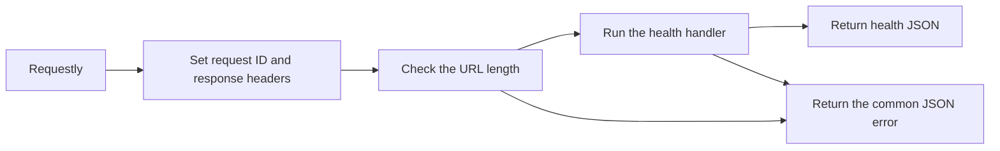

# API guide

Use `http://127.0.0.1:3000` with the local settings. Start the API in your terminal as described in [setup](setup.md). Authentication and finance endpoints do not exist yet.

## Health requests

| Request | Response |
| --- | --- |
| `GET /health/live` | `200` with `{"status":"ok"}`. Makes no database query. |
| `GET /health/ready` | Runs `SELECT 1` through Drizzle. Returns the same success body, or `503` with error code `DATABASE_UNAVAILABLE`. |
| `HEAD` on either health URL | Uses the GET behavior and returns headers without a body. |

Readiness uses the existing database timeouts. It has no separate deadline or connection-reservation logic.

Every response has a server-generated `X-Request-Id` and `Cache-Control: no-store`. The server ignores any request ID supplied by a client. Browser security headers include `X-Content-Type-Options: nosniff`. Local HTTP responses do not include Strict-Transport-Security, which tells browsers to require HTTPS.

## Errors

All API errors use this shape:

```json
{
  "error": {
    "code": "NOT_FOUND",
    "message": "The requested resource was not found.",
    "status": 404,
    "requestId": "4d598d39-dc7a-4ca5-aab6-509ad69080d1",
    "timestamp": "2026-10-29T18:30:00.000Z"
  }
}
```

The request ID matches the response header. The timestamp uses UTC. Unexpected failures return a generic message; responses do not include raw exceptions, submitted bodies, or SQL details.

| Status | Code | Meaning |
| --- | --- | --- |
| `400` | `INVALID_INPUT` | The JSON body is empty or malformed. |
| `404` | `NOT_FOUND` | No resource matches the URL. |
| `405` | `METHOD_NOT_ALLOWED` | The URL exists but does not support that method. `Allow` lists supported methods. |
| `413` | `PAYLOAD_TOO_LARGE` | A request body exceeds 65,536 bytes, or 64 KiB. |
| `414` | `URI_TOO_LONG` | The full request URL exceeds 8,192 bytes, or 8 KiB. |
| `415` | `UNSUPPORTED_MEDIA_TYPE` | A JSON reader received a content type other than `application/json`. |
| `500` | `INTERNAL_ERROR` | An unexpected application failure occurred. |
| `503` | `DATABASE_UNAVAILABLE` | The readiness query failed. |

In Requestly, send `GET /missing` to see a `404`, or `POST /health/live` to see a `405`. Neither request needs a body. Inspect `X-Request-Id` and, for the method error, `Allow` in the response headers.

## Shared request handling



`src/app.ts` installs the common HTTP behavior from `src/http.ts` before registering routes. Hono identifies unsupported methods and adds the allowed-method list. Successful health responses keep their simple status body.

Hono's body-limit middleware enforces the 64 KiB request limit before handlers run, including streamed bodies without a `Content-Length` header. `readJson` in `src/http.ts` checks for `Content-Type: application/json`, allowing a charset parameter, then calls `c.req.json()` with a safe error for malformed JSON. Each feature will validate its own fields with Valibot. Tests use a test-only POST route; the running application still has only health routes.
