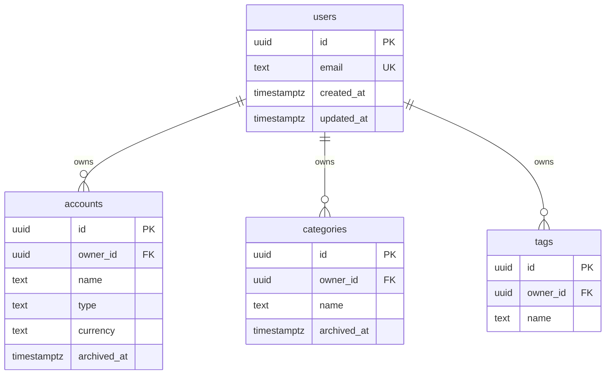
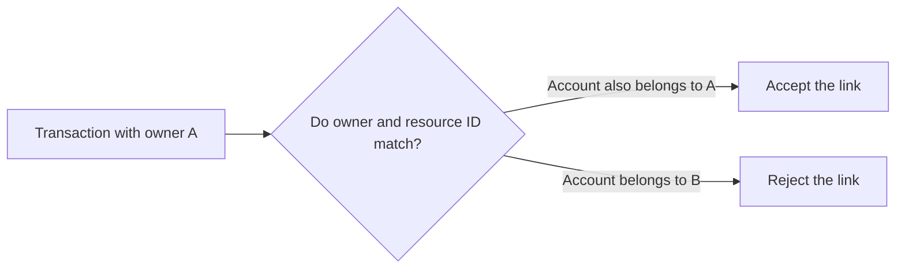
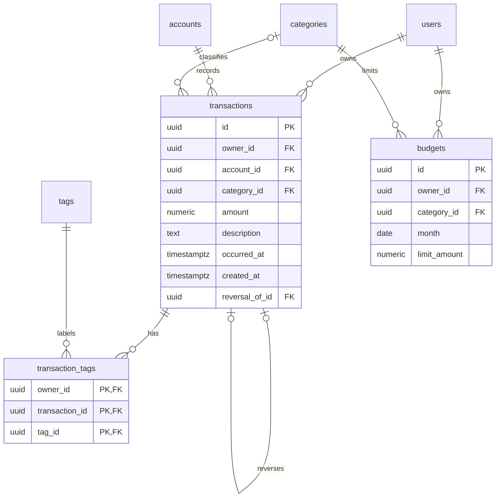
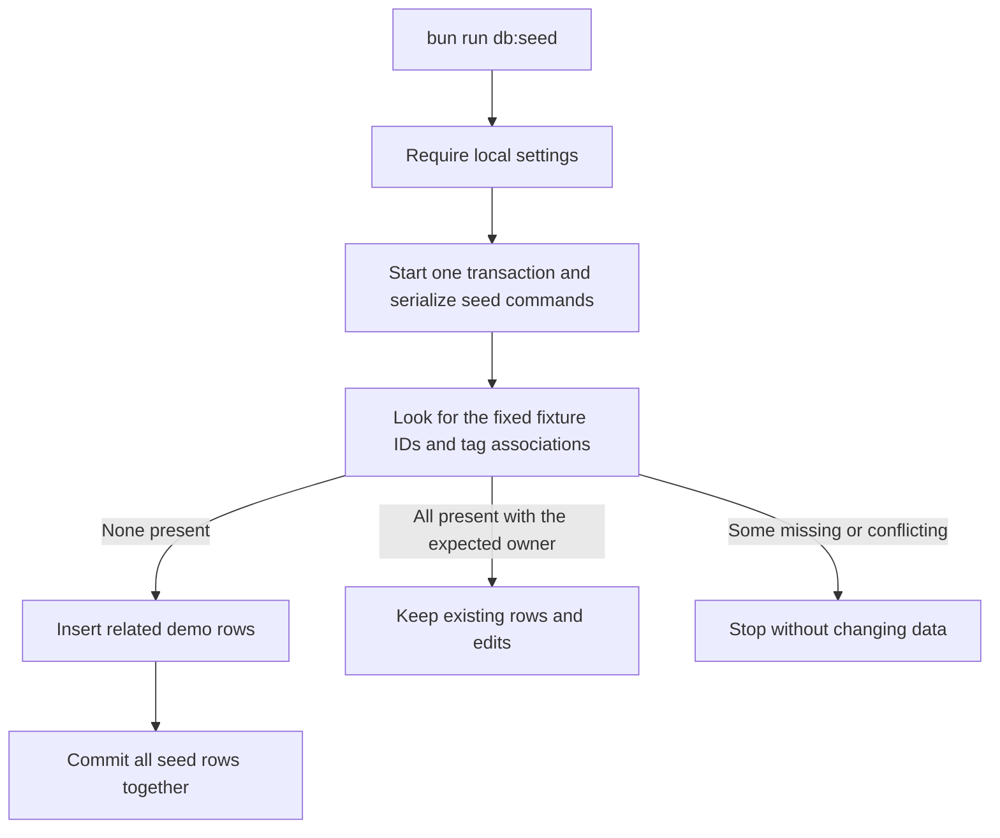
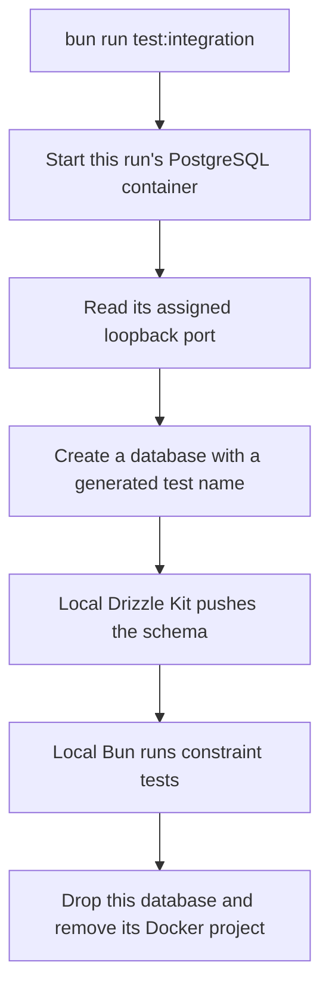

# Database schema and tests

The schema through Gate 6 is defined in [src/db/schema.ts](../src/db/schema.ts). Four reference tables identify owners and organize transactions, tags, and monthly budgets. Gate 7 adds an explicit local demo seed. Business API routes and login are later work.

## How the tables connect



One user can own many accounts, categories, and tags. Every reference must belong to an existing user. PostgreSQL refuses to delete a user while these references exist. Accounts, categories, and tags also have the creation/update timestamps shown on `users`.

A UUID is a generated identifier. A primary key uniquely identifies a row; a foreign key requires a matching row in another table. PostgreSQL generates IDs when callers omit them. `timestamptz` stores a point in time, so an input with a timezone offset still represents the same instant when read in UTC.

## Reference-table rules

| Field or rule | Behavior |
| --- | --- |
| User email | Required, unique, lowercase, without surrounding spaces, and at most 254 characters. A basic email-shape check rejects missing parts and whitespace. It does not verify that the address exists. |
| Reference name | Required, 1–100 characters, without surrounding ordinary spaces or control characters such as tabs and newlines. |
| Name uniqueness | Names ignore case within each table for one owner. `Checking` and `checking` conflict for that owner, but another owner can use the same name. A category and a tag can also share a name. |
| Account type | Required; only `checking`, `savings`, or `cash`. These are text values with an explicit database check. |
| Account currency | Defaults to `USD`; other currencies are rejected. |
| Archive state | Accounts and categories start with `archived_at = null`. Setting a timestamp archives them; clearing it restores them. The name remains reserved while archived. Tags do not have an archive field. |
| Timestamps | All tables have required `created_at` and `updated_at` fields, initially set by PostgreSQL. Later application updates must set `updated_at` explicitly; no automatic update trigger is installed. |

PostgreSQL rejects an uppercase or untrimmed email rather than silently changing it. Future user creation code must normalize the value before inserting it. The same rule applies to trimming names.

## Why there are owner-and-ID pairs

Accounts, categories, tags, and transactions have unique `(owner_id, id)` pairs in addition to their primary keys. Financial relationships reference both fields together. That lets PostgreSQL reject a transaction that names one owner but links to another owner's account or category.



The tests check both valid and cross-owner links. The reference-table suite also creates a small probe table inside a transaction, then rolls it back to remove the probe and its rows.

Each table's name index starts with `owner_id`, then the lowercase name. The owner-and-ID unique index also starts with `owner_id`. These support owner-scoped lookups and owner references; a separate index on `owner_id` alone would duplicate work already covered here. [Drizzle constraints and indexes](https://orm.drizzle.team/docs/indexes-constraints)

## Financial tables



A transaction requires an account and may have a category. `transaction_tags` connects transactions and tags, allowing many tags per transaction and many transactions per tag. A budget belongs to one owner's category for one calendar month. All these relationships enforce matching owners in PostgreSQL.

| Table | Stored rules |
| --- | --- |
| `transactions` | Required owner, account, nonzero signed amount, and finite business timestamp. Description is trimmed, 1–500 characters, without control characters. Creation time defaults to now. There is no update timestamp because financial fields will be immutable through the API. |
| `transaction_tags` | The owner/transaction/tag combination is its primary key, so a tag cannot be attached twice to the same transaction. Both referenced rows must belong to the same owner. |
| `budgets` | Required owner, category, positive `limit_amount`, and finite `month` date on the first day. One budget per owner/category/month. Creation/update timestamps follow the reference-table convention. Drizzle exposes `limit_amount` as `limitAmount`. |

`occurred_at` is the business date used for reports. `created_at` records when the row was inserted. Budget months are date strings such as `2026-01-01`; they do not carry a time of day or timezone.

### Exact money

Positive transactions represent income; negative transactions represent expenses. Account currency is constrained to USD, and this version treats budgets as USD too. Transactions and budget limits allow values up to `999999999999.99` in magnitude. A transaction cannot be zero; a budget limit must be positive. Fractions of a cent, `NaN`, and infinity are rejected.

We use `numeric` with explicit range and whole-cent checks. PostgreSQL's `numeric(14,2)` would round `1.239` before a check could reject it. The selected representation preserves the intended range while refusing that value. Trailing zeros such as `1.2300` are allowed because the value is still an exact number of cents. [PostgreSQL numeric behavior](https://www.postgresql.org/docs/18/datatype-numeric.html)

Drizzle returns money as strings. Later API code must format two decimal places and perform calculations in SQL or another exact representation, never JavaScript floating-point arithmetic. No balance column is stored; account balances will be calculated from transactions.

### Reversals and deletion

An optional `reversal_of_id` points to another transaction belonging to the same owner. A unique rule allows one reversal per original, and a check prevents a row from reversing itself. Two competing reversal inserts cannot both succeed.

PostgreSQL blocks deletion of an account/category referenced by a transaction, a category referenced by a budget, a tag referenced by a tag link, or a transaction referenced by a reversal or tag link. Archiving an account/category preserves its rows and related history. A budget can be edited/deleted, and tag links can be removed explicitly.

The later reversal handler must insert the exact opposite amount and copy the original account, category, business timestamp, and tags atomically. It must also reject reversing a reversal and coordinate writes with archiving. These cross-row business operations are not implemented in this schema gate. Direct administrative SQL remains outside the API's immutability boundary; no trigger makes transaction rows globally read-only.

### Indexes and their purpose

| Lookup | Supporting index |
| --- | --- |
| Owner's transactions in date order | Owner, descending business timestamp, descending ID. The ID gives equal timestamps a stable order. |
| Transactions for an account or category in a date range | Owner/account/date/ID and owner/category/date/ID indexes. Their leading columns also support foreign-key checks. |
| Reversal for an original | Unique `reversal_of_id` index, also useful when checking whether an original is referenced. |
| Tags for a transaction; transactions carrying a tag | Owner/transaction/tag primary key and owner/tag/transaction index. |
| Budget for a category/month; owner's monthly budget list | Unique owner/category/month rule and owner/month/ID index. |

Description substring search has no specialized index yet. The planned API bounds that search; a more complex index should follow a measured need.

## Apply and inspect the schema

From your project terminal:

```bash
bun run db:push
bun run db:studio
```

Review the push before accepting changes. Studio opens at [local.drizzle.studio](https://local.drizzle.studio/?host=127.0.0.1). After the push, expect `users`, `accounts`, `categories`, `tags`, `transactions`, `transaction_tags`, and `budgets`. The tables remain empty until you run the optional seed command.

The API still does not push or seed during startup. Its readiness query works without business rows. Local and production pushes retain strict review, and no migration files are generated.

## Add demo data

After `bun run db:up` and `bun run db:push`, run:

```bash
bun run db:seed
```

The command explicitly loads `.env.local` and requires `APP_ENV=local` before connecting. It never runs during API startup. Production mode is rejected; this is demo data, not a production setup command. Environment labels are a guard, not proof of database identity, so keep local connection settings pointed at your development database.

[demo-data.ts](../src/db/demo-data.ts) defines one owner, `demo@example.test`, two accounts, three categories, two tags, ten transactions, five tag associations, and six monthly budgets. `DEMO_OWNER_ID` is the fixed identity that later API gates will use. All IDs and timestamps are fixed. The data covers January and February 2026, rather than changing with today's date.

| Example | Expected result after a fresh seed |
| --- | --- |
| Checking balance across both months | `6282.90` USD |
| Savings balance | `5000.00` USD |
| January grocery spending after the refund | `80.00` USD |
| Monthly grocery budget | `400.00` USD |

Reference fixtures use [drizzle-seed refinements](https://orm.drizzle.team/docs/seed-overview#refinements) with a fixed seed number and generator version. Financial rows specify exact decimal strings and relationships directly, so their amounts and dates are easy to review. Opening balances are transactions; no separate balance field is maintained.



The transaction makes insertion all-or-nothing. A database lock makes simultaneous seed commands run in order. An existing email or unique-name conflict rolls back the attempt. Unrelated rows are preserved.

A completed seed is detected by its reserved IDs, owner, and original tag associations. Rerunning does not restore names, amounts, dates, or budget values to their original defaults. If you delete a fixture or an original tag association, the next seed reports incomplete fixtures. It does not repair or reset them. Inspect the records in Studio before deciding how to proceed; no reset or automatic deletion command is provided.

## Run the checks

| Command | Purpose |
| --- | --- |
| `bun run check` | Run local type checking, lint, fast tests, and the application build. Database integration tests are discovered but skipped here. |
| `bun run test:integration` | Start temporary PostgreSQL, push the schema into a fresh test database, run schema safeguards and seed behavior tests in local Bun, and clean up. |

The database suites cover a small set of rules declared in our schema: owner isolation, reserved names, money limits, unique reversals and monthly budgets, and protected financial history. They use real tables, including competing reversal inserts. They do not check UUID generation, timestamp conversion, SQL arithmetic, or every field-validation example.

The schema suites cover database safeguards only. Seed tests call our seed operation to check its results, safe repeats, conflicts, concurrent runs, and production rejection. Tests for creating transactions, copying reversal tags, refusing writes to archived accounts, and calculating reports belong at the HTTP boundary when those features exist.

Integration tests deliberately attempt invalid inserts and deletions. A passing test confirms PostgreSQL rejected them with the expected error. The local runner prints test output; database container logs can contain expected `ERROR` entries because those invalid writes are intentional.

## How database tests stay separate

[compose.test.yaml](../compose.test.yaml) defines PostgreSQL only, with fixed test-only credentials and temporary in-memory storage. The local runner assigns a unique project name and publishes its database on an available `127.0.0.1` port. It does not read either real environment file or use persistent database volumes.



The runner connects first to a dedicated admin database named `finance_test`. It creates a fresh database named `finance_test_` followed by a generated identifier. Tests check the actual database name and connected user before clearing fixture rows. Cleanup checks the admin connection again and drops only the database this run created, even if assertions fail. Unexpected credentials, target names, ports, and non-loopback hosts are rejected.

The installed stable Drizzle Kit can propose rebuilding unchanged composite keys or indexes on later pushes. This tooling issue is documented and deferred at the user's request. The integration suite checks the stored financial rules and does not require a repeat push to report no changes. Ordinary local pushes still require review.

The test-only Drizzle configuration applies changes without interactive review because its target is newly created and disposable. It uses no force flags for schema pushes. Ordinary `db:push` still requires review.

Docker chooses a different available port for each run; the runner passes that port to its local Drizzle/test processes. Unique project names keep simultaneous runs from sharing a container. Temporary container storage is independent of local and production data volumes.

The runner attempts cleanup when interrupted. If cleanup fails, it prints the generated project name. Remove that project with `docker compose -p <project-name> -f compose.test.yaml down --remove-orphans`. The old `test:integration:down` command is gone because normal cleanup is automatic. To remove stopped test containers left from the earlier setup once, use `docker compose -f compose.test.yaml down --remove-orphans`.
