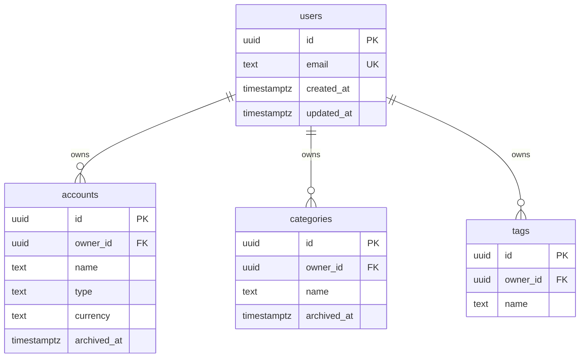
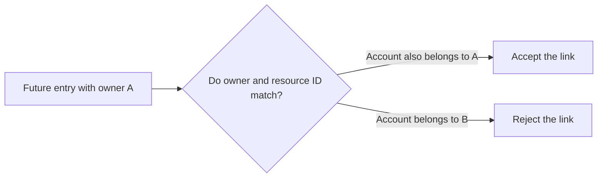
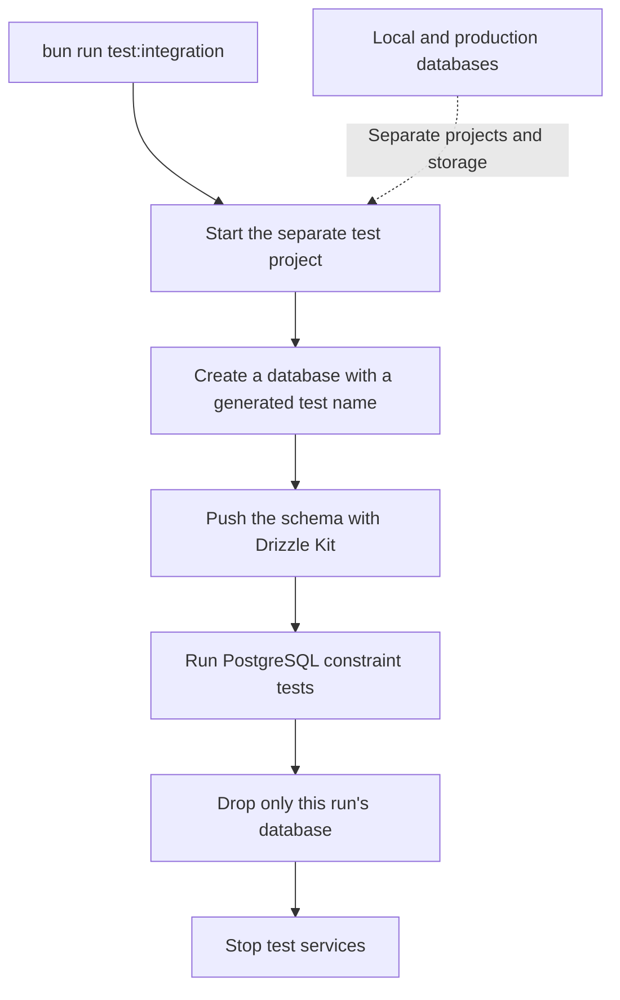

# Database schema and tests

Gate 5 adds four reference tables in [src/db/schema.ts](../src/db/schema.ts). These identify owners and organize future financial entries. Transactions and budgets come in Gate 6; demo rows come in Gate 7. This gate adds no business API routes or login system.

## How the tables connect



One user can own many accounts, categories, and tags. Every reference must belong to an existing user. PostgreSQL refuses to delete a user while these references exist. Accounts, categories, and tags also have the creation/update timestamps shown on `users`.

A UUID is a generated identifier. A primary key uniquely identifies a row; a foreign key requires a matching row in another table. PostgreSQL generates IDs when callers omit them. `timestamptz` stores a point in time, so an input with a timezone offset still represents the same instant when read in UTC.

## Rules PostgreSQL enforces

| Field or rule | Behavior |
| --- | --- |
| User email | Required, unique, lowercase, without surrounding spaces, and at most 254 characters. A basic email-shape check rejects missing parts and whitespace. It does not verify that the address exists. |
| Reference name | Required, 1–100 characters, without surrounding ordinary spaces or control characters such as tabs and newlines. |
| Name uniqueness | Names ignore case within each table for one owner. `Checking` and `checking` conflict for that owner, but another owner can use the same name. A category and a tag can also share a name. |
| Account type | Required; only `checking`, `savings`, or `cash`. These are text values with an explicit database check. |
| Account currency | Defaults to `USD`; other currencies are rejected. |
| Archive state | Accounts and categories start with `archived_at = null`. Setting a timestamp archives them; clearing it restores them. The name remains reserved while archived. Tags do not have an archive field. |
| Timestamps | All tables have required `created_at` and `updated_at` fields, initially set by PostgreSQL. Later application updates must set `updated_at` explicitly; no automatic update trigger is installed. |

PostgreSQL rejects an uppercase or untrimmed email rather than silently changing it. Future user creation code must normalize the value before inserting it. The same rule applies to trimming names.

## Why there are owner-and-ID pairs

Each reference table has a unique `(owner_id, id)` pair in addition to its primary key. Gate 6 can reference both fields together. That lets PostgreSQL reject a transaction that names one owner but links to another owner's account or category.



Gate 5 tests this with a small probe table inside a transaction. The test rolls back the transaction afterward, removing the probe table and its rows. The actual financial tables remain for Gate 6.

Each table's name index starts with `owner_id`, then the lowercase name. The owner-and-ID unique index also starts with `owner_id`. These support owner-scoped lookups and owner references; a separate index on `owner_id` alone would duplicate work already covered here. [Drizzle constraints and indexes](https://orm.drizzle.team/docs/indexes-constraints)

## Apply and inspect the schema

From your project terminal:

```bash
bun run db:push
bun run db:studio
```

Review the push before accepting changes. Studio opens at [local.drizzle.studio](https://local.drizzle.studio/?host=127.0.0.1). After the first push, expect `users`, `accounts`, `categories`, and `tags`. The tables can be empty; no demo rows are created yet.

The API still does not push or seed during startup. Its readiness query works without business rows. Local and production pushes retain strict review, and no migration files are generated.

## Run the checks

| Command | Purpose |
| --- | --- |
| `bun run docker:check` | Run type checking, lint, fast tests, and the application build in Docker. Database integration tests are discovered but skipped here. |
| `bun run test:integration` | Build a test runner, start isolated PostgreSQL, push the schema into a fresh test database, test actual constraints, then remove that database and stop both services. |
| `bun run test:integration:down` | Remove the stopped test containers and their network when desired. It targets only the test Compose project. |

Integration tests deliberately attempt invalid inserts and deletions. A passing test confirms PostgreSQL rejected them with the expected error. The command shows the test runner's output; PostgreSQL's own logs can contain expected `ERROR` lines. To inspect those logs, use `docker compose -f compose.test.yaml logs db`.

## How database tests stay separate

[compose.test.yaml](../compose.test.yaml) uses project name `hono-drizzle-test`. It has its own network, fixed test-only credentials, no published database port, and temporary in-memory storage instead of the local or production data volume. It does not read either environment file.



The runner connects first to a dedicated admin database named `finance_test`. It creates a fresh database named `finance_test_` followed by a generated identifier. Tests check the actual database name and connected user before clearing fixture rows. Cleanup checks the admin connection again and drops only the database this run created, even if assertions fail. Unexpected target settings or names are rejected.

The test-only Drizzle configuration applies changes without interactive review because the target is newly created and disposable. It does not use force flags. Your ordinary `db:push` configuration still requires review.

If a run is interrupted, the test service has temporary storage rather than a persistent volume. Use `bun run test:integration:down` to remove remaining test containers. Normal local database data is separate from this cleanup.
