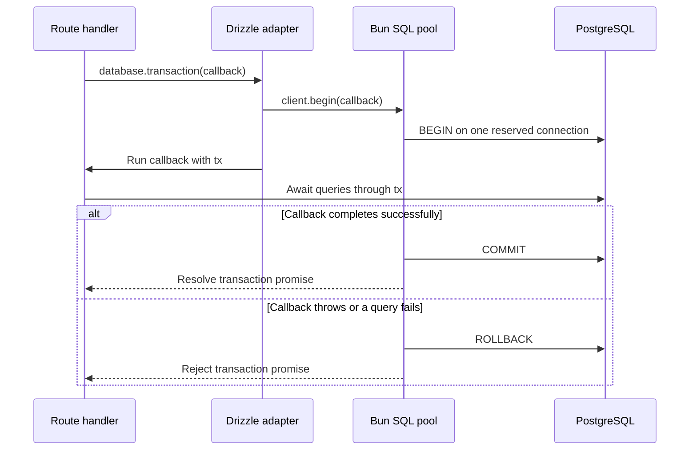

# Database transactions with Bun SQL and Drizzle

A database transaction groups several SQL statements into one operation. Our password-change handler must replace the password hash and delete the user's sessions together. If either write fails, neither should remain applied.

## Who does what

[src/db/client.ts](../src/db/client.ts) creates a Bun `SQL` client with a pool of up to five PostgreSQL connections, then passes it to Drizzle. Drizzle builds queries; Bun sends them to PostgreSQL.

Our code calls `database.transaction(async (tx) => { ... })`. The installed Drizzle Bun SQL adapter delegates that call to Bun's `client.begin(...)` and builds `tx` around the transaction's connection. It does not create another connection pool.

Bun reserves one connection for the transaction and returns it to the pool afterward. All statements in that transaction must use that connection. Inside the callback, use `tx` for database work. Calling the outer `database` object can use another connection and will not join the transaction. See [Bun's transaction documentation](https://bun.sh/docs/runtime/sql#transactions).

Await every query. The callback finishing successfully tells Bun to commit. Throwing an error, including our `ApiError`, causes rollback. Do not swallow an application error and return normally when you intend to roll back. Let failures escape unless the transaction has deliberately recovered from them.

## Our password-change transaction

The handler in [src/features/auth.ts](../src/features/auth.ts) first verifies the current password and computes the replacement hash. This expensive work happens before taking the user-row lock.

Its transaction then:

1. Reads the user with `.for('update')`, which produces `SELECT ... FOR UPDATE`.
2. Checks that the stored hash still matches the hash verified earlier.
3. Updates `password_hash` and `updated_at`.
4. Deletes every session belonging to that user.

The row lock makes competing operations that lock or update that user wait until this transaction ends. It does not block ordinary reads or lock every user. Login takes the same user-row lock and rechecks its previously verified hash before inserting a session. If a password change commits first, an old-password login fails that recheck. If login commits first, the password change deletes the session it just created.

If session deletion fails after the password update, rollback restores the previous password hash and preserves the sessions. A transaction protects the SQL statements executed through `tx`; earlier queries and JavaScript side effects are outside that boundary.

## What happens after commit

Only after `await database.transaction(...)` resolves does the handler clear the browser cookie and return `204`. Cookie headers and HTTP responses cannot be rolled back by PostgreSQL.

If the response is lost after commit, the password is still changed and the old sessions are revoked. The client must log in with the new password. The transaction makes the database writes atomic; it cannot make delivery of the HTTP response atomic too.
