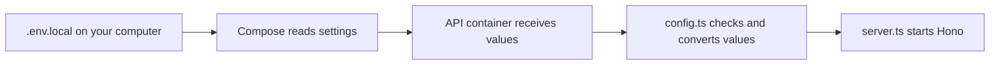
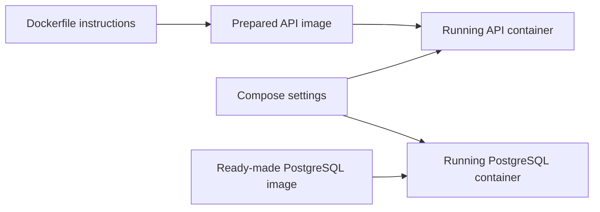
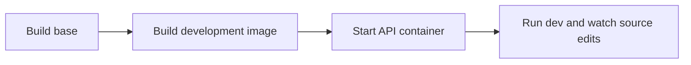
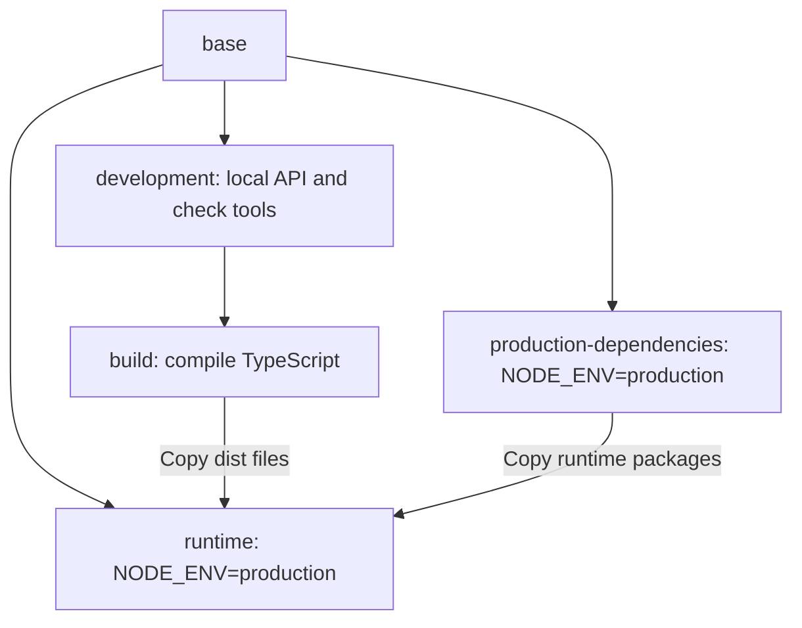
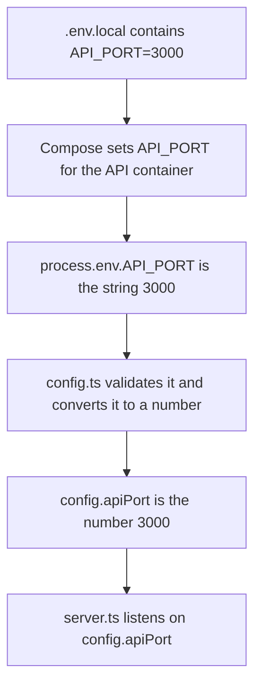
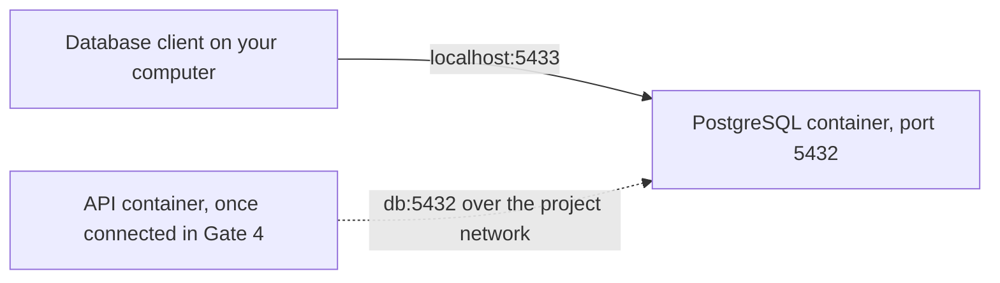
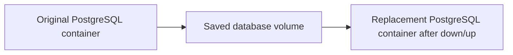
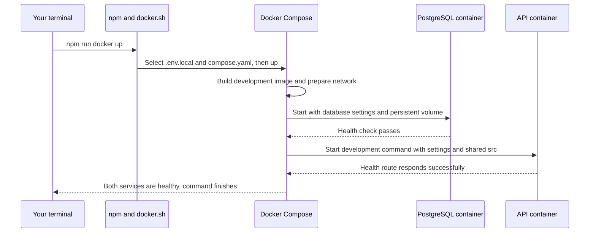

# Docker setup, from startup to each instruction

This guide brings the local startup explanation and the full instruction walkthrough into one document. It follows our [Dockerfile](../Dockerfile) and local [compose.yaml](../compose.yaml) in order, explaining each instruction or small group of related lines.

It describes the project at Gate 3. The API and PostgreSQL run in separate containers. The API does not query PostgreSQL yet; Gate 4 adds that connection.

Use Node.js 24 and npm in your WSL project for editor support. Run the API, PostgreSQL, and verification checks in Docker. Install locked dependencies both locally and in the development image; they remain separate and use the same lockfile. Docker uses Node.js 24.22.1.

## How to read this guide

1. Start with the local settings and startup command below.
2. Read Part 1 for every Dockerfile instruction, then Part 2 for every local Compose section. The application configuration explanation sits beside the Compose settings that supply it.
3. Part 3 follows the running services and shows how to edit, check, and stop them.
4. Part 4 covers dependency updates, production, and troubleshooting as separate workflows.

There is one application configuration path: Compose reads the selected file, passes values into the container, and `config.ts` validates `process.env`. The application has no environment-file reader.

The application has two startup commands: `dev` watches local source edits, and `start` runs compiled production code. Both use supplied environment values. The `docker:*` shortcuts arrange those values for you.

## Prepare the editor

Run `npm ci` in your WSL project folder to install dependencies for type hints, imports, and code navigation. The editor needs these local packages even though the application runs in Docker.

Open the project through your editor's WSL connection. For VS Code, `.vscode/settings.json` points to `node_modules/typescript/lib`. Choose **TypeScript: Select TypeScript Version → Use Workspace Version** if prompted.

For a first setup or after dependency changes, use `npm run docker:rebuild` after preparing `.env.local`. It runs local `npm ci`, builds the API and tools images, and starts or updates services. It does not update the lockfile or run tests. Use `npm run docker:check` separately for verification.

## Prepare your local settings

Copy the example if you have not already created `.env.local`:

```bash
cp .env.example .env.local
```

Replace the example password in your copy. Do not overwrite an existing file when restarting the project.

Your local file supplies these settings:

```dotenv
APP_ENV=local
API_PORT=3000
POSTGRES_PORT=5433
POSTGRES_USER=finance
POSTGRES_DB=finance
POSTGRES_PASSWORD='your-own-password'
```

These are values, not commands. The file does not start the application or install anything.

For the normal Docker workflow, **Compose reads this file. Our API does not read it again.** Compose passes selected values into the containers, and the API reads those supplied values.



The database receives its username, password, and database name from the same file. You maintain one local set of credentials. `compose.production.yaml` and `compose.tools.yaml` are not involved in this local startup.

## Follow the startup shortcut

From the project directory:

```bash
npm run docker:up
```

Your computer's npm looks up this entry in `package.json`:

```json
{
  "scripts": {
    "docker:up": "sh scripts/docker.sh local up"
  }
}
```

That starts [scripts/docker.sh](../scripts/docker.sh) on your computer. The helper selects:

| Argument | What the helper chooses |
| --- | --- |
| `local` | `.env.local` and `compose.yaml` |
| `up` | Build if needed, start services, and wait for health checks. |

It also clears inherited project settings before calling Compose. For example, an old `POSTGRES_PASSWORD` in your terminal will not override the password in `.env.local`.

The resulting Docker command is:

```bash
docker compose --env-file .env.local -f compose.yaml up --build --detach --wait --wait-timeout 120
```

`--detach` leaves the containers running in the background. `--wait` means this command reports success only after their health checks pass.

For `docker:up`, host npm only launches this helper. The separate `docker:rebuild` command first runs `npm ci` locally for the editor, then builds the Docker images and updates services. Neither command runs the API locally.

## Before reading either file

An **image** is a prepared environment containing files, programs, and startup settings. A **container** is an instance of that image that Docker can start and stop.

The **Dockerfile** explains how to prepare our API image. **Compose** explains how to run the API alongside PostgreSQL, including settings, ports, storage, and startup order.



Preparing an image and starting a container are separate actions. This explains the distinction between `RUN` and `CMD` later in the file.

## Part 1. Read the Dockerfile

### The base stage

```dockerfile
FROM node:24.22.1-bookworm-slim AS base
```

Start with a published image containing Node.js and npm. The image name has several parts:

| Part | Meaning |
| --- | --- |
| `node` | The official Node.js image. |
| `24.22.1` | The Node.js version we selected. |
| `bookworm` | The Debian Linux release used inside the image. |
| `slim` | A smaller collection of Linux system packages. It still includes Node.js and npm. |
| `AS base` | Name this stage `base` so other stages can build on it. |

This does not install Node.js on your computer. Docker downloads the image and uses it to prepare our own image.

```dockerfile
WORKDIR /app
```

Make `/app` the working directory inside the image. Docker creates it if necessary. Later commands and relative destination paths use this directory.

`/app` is an internal Linux path. It does not refer to a folder named `app` in your project.

```dockerfile
RUN chown node:node /app
```

Run `chown` while building the image. It gives the existing `node` user and `node` group ownership of `/app`, allowing that user to write there.

The first `node` is the username; the second is the group name. This command still runs as the image's initial administrator user, `root`.

```dockerfile
USER node
```

Switch to the regular `node` user for later build commands and for containers created from this stage. This avoids running our application as an administrator.

The shared `base` stage now has Node.js, a working folder, and a regular user. It does not yet contain our source code or project dependencies.

### The development stage

```dockerfile
FROM base AS development
```

Start a stage named `development` using the contents and settings of `base`. This includes `/app` as the working folder and `node` as the user.

Each `FROM` starts from the stage or image it names. It does not automatically inherit every section written above it.

```dockerfile
COPY --chown=node:node package.json package-lock.json ./
```

Copy the two package files from the build's project directory into `/app`.

- `package.json` declares dependencies and npm scripts.
- `package-lock.json` records the exact dependency versions to install.
- `./` is the destination, relative to `WORKDIR`, so it means `/app/` here.
- `--chown=node:node` assigns ownership as Docker copies the files. It does not run a separate `chown` command afterward.

Why copy these files before the source? Docker remembers completed build steps. When the package files stay unchanged, it can reuse the dependency installation even when application code changes.

```dockerfile
RUN npm ci
```

Install the locked dependency versions during the image build. This includes development tools such as TypeScript, ESLint, and Vitest.

The packages go into `/app/node_modules` inside the image. This build step does not install them into your computer's project folder. Your separate local `npm ci` supplies the editor installation.

```dockerfile
COPY --chown=node:node . .
```

Copy the remaining project files into `/app`, with ownership assigned to `node`.

The first `.` is the source, the build context selected by Compose. The second `.` is the destination, our current working folder inside the image.

`.dockerignore` excludes files before Docker copies them. In this project, that includes real environment files, host `node_modules`, and host `dist` output. Copying the project therefore does not overwrite installed dependencies with a local `node_modules` folder.

```dockerfile
CMD ["npm", "run", "dev"]
```

Record the default startup command for a container created from the development image. The array lists the executable followed by its arguments.

This command does not run while the image is being built. It runs when a container starts, unless Compose supplies a different command.

Our `dev` script is:

```text
tsx watch src/server.ts local
```

`tsx` runs the TypeScript entry point. `watch` restarts it when the entry point or its imported modules change. `local` tells our application which mode the command expects. Configuration always comes from the container environment; there is no application file-reading option.

### Why local development stops here

Local Compose chooses:

```yaml
build:
  target: development
```

Docker prepares `base` and `development`. The later production stages are not required for this target.



The stages themselves do not each become a running application container. They prepare the image from which Compose starts the API container.

### The build stage

```dockerfile
FROM development AS build
RUN npm run build
```

The first line starts from `development`, which already contains source files and build tools. Its inherited `CMD` still does not execute during the image build.

The second line runs TypeScript compilation. Our build script converts application code into JavaScript under `/app/dist`.

This output is used for the production image. Local development can run TypeScript directly through `tsx`.

### The production dependency stage

```dockerfile
FROM base AS production-dependencies
```

Start from `base` again. This stage does not contain the packages installed in `development`, because it does not inherit from that stage.

```dockerfile
ENV NODE_ENV=production
```

Set an environment variable for commands in this stage and containers created from it. Libraries and tools commonly use `NODE_ENV` to select production behavior.

This setting does not change your computer's environment, and it does not reach backward into `development`.

```dockerfile
COPY --chown=node:node package.json package-lock.json ./
RUN npm ci --omit=dev
```

Copy the package files into this stage, then install runtime dependencies without the packages listed under `devDependencies`. Hono is included; Vitest and the TypeScript compiler are left out.

### The final runtime stage

```dockerfile
FROM base AS runtime
```

Start the production image from `base`. It inherits the working folder and regular user, but does not inherit the development packages or source files.

```dockerfile
ENV NODE_ENV=production
```

Set production mode here too. It must be repeated because this stage starts from `base`, not from `production-dependencies`.

```dockerfile
COPY --from=production-dependencies --chown=node:node /app/node_modules ./node_modules
```

Copy the installed packages from another build stage. Here, `--from` changes the copy source from your project files to the named stage's files. The destination is `/app/node_modules` in the runtime image.

```dockerfile
COPY --from=build --chown=node:node /app/dist ./dist
```

Copy compiled JavaScript from the build stage into `/app/dist` in the runtime image. We do not copy that stage's source tree or development tools.

```dockerfile
COPY --chown=node:node package.json ./
```

Copy `package.json` from the project into the runtime image. Its `"type": "module"` setting tells Node how to interpret our `.js` files.

```dockerfile
EXPOSE 3000
```

Document the usual API port. This does not open a port on your computer or force the application to listen on port 3000. Our application reads `API_PORT`; Compose publishes the selected port.

```dockerfile
CMD ["node", "dist/server.js", "production"]
```

When the production container starts, run compiled JavaScript directly with Node. The final argument selects production mode. Our configuration loader always checks values supplied to the container.

### Where NODE_ENV fits



| Setting | What it controls |
| --- | --- |
| `NODE_ENV` | A convention used by libraries and tools. Production stages set it explicitly. Our local setup currently leaves it unset. |
| `APP_ENV` | Our own application setting. It must match the selected `local` or `production` mode. |

You do not enter production mode locally merely because `ENV NODE_ENV=production` appears later in the Dockerfile. The selected stage determines which settings the image inherits.

## Part 2. Read compose.yaml

YAML uses indentation to group settings. For example, settings nested under `api` apply to the API service. A leading `-` introduces an item in a list.

### Project name

```yaml
name: hono-drizzle-local
```

Name the local Compose project. Docker Desktop displays this as an expandable group containing the API and database containers. It is not a single container.

The project name also helps Compose name its resources, including the database volume and network.

### Reusable database settings

```yaml
x-database-settings: &database-settings
  POSTGRES_USER: ${POSTGRES_USER:?Set POSTGRES_USER in .env.local}
  POSTGRES_PASSWORD: ${POSTGRES_PASSWORD:?Set POSTGRES_PASSWORD in .env.local}
  POSTGRES_DB: ${POSTGRES_DB:?Set POSTGRES_DB in .env.local}
```

`x-database-settings` is a custom helper section. It does not define a container. `&database-settings` names this group so later sections can reuse it.

Reusing this group does not select another settings file or create another source of credentials.

The three entries supply the database username, password, and database name. The `:?` syntax requires each value to be present and nonempty. Otherwise, Compose stops and prints the message after `:?`.

Our startup helper explicitly selects `.env.local`. When calling Compose directly, shell variables can override file values. The helper clears inherited project settings first so that file is the source of these values.

### Declare the services

```yaml
services:
```

Everything under this key describes a service Compose can run. We define `api`, `db`, and `tools`. These are names we chose, not special Docker keywords.

### API image selection

```yaml
  api:
    build:
      context: .
      target: development
```

`api` names the service. `build` tells Compose to build its image rather than use only a ready-made image.

`context: .` selects this project's directory as the source of files for the build. Docker uses the `Dockerfile` there by default. `.dockerignore` controls which files are excluded.

`target: development` selects the stage described in Part 1. This is why the local API gets development tools and the source watcher.

### API environment variables

```yaml
    environment:
      <<: *database-settings
      APP_ENV: ${APP_ENV:?Set APP_ENV=local in .env.local}
      API_PORT: ${API_PORT:-3000}
      POSTGRES_PORT: ${POSTGRES_PORT:-5433}
```

Pass these values into the API container's environment.

`*database-settings` references the reusable group. `<<` merges its entries into this list, giving the API the same credentials as PostgreSQL.

`APP_ENV` is required. Compose checks that it is present; our application checks that its value matches local mode.

`${API_PORT:-3000}` means to use the supplied value, or `3000` when missing or empty. The database host port similarly defaults to `5433`.

Selecting a file with Compose's `--env-file` and passing settings to a container are separate steps. The `environment` section is what passes these particular values into the container.

#### Follow these settings into config.ts

`dev` runs `tsx watch src/server.ts local`. The final `local` argument names the expected mode. [src/server.ts](../src/server.ts) passes that argument to `loadConfig` in [src/lib/config.ts](../src/lib/config.ts).

For this startup, `loadConfig` reads `process.env`, which is how Node exposes the container's environment variables. It does not search for files or merge local and production settings.

It then:

1. Checks that the requested mode is recognized.
2. Checks required credentials and validates ports.
3. Converts port strings into numbers.
4. Checks that `APP_ENV=local` matches the `local` startup argument.
5. Returns an ordinary JavaScript object that the server can use.

For example, this value follows one continuous path:



This is why a settings file and `config.ts` both exist. The file stores your choices. Compose delivers them to the container. `config.ts` checks them and makes them usable by application code.

Database credentials follow the same path into `config.database`. The connection address is fixed in that object as `db:5432`, because this project runs its clients inside Docker. At Gate 3, those connection settings are prepared but not used to open a database connection.

If validation fails, startup stops with a message naming the invalid fields. It does not print credential values.

#### Why the startup mode must match APP_ENV

The startup argument says what mode the command expects. `APP_ENV` says what mode the supplied settings belong to. Requiring them to match is a guard against starting the local command with production settings or the other way around.

`NODE_ENV` is separate. It is a convention libraries and tools use, rather than our file selector. Our production Dockerfile stages set it to `production`; the local development stage currently leaves it unset.

### Share source edits

```yaml
    volumes:
      - ./src:/app/src:ro
```

This is a bind mount, which shares a host folder with a container.

| Part | Meaning |
| --- | --- |
| `./src` | The source folder on your computer. |
| `/app/src` | Where the container sees that folder. |
| `ro` | Read-only from the container's perspective. |

Your editor can still save changes to `./src`. The container sees them, and the watcher restarts the API.

The mount covers the `/app/src` files that were copied into the image. It does not replace `/app/node_modules`, so dependencies installed during the image build remain available.

### Publish the API port

```yaml
    ports:
      - "127.0.0.1:${API_PORT:-3000}:${API_PORT:-3000}"
```

With default settings, this becomes `127.0.0.1:3000:3000`.

Read the three parts as your computer's address, your computer's port, and the container's port. A request to `http://localhost:3000` reaches the API listening on port 3000 inside its container.

`127.0.0.1` limits the published connection to your computer. The application itself listens on `0.0.0.0` inside its container so Docker can forward requests to it.

### Wait for PostgreSQL

```yaml
    depends_on:
      db:
        condition: service_healthy
```

Wait for `db` to pass its health check before starting the API. Starting a database process is not the same as being ready to accept connections, so the health condition matters.

This controls startup order. If PostgreSQL later becomes unavailable, Compose does not automatically stop the already-running API. Gate 4 adds application behavior for database failures.

### Handle processes and restarts

```yaml
    init: true
    restart: unless-stopped
```

`init: true` adds a small process that helps forward stop signals and clean up finished child processes. Our development command starts npm, a watcher, and Node, so this is useful when stopping the container.

`restart: unless-stopped` asks Docker to restart the container if it exits unexpectedly. A deliberately stopped container stays stopped until started again.

### Check API health

The file's `healthcheck.test` runs Node with this JavaScript expression. It is shown across several lines here for readability:

```javascript
fetch('http://127.0.0.1:' + process.env.API_PORT + '/health/live', {
  signal: AbortSignal.timeout(2000)
})
  .then(r => process.exit(r.ok ? 0 : 1))
  .catch(() => process.exit(1))
```

The surrounding command starts with `["CMD", "node", "-e", ...]`. `node -e` executes the supplied JavaScript inside the API container. This `CMD` is health-check syntax, not a replacement for the Dockerfile's startup `CMD`.

The request calls the API inside its own container. A successful HTTP response exits with code `0`, meaning success. A failed response or request exits with code `1`, meaning failure. The request has a two-second time limit.

```yaml
      interval: 5s
      timeout: 3s
      retries: 10
      start_period: 10s
```

| Setting | Meaning |
| --- | --- |
| `interval: 5s` | Normally check every five seconds. |
| `timeout: 3s` | Docker stops an individual check after three seconds. |
| `retries: 10` | Ten consecutive failures mark the container unhealthy. |
| `start_period: 10s` | Give startup an initial grace period before failures count. A successful check can establish health earlier. |

Unhealthy status does not itself trigger the restart policy. The policy responds to the container exiting. At this stage, API health checks only prove that the health route responds, not that the API can query PostgreSQL.

### Select the database image

```yaml
  db:
    image: postgres:18.6-bookworm
```

Define the database service and use the published PostgreSQL image directly. We do not need a database Dockerfile.

`db` also becomes the address other containers use to reach this service on the project network. The container uses the `postgres` image, so its service name and image name differ.

### Supply database credentials

```yaml
    environment: *database-settings
```

Use the reusable credential group as the entire environment section. Here no merge is needed because we are not adding other entries alongside it.

On an empty data volume, PostgreSQL uses these settings to initialize its database and user. Changing the environment file later does not automatically change a password already stored in the database.

### Publish a database port

```yaml
    ports:
      - "127.0.0.1:${POSTGRES_PORT:-5433}:5432"
```

Your computer connects through `localhost:5433` by default. Docker forwards that connection to PostgreSQL on port `5432` inside the database container.

The API will use `db:5432` directly. It does not need to go out through the host's published port.

Changing `POSTGRES_PORT` changes the optional host connection only. PostgreSQL's internal port and the API's connection address remain `db:5432`.



Inside the API container, `localhost` would mean the API container itself. It would not mean your computer or the separate PostgreSQL container.

### Attach persistent database storage

```yaml
    volumes:
      - postgres_data:/var/lib/postgresql
```

Attach the named volume `postgres_data` to PostgreSQL's storage folder. This PostgreSQL 18 image keeps version-specific data beneath that parent folder.

Unlike `./src`, `postgres_data` is not a folder in your repository. Docker manages this storage. The volume is declared at the end of the Compose file.

### Check database health

```yaml
    healthcheck:
      test: ["CMD-SHELL", "pg_isready -h 127.0.0.1 -U \"$$POSTGRES_USER\" -d \"$$POSTGRES_DB\""]
      interval: 3s
      timeout: 3s
      retries: 20
      start_period: 10s
```

`CMD-SHELL` runs the following command through the container's shell. The shell expands its variables and runs `pg_isready`, a program included with PostgreSQL.

| Command part | Meaning |
| --- | --- |
| `-h 127.0.0.1` | Contact PostgreSQL inside its own container over a network connection. |
| `-U` | Supply the configured database username. |
| `-d` | Supply the configured database name. |
| `$$POSTGRES_USER` | Leave the variable for the container's shell to expand, rather than expanding it in Compose. |
| `\"` | Include a literal quote inside the YAML string, keeping expanded values together. |

The timing settings work like the API's check, with a three-second normal interval, a three-second timeout, twenty consecutive failures, and a ten-second startup grace period.

`pg_isready` checks whether PostgreSQL accepts connections. It is not a test of application queries or proof that application credentials work. Once it reports success, the API's startup dependency is satisfied.

```yaml
    restart: unless-stopped
```

Give the database the same restart policy as the API.

### Define optional check tools

```yaml
  tools:
    profiles: [tools]
```

Define another service, also called `tools`. The profile makes it optional, so normal `npm run docker:up` does not start it.

`npm run docker:check` selects it for a one-time run. A service name and profile name can be the same, as they are here, but they are separate settings.

```yaml
    build:
      context: .
      target: development
```

Build from the same development stage as the API. This supplies source files, dependencies, TypeScript, ESLint, and Vitest. Docker can reuse unchanged build steps for both services.

```yaml
    volumes:
      - ./src:/app/src:ro
      - ./tests:/app/tests:ro
      - ./scripts:/app/scripts:ro
      - ./tsconfig.json:/app/tsconfig.json:ro
      - ./tsconfig.build.json:/app/tsconfig.build.json:ro
      - ./eslint.config.js:/app/eslint.config.js:ro
      - ./vitest.config.ts:/app/vitest.config.ts:ro
```

Share the latest local code, tests, scripts, and check configuration with the container. Every entry follows the same source/destination/read-only pattern used for the API source mount. Some entries share whole folders; others share one file.

Dependencies still come from the image's `/app/node_modules`. These mounts do not cover that folder.

```yaml
    command: ["npm", "run", "check"]
```

Override the development image's default `CMD`. This container runs checks instead of starting the development server.

The `check` script runs type checking, linting, tests, and compilation, in that order. It stops at the first failure. The helper removes this one-time container after it exits.

This `tools` service belongs to `compose.yaml`. It is different from the service in `compose.tools.yaml`, which exists to update dependencies and write package-file changes back to your project.

### Declare the named volume

```yaml
volumes:
  postgres_data:
```

At the top level, `volumes` declares Docker-managed storage. Under a service, `volumes` attaches storage or shared files to that particular container. The indentation tells you which meaning applies.

The empty entry asks Docker to create the volume with its default settings. The project name gives it the complete name `hono-drizzle-local_postgres_data`.



Normal `npm run docker:down` removes the service containers and project network but keeps this volume. A later `npm run docker:up` reattaches it. Deleting the volume would delete the stored database data.

## Part 3. Put the files together



Both containers keep running after the command returns because the helper uses `--detach`. It also uses `--wait`, so a successful startup command means both health checks passed.

No `networks` section is required here. Compose creates a project network automatically and makes service names such as `db` available on it.

| Question | Current answer |
| --- | --- |
| Does each Dockerfile stage start a container? | No. Stages prepare images and files. Compose starts the requested services. |
| Does local development set `NODE_ENV=production`? | No. The selected development stage does not inherit that setting. |
| Does `COPY` keep files synchronized after building? | No. The local bind mount is what makes new source edits visible. |
| Does `EXPOSE` publish the API on my computer? | No. Compose's `ports` section does that. |
| Are the API and PostgreSQL in one container? | No. Docker Desktop groups their separate containers under the project name. |
| Are installed dependencies in my local `node_modules`? | Yes, for editor support. Containers use a separate installation in the image, from the same lockfile. |
| Does normal shutdown erase my database? | No. The named database volume survives. |
| Does healthy API status prove a database query works? | Not yet. That connection comes in Gate 4. |

### Call the running API

After successful startup, both containers stay running in the background. Call the published API port from your terminal:

```bash
curl http://localhost:3000/health/live
```

Expected response:

```json
{"data":{"status":"ok"}}
```

Expand `hono-drizzle-local` in Docker Desktop to see `api-1` and `db-1`. The project group contains both containers; their images appear separately under Images.

### Edit, check, and stop the local setup

Source edits under `src/` appear in the container through the shared folder. The watcher restarts the API without requiring an image rebuild for each edit.

Use these commands from your computer:

| Task | Command | What happens |
| --- | --- | --- |
| Start services | `npm run docker:up` | Reuse unchanged build steps and apply current settings. |
| Synchronize editor dependencies and rebuild | `npm run docker:rebuild` | Run local `npm ci`, rebuild API and tools images, and update services. |
| Follow logs | `npm run docker:logs` | Show API and database logs until you press Ctrl+C. |
| Run code checks | `npm run docker:check` | Build a development tools image if needed, then run a one-time check container. |
| Stop local services | `npm run docker:down` | Remove service containers and their network while keeping database data. |

The check container uses the same development stage as the API but overrides its startup command with `npm run check`. It reads shared source, tests, and check configuration. Its dependencies remain inside the image. It does not start the source watcher or need real database credentials for the tests themselves. The Compose helper still needs `.env.local` to read the service definitions.

If you change `.env.local`, run `npm run docker:up` to apply the new settings. Editing the file alone does not change the environment of an existing container.

Changing a database password in the file also does not update an existing database's stored password. PostgreSQL uses those initialization values only when the data volume is empty.

Normal shutdown preserves the volume, so restarting restores the same database data. Deleting that volume would delete the saved data.

## Part 4. Other workflows

### Update dependencies and rebuild

From your WSL terminal:

```bash
npm install package-name
npm run docker:rebuild
npm run docker:check
```

`npm install` updates package declarations and the lockfile. `docker:rebuild` first runs local `npm ci`, then builds both development images and starts or updates the local services. Tests remain a separate Docker command, `docker:check`.

After manually changing dependency declarations, update the lockfile with `npm install --package-lock-only` before rebuilding. `npm ci` checks that the package declarations and lockfile agree; it does not resolve changes into a new lockfile.

The local and container installations are independent. Host `node_modules` is ignored by Git, excluded from image builds, and never mounted over container dependencies. Database data stays in its named volume through the rebuild.

`compose.tools.yaml` remains an optional way to update dependencies in Docker. It shares the project so npm can write package files back, while its installed dependencies use temporary storage. For example:

```bash
docker compose -f compose.tools.yaml run --rm tools npm install package-name
npm run docker:rebuild
```

You normally do not need this extra helper in the hybrid workflow. Local `npm ci` is allowed specifically to give the editor the project's packages and types. The application and verification checks still run in Docker.

### Try production

Only when you run `npm run docker:up:production` does the helper select `.env.production` and `compose.production.yaml`.

That flow still reads the selected file, passes values into containers, and validates them in `config.ts`. The production image starts compiled code with `node dist/server.js production` and runs as the regular `node` user. It does not share local source files. What changes is:

| Local startup | Production startup |
| --- | --- |
| `.env.local`, with `APP_ENV=local` | `.env.production`, with `APP_ENV=production` |
| Dockerfile target `development` | Dockerfile target `runtime` |
| Watch TypeScript source edits | Run compiled JavaScript |
| Shared local `src/` folder | Application files come from the image |
| Local database volume and network | Separate production database volume and network |

Use API port `3001` and database host port `5434` in `.env.production` if you want both setups running at once. Supply separate credentials. The volume names are `hono-drizzle-local_postgres_data` and `hono-drizzle-production_postgres_data`. The projects have separate networks as well. These are independent Compose files; we do not combine them.

```bash
npm run docker:up:production
curl http://localhost:3001/health/live
npm run docker:down:production
```

This is a production build example, not a public deployment with authentication and hosting configured. See the [README production steps](../README.md#production-setup) for setup details.

### Inspect a problem or repeat verification

If startup fails, first check service status and logs:

```bash
sh scripts/docker.sh local ps
npm run docker:logs
```

A configuration error names missing or invalid settings. A port conflict means another program is using the selected host port. The API and database health-check sections in Part 2 explain the timing and restart settings.

To repeat the startup and persistence checks after Docker changes:

```bash
sh scripts/verify-docker.sh
```

That script briefly saves a probe row, removes and recreates the local containers, verifies the row survived, and removes its probe table. It also checks the production image. It is a verification tool, not part of every startup.

If your computer has no npm, each Docker shortcut can be replaced by its shell command. For example, `npm run docker:up` and `sh scripts/docker.sh local up` run the same helper.

## References and future updates

The examples above describe this repository's files. Docker documents [build stages](https://docs.docker.com/build/building/multi-stage/), [Compose environment values](https://docs.docker.com/compose/how-tos/environment-variables/variable-interpolation/), [startup dependencies](https://docs.docker.com/compose/how-tos/startup-order/), and [service settings](https://docs.docker.com/reference/compose-file/services/) in more detail.

Update this walkthrough when those files change, especially when Gate 4 adds database readiness and Drizzle tooling. Keep this document as the single active Docker explanation. The two source notes remain unchanged in `docs/archive/` for reference; the [README](../README.md) provides a shorter command reference.
