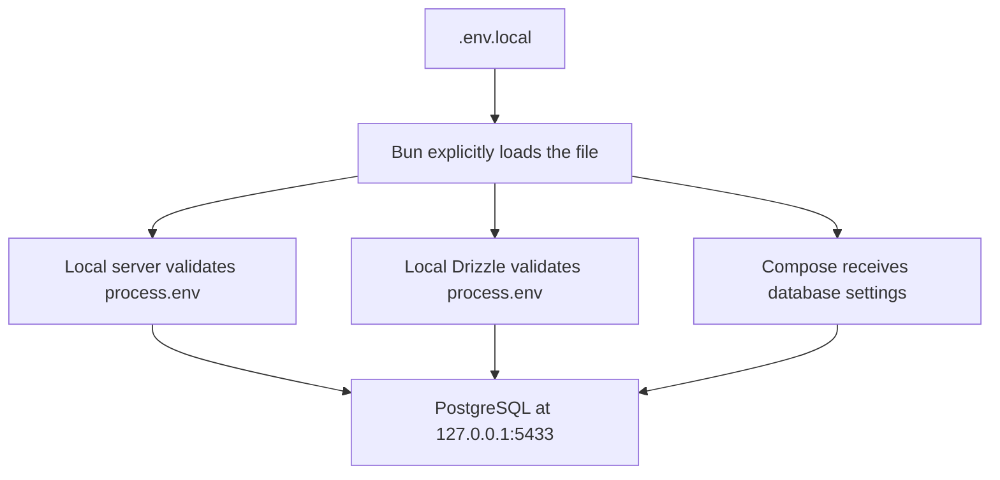
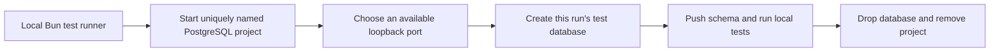
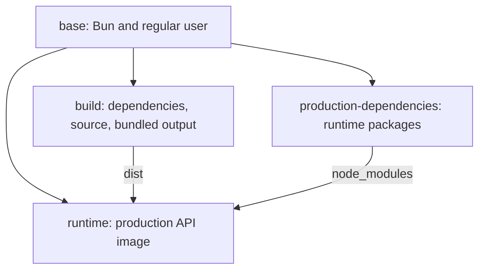

# Local development and Docker walkthrough

Run Bun, Hono, and Drizzle directly in your WSL distro or local terminal. Docker runs PostgreSQL. Build the API container when checking deployment, rather than for each development change.

This guide follows the files in startup order. The [README](../README.md) is the shorter command reference; the [database guide](database-guide.md) explains table rules and database tests. The previous container-development walkthrough is retained locally under `docs/archive/docker-guide-before-local-development.md`; Git also records the earlier version.

## 1. Install once, then start the database

Use Bun 1.3.14 and Docker Compose. In WSL, enable the distro in Docker Desktop's WSL Integration settings.

```bash
bun install --frozen-lockfile
cp .env.example .env.local
```

Replace the example password. For an existing project, keep the current database name and credentials. The lockfile fixes dependency versions, and the local `node_modules` supplies both runtime packages and editor types. There is no separate development-container installation.

```bash
bun run db:up
```

The script in `package.json` expands to:

```bash
bun --env-file=.env.local run docker compose -f compose.yaml up --detach --wait --wait-timeout 120 --remove-orphans
```

Bun first loads the selected settings, then runs Docker Compose with them. `--detach` leaves PostgreSQL in the background. `--wait` waits for its health check, for up to 120 seconds. `--remove-orphans` removes old services from this same project, including the former API/Studio containers.

### Read compose.yaml

```yaml
name: hono-drizzle-local
```

The fixed project name preserves the existing database volume name during this workflow change. It groups this project's database container and network in Docker Desktop. Two clones with this same project name would share those Docker resources; change the project name deliberately if independent clones are needed.

```yaml
services:
  db:
    image: postgres:18.6-bookworm
```

This file now defines just one service. `db` is its name, and the image pins PostgreSQL 18.6 on Debian. Starting local development does not build or start an API image.

```yaml
    environment:
      POSTGRES_USER: ${POSTGRES_USER:?Set POSTGRES_USER in .env.local}
      POSTGRES_PASSWORD: ${POSTGRES_PASSWORD:?Set POSTGRES_PASSWORD in .env.local}
      POSTGRES_DB: ${POSTGRES_DB:?Set POSTGRES_DB in .env.local}
```

Compose requires these values, which Bun's command supplies from `.env.local` or inherited terminal settings. PostgreSQL uses them to initialize an empty data volume. Editing the file afterward does not change an existing database password or rename its database.

Bun expands `$VARIABLE` even inside quoted values. Escape a literal reference as `\$VARIABLE`. A dollar sign at the end of the value should remain unescaped in Bun 1.3.14. Loading settings through Bun for both database and application commands keeps their password interpretation consistent. Passwords remain separate connection fields; URL encoding is unnecessary.

```yaml
    ports:
      - "127.0.0.1:${POSTGRES_PORT:-5433}:5432"
```

The parts mean:

| Part | Purpose |
| --- | --- |
| `127.0.0.1` | Publish only on your computer's loopback address. |
| `${POSTGRES_PORT:-5433}` | Use the chosen host port, or `5433` when unset. |
| `5432` | PostgreSQL's listening port inside its container. |

The local API and Drizzle connect to `127.0.0.1:5433`. The name `db` belongs to the Docker network; local application code does not use it.

```yaml
    volumes:
      - postgres_data:/var/lib/postgresql
```

Mount a named Docker volume at PostgreSQL 18's data-directory parent. This is separate from the project source folder. The full volume name is `hono-drizzle-local_postgres_data`. It survives container replacement and normal shutdown.

```yaml
    healthcheck:
      test: ["CMD-SHELL", "pg_isready -h 127.0.0.1 -U \"$$POSTGRES_USER\" -d \"$$POSTGRES_DB\""]
      interval: 3s
      timeout: 3s
      retries: 20
      start_period: 10s
```

Run `pg_isready` inside the database container. `$$` leaves a dollar sign for that container's shell to expand, rather than Compose expanding it first. Check every three seconds, allow each check three seconds, and allow initial startup time. This checks PostgreSQL availability; the API's readiness route separately checks an actual application query.

```yaml
    restart: unless-stopped
```

Restart the database after an unexpected exit or Docker restart, unless deliberately stopped.

```yaml
volumes:
  postgres_data:
```

Declare the named volume. The empty entry uses Docker's default volume settings. No custom network is needed for this one-service development file.

## 2. Apply the schema and run the local API

```bash
bun run db:push
bun run dev
```

`db:push` runs local Drizzle Kit with the selected file and strict review. It compares [src/db/schema.ts](../src/db/schema.ts) with PostgreSQL and applies accepted changes. It creates no migration files. Startup does not run this command automatically.

`dev` runs:

```bash
bun --env-file=.env.local --watch src/server.ts local
```

Bun reads the chosen file and watches imported source files. Edits restart the process. `local` names the expected application mode, which must match `APP_ENV`. Local mode listens on `127.0.0.1`, so the API is accessible from your own machine.

### Follow the settings



There is one application validation function, [src/lib/config.ts](../src/lib/config.ts). It reads supplied values; it does not read files, inspect Docker, or switch database addresses based on where it thinks it is running. Both API and Drizzle use it.

`POSTGRES_HOST` defaults to `127.0.0.1`, and `POSTGRES_PORT` defaults to `5433`. Deployment supplies a different address explicitly. `APP_ENV` checks the selected mode; it does not determine the database address.

[bunfig.toml](../bunfig.toml) disables automatic environment-file loading. Commands that need local settings select `.env.local` explicitly. Checks and builds do not need database credentials. Exported terminal values take precedence over file values. If settings appear wrong, check exported overrides without printing passwords.

### Studio

```bash
bun run db:studio
```

Studio runs in this terminal on `127.0.0.1:4983`. Open [local.drizzle.studio](https://local.drizzle.studio). Keep the command running while browsing; Ctrl+C stops it. No Studio container, published port, background-service command, or separate stop shortcut is needed.

If a previous Studio process holds the port, stop its terminal session. If the browser blocks the connection, allow its Apps on device or local/loopback network permission and reload. [Drizzle Studio documentation](https://orm.drizzle.team/docs/drizzle-kit-studio)

## 3. Edit, check, and stop

| Task | Command or action |
| --- | --- |
| Edit API code | Save files; Bun's watcher restarts the local process. |
| Check code | `bun run check` |
| Test real database rules | `bun run test:integration` |
| Add a dependency | `bun add package-name`, then `bun run check` |
| Follow database logs | `bun run db:logs` |
| Stop the API or Studio | Ctrl+C in its terminal. |
| Stop PostgreSQL | `bun run db:down` |

`check` runs type checking, lint, fast tests, and bundling. The fast suite skips PostgreSQL integration tests. No image rebuild is required after a source or dependency change. Commit `bun.lock` with package changes, and keep `node_modules` out of Git.

The API keeps its ten-connection pool and bounded connection/query waits. `/health/live` checks the process; `/health/ready` runs a database query within three seconds. An outage returns `503` without revealing database error details. On Ctrl+C or SIGTERM, Bun waits for active HTTP requests, closes the pool, then exits within the ten-second shutdown deadline.

`db:down` only controls Docker resources. It preserves the named volume and does not stop a locally running API or Studio process. Deleting the volume, including with Docker's `--volumes` option, deletes stored database data.

## 4. Integration tests use temporary PostgreSQL

`bun run test:integration` runs [scripts/test-integration.ts](../scripts/test-integration.ts) locally. This script handles the database lifecycle so you do not need separate test startup/cleanup commands.



[compose.test.yaml](../compose.test.yaml) describes PostgreSQL only. It uses fixed test-only credentials, temporary in-memory storage, and `127.0.0.1::5432` to request an available host port. The runner reads that port from Docker and passes it to its local test process.

Every run gets a unique project and database name. Name, connection identity, credentials, and loopback-address guards protect setup and cleanup. The runner removes its project after tests pass or fail and attempts cleanup on interruption. If interrupted cleanup cannot finish, it prints the generated project name; use `docker compose -p <project-name> -f compose.test.yaml down --remove-orphans` to remove that project.

This test configuration does not read real environment files or mount the local/production volume. See the [database guide](database-guide.md) for fixture and constraint details.

## 5. Build the deployment image separately

```bash
bun run docker:build
```

This builds `hono-drizzle-api` from the Dockerfile's `runtime` stage. It starts no container. A CI system can run this after local-style code and integration checks. CI/CD means automated checks and deployment steps; this repository does not configure a provider or publish an image yet.

### Read the Dockerfile

```dockerfile
FROM oven/bun:1.3.14-debian AS base
WORKDIR /app
RUN chown bun:bun /app
USER bun
```

Use the pinned Bun Debian image and name the shared stage `base`. Make `/app` the working directory. Give the image's existing `bun` user and group ownership while still building as root, then switch to that regular user. Following stages inherit the working directory and user; neither is a host-machine setting.

```dockerfile
FROM base AS build
COPY --chown=bun:bun package.json bun.lock bunfig.toml ./
RUN bun install --frozen-lockfile
COPY --chown=bun:bun . .
RUN bun run build
```

Start a build stage from `base`. Copy package/configuration files before source so Docker can reuse dependency installation when only source changes. `--chown` assigns ownership during copying. `./` is relative to `/app`.

Install exact locked dependencies, including build tools. Copy the project, then run Bun's bundler. It builds `src/server.ts` and its local imports into `dist/server.js`, with a source map. `--target=bun` selects Bun output; `--packages=external` leaves installed packages in `node_modules`. Bundling is separate from TypeScript checking, so CI should run `check` too.

The two dots in `COPY . .` mean the build context and current destination. `.dockerignore` excludes real environment files, host dependencies, Git metadata, and old build output. No source folder is mounted into the runtime container.

```dockerfile
FROM base AS production-dependencies
ENV NODE_ENV=production
COPY --chown=bun:bun package.json bun.lock bunfig.toml ./
RUN bun install --frozen-lockfile --production
```

Start independently from `base`, without inheriting development packages. Set production library behavior and install runtime dependencies only. Hono, Drizzle ORM, and `pg` remain; TypeScript, ESLint, and Drizzle Kit stay out. `NODE_ENV` is a library convention also supported by Bun; its name does not select a Node.js runtime.

```dockerfile
FROM base AS runtime
ENV NODE_ENV=production
COPY --from=production-dependencies --chown=bun:bun /app/node_modules ./node_modules
COPY --from=build --chown=bun:bun /app/dist ./dist
COPY --chown=bun:bun package.json bunfig.toml ./
EXPOSE 3000
CMD ["bun", "--no-env-file", "dist/server.js", "production"]
```

Start the final stage from the clean base. Repeat `NODE_ENV` because this stage does not inherit the production-dependency stage's settings. Copy its runtime packages and the build stage's JavaScript output. Copy package/Bun configuration so module handling and environment loading remain explicit.

`EXPOSE` documents the usual port; it does not publish it on your computer. `CMD` records the command run when a container starts. Bun runs the built server directly, using supplied environment values and expecting `APP_ENV=production`. The image includes no credentials, schema-push tool, tests, or development watcher.



Stages prepare files and images; each stage does not become a separate running service. `RUN` executes during the image build. `CMD` executes later when the final image starts.

## 6. Optional production-build example

[compose.production.yaml](../compose.production.yaml) runs the runtime image and PostgreSQL together for a deployment-style check. It is separate from everyday development. The README shows commands using an explicitly selected `.env.production` file.

Its API receives `POSTGRES_HOST=db` and `POSTGRES_PORT=5432` because both services share a Docker network. The host port, suggested as `5434`, is for local administration tools. The API waits for PostgreSQL health; its own health check calls `/health/ready`. Docker allows fifteen seconds for the API's ten-second shutdown sequence.

The production project and volume have different names from development. This prevents their storage from being mixed. The example publishes only on loopback and does not configure public hosting, TLS, or authentication.

Docker documents [build stages](https://docs.docker.com/build/building/multi-stage/) and [containerized databases](https://docs.docker.com/guides/databases/). Bun documents [explicit environment files](https://bun.com/docs/runtime/environment-variables).
