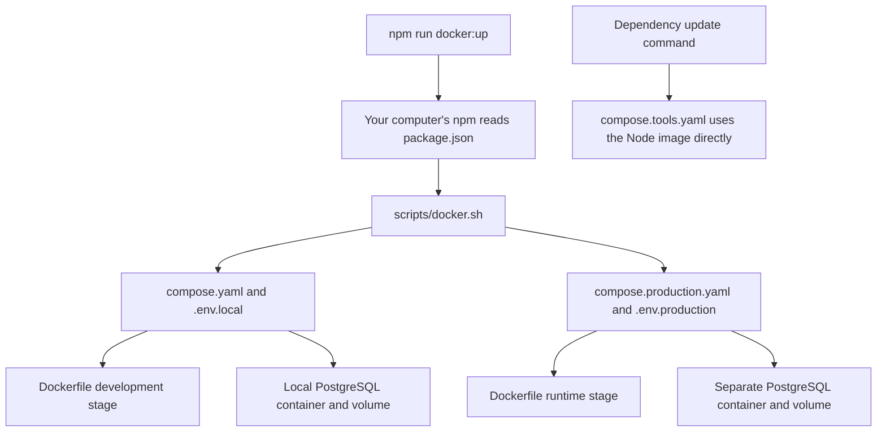
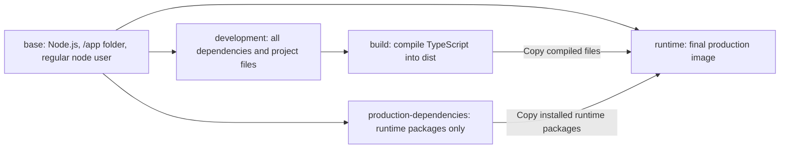
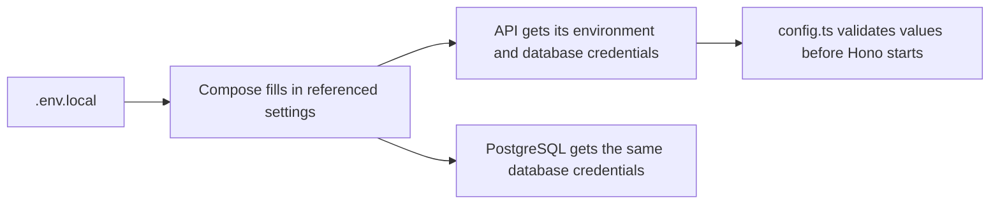
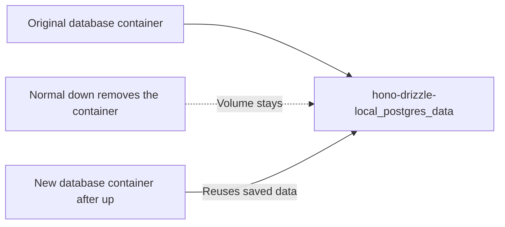

# How this project's Docker setup works

This guide explains the setup verified at the end of Gate 3. PostgreSQL and the API run together, but the API does not query the database yet. Gate 4 will add Drizzle, database readiness, and database tools.

This guide assumes your computer already has Node.js and npm, and uses the `npm run docker:*` shortcuts first. Your computer's npm only launches the Docker helper. The application, dependency installation, and checks still run inside Docker. You do not need to run `npm install` on your computer to use these shortcuts.

If your computer has no Node.js installation, use the equivalent `sh scripts/docker.sh ...` commands shown below. Both approaches run the same setup.

Start with sections 1–3 to understand the files. Sections 4–7 explain where settings and files live. The final sections cover everyday changes and troubleshooting. The [README](../README.md) has the shorter command reference.

## 1. The pieces in plain language

| Term | Meaning in this project |
| --- | --- |
| Image | A prepared environment containing Node.js and our API, or PostgreSQL. Docker can reuse it to create containers. |
| Container | A running instance of an image. Our API and database run in separate containers. |
| Dockerfile | Instructions for building our API images. |
| Compose | The Docker tool that starts related containers with the right settings, connections, and storage. |
| Service | A named job in a Compose file, such as `api`, `db`, or `tools`. |
| Bind mount | A shared folder or file from your computer that a container can access. We use this for source edits. |
| Named volume | Storage managed by Docker. We use this to keep database data between runs. |

The PostgreSQL image comes ready-made from its maintainers. Our Dockerfile builds the API image using a ready-made Node.js image as its starting point.

## 2. Which file does what?

| File | Responsibility | When you use it |
| --- | --- | --- |
| [`Dockerfile`](../Dockerfile) | Builds development and production API images. | Compose uses it when building or rebuilding. |
| [`compose.yaml`](../compose.yaml) | Defines the local API, database, and optional checks container. | Everyday development. |
| [`compose.production.yaml`](../compose.production.yaml) | Defines a separate API/database setup using compiled application code. | Trying the production build. |
| [`compose.tools.yaml`](../compose.tools.yaml) | Starts a temporary Node.js container with access to your project files. | Adding dependencies or updating the lockfile. |
| [`scripts/docker.sh`](../scripts/docker.sh) | Selects the right Compose file and environment file, then runs your command. | Starting, stopping, checking, or viewing logs. |
| [`scripts/verify-docker.sh`](../scripts/verify-docker.sh) | Checks code, startup, database persistence, and the runtime image. | Verifying Docker changes; not needed for each edit. |
| [`.env.example`](../.env.example) | Lists the settings to copy into a private environment file. | Initial setup. |
| `.env.local` / `.env.production` | Hold settings and credentials for one environment. | Compose reads the selected file at startup. |
| [`.dockerignore`](../.dockerignore) | Excludes files from the image-building process, including real environment files. | Docker uses it during builds. |
| [`package.json`](../package.json) | Defines application commands and the recommended `docker:*` shortcuts. | Your computer's npm launches Docker shortcuts; container npm runs application commands. |

The three Compose files are separate entry points. We do not combine them. Both local and production use the same Dockerfile, choosing different stages.



## 3. Follow one startup command

```bash
npm run docker:up
```

1. Your computer's npm reads `docker:up` from `package.json` and runs `sh scripts/docker.sh local up`. The helper changes to the project directory and selects `compose.yaml` and `.env.local`.
2. The script clears inherited project settings so credentials already present in the terminal cannot override the selected file.
3. Compose reads `.env.local` and fills in the settings referenced by `compose.yaml`.
4. Docker builds the API's development image if necessary and obtains the PostgreSQL image if it is missing.
5. Compose starts PostgreSQL with its named data volume attached.
6. PostgreSQL's health check must pass before Compose starts the API.
7. The API validates its settings and starts Hono. A second health check requests `/health/live`.
8. Once both services are healthy, the command finishes. The containers keep running in the background.

The script uses this underlying command, with an additional 120-second wait limit:

```bash
docker compose --env-file .env.local -f compose.yaml up --build --detach --wait
```

| Part | Meaning |
| --- | --- |
| `--env-file .env.local` | Select this settings file. |
| `-f compose.yaml` | Select this Compose file. |
| `up` | Create or update the services and start them. |
| `--build` | Check whether the application image needs rebuilding. |
| `--detach` | Keep the services running after the command returns. |
| `--wait` | Wait for the services to become healthy. |

The optional `tools` service is under the `tools` profile, so normal startup does not run tests. `npm run docker:check` selects that service separately.

## 4. How the Dockerfile prepares the API

The Dockerfile has named stages. A stage can build on another stage or copy selected files from it. This lets us prepare different images in one file. [Docker's guide to build stages](https://docs.docker.com/build/building/multi-stage/)



Local Compose chooses `target: development`. Its image starts `npm run dev:container`, which watches source edits and runs the API with local settings supplied by Compose.

Production Compose chooses `target: runtime`. Its image starts compiled code with `node dist/server.js production environment`. It contains no TypeScript compiler, test suite, or shared source folder.

These Dockerfile instructions explain most of the build:

| Instruction | What it does here |
| --- | --- |
| `FROM ... AS ...` | Starts a named stage from the Node.js image or an earlier stage. |
| `WORKDIR /app` | Makes `/app` the working folder inside the image. |
| `COPY` | Copies selected project files into the image during a build. |
| `RUN npm ci` | Installs the exact dependencies recorded in `package-lock.json` during a build. |
| `USER node` | Runs later commands as the regular `node` user. |
| `CMD` | Sets the default command a container runs when started. |
| `EXPOSE 3000` | Documents the usual API port. Compose's `ports` setting actually publishes access from your computer. |

We copy the package files before installing dependencies, then copy the remaining project files. If only source files change, Docker can reuse the earlier dependency-install step. That is what `CACHED` means in build output. [Docker's explanation of build caching](https://docs.docker.com/build/cache/)

## 5. Where settings come from

There are two steps: Compose reads a file, then supplies selected values to containers. `--env-file` alone does not automatically put every value into a container; the Compose `environment` sections specify which values to pass.



For example, `${POSTGRES_USER:?Set POSTGRES_USER in .env.local}` means that the value is required. `${API_PORT:-3000}` means to use `3000` when the value is missing or empty.

The `&database-settings`, `*database-settings`, and `<<` syntax reuses the credential settings within each YAML file. This prevents us from maintaining separate credential lists for the API and database.

The application also supports reading an environment file directly. That is what `npm run dev` does. The main Compose setup uses `dev:container` instead, so the API receives settings without needing a secret file mounted into its container.

`.gitignore` keeps private files out of Git. `.dockerignore` keeps them out of image builds. These are separate controls. A bind mount can still share an ignored file, which is why the main local API shares only `src/` rather than the entire project.

Production follows the same process with `.env.production`. The API rejects settings whose `APP_ENV` does not match the selected mode.

## 6. How ports and container names connect

```yaml
ports:
  - "127.0.0.1:5433:5432"
```

Read this as: accept connections on your computer's address `127.0.0.1`, port `5433`, and forward them to port `5432` inside the database container.

| Caller | Address | Reason |
| --- | --- | --- |
| Your computer calling the local API | `localhost:3000` | The API port is published on your computer. |
| A database client on your computer | `localhost:5433` | Docker forwards it to PostgreSQL's internal port. |
| The API or future database tools inside the Compose network | `db:5432` | Compose makes the database service available by its service name, `db`. |

Inside a container, `localhost` means that container itself. The API must use `db` to reach the separate database container. Changing the published database port does not change `db:5432`.

## 7. Where files and dependencies live

The two kinds of tools container have different jobs and different storage arrangements.

| Location | Main API / normal checks | Bootstrap helper in `compose.tools.yaml` |
| --- | --- | --- |
| Source code | Built into the image, with selected local files shared over it during development. | The entire project is shared at `/app`. |
| `node_modules` | Installed in the development image and reused. | A temporary folder covers `/app/node_modules`. Dependencies disappear when the container stops. |
| Changes to package files | Rebuild after updating them outside this container. | Written back to your project through the shared folder. |
| Compiled `dist/` | Check-container output disappears when that container is removed. Production build output is copied into the runtime image. | If you explicitly run a build here, output is written back to your project. |

In the main local API, `./src:/app/src:ro` shares your source folder at `/app/src`. `ro` means the container can read it but cannot edit your original files. Your editor can still change them, and the development watcher sees those changes.

The old bootstrap helper uses `tmpfs`, which provides temporary storage for dependencies. Its `exec` option allows tools such as esbuild to run programs stored there. The empty host `node_modules` folder it may leave is just an attachment point; it does not contain the installed packages. [Docker's temporary-storage guide](https://docs.docker.com/engine/storage/tmpfs/)

## 8. Why database data survives shutdown

The database mounts `postgres_data` at `/var/lib/postgresql`. PostgreSQL writes its database files there. For this PostgreSQL 18 image, that parent folder contains the version-specific data directory.



Local and production have different project names, so Compose creates different networks and volumes for them. Their complete volume names are listed in the README.

Normal `down` preserves data. Adding `--volumes` deletes the Compose-managed named volume and its database data. Rebuilding an API image does not modify that volume.

PostgreSQL initializes its username, password, and database when the volume is empty. Editing `.env.local` afterward does not change an existing database password. Keep the settings consistent with the database already stored in the volume. [Official PostgreSQL image documentation](https://hub.docker.com/_/postgres)

## 9. Which command should I use?

| Task | npm shortcut | Equivalent without host npm |
| --- | --- | --- |
| Start or rebuild local services | `npm run docker:up` | `sh scripts/docker.sh local up` |
| Follow local logs | `npm run docker:logs` | `sh scripts/docker.sh local logs` |
| Stop local services and keep data | `npm run docker:down` | `sh scripts/docker.sh local down` |
| Run type checks, lint, tests, and compilation | `npm run docker:check` | `sh scripts/docker.sh local check` |
| Start the production example | `npm run docker:up:production` | `sh scripts/docker.sh production up` |
| Follow production logs | `npm run docker:logs:production` | `sh scripts/docker.sh production logs` |
| Stop production services and keep data | `npm run docker:down:production` | `sh scripts/docker.sh production down` |

These less frequent commands do not currently have npm shortcuts:

```bash
# View local container status.
sh scripts/docker.sh local ps

# Validate local Compose settings without starting services.
sh scripts/docker.sh local config

# Repeat the Docker smoke test.
sh scripts/verify-docker.sh
```

Run the `docker:*` shortcuts in your computer's terminal from the project directory. They call the same shell helper shown in the table. Do not run them inside our containers, which do not have Docker installed. By comparison, `npm run dev:container` and `npm run check` are application commands that the Docker setup runs inside containers.

Compose's `up` starts the usual services. `run --rm` creates a separate container for a one-time task and removes it afterward. `exec` runs a command in a container that is already running. The verification script uses `exec` to run PostgreSQL's `psql` command in the database container. [Docker's one-time command reference](https://docs.docker.com/reference/cli/docker/compose/run/)

## 10. What to do after an edit

| You changed | Next action |
| --- | --- |
| A file under `src/` | Save it. The local API restarts automatically. |
| Tests or check configuration | Run `npm run docker:check`; the checks container reads the shared files. |
| `package.json` dependencies | Update the lockfile with the bootstrap helper, then run `npm run docker:check` and `npm run docker:up`. |
| `.env.local` | Run `npm run docker:up` so Compose applies updated settings. Existing database passwords need separate database administration. |
| Dockerfile or Compose files | Run `npm run docker:check` where relevant, then `npm run docker:up`. Use the smoke test to check storage-related changes. |
| Production source code | Run `npm run docker:up:production` to rebuild and replace the running API container. |

The dependency commands are in the README. No lockfile update is needed solely for changing application code.

## 11. Reading output and checking problems

- `Pulled` means Docker downloaded an image. `Built` means it prepared our image. `CACHED` means it reused an unchanged build step.
- `Healthy` means a configured check passed. The current API check tests Hono's health route; it does not yet prove a database connection. Gate 4 will add that check.
- `--wait` stops startup from reporting success before the checks pass. If startup fails, use `sh scripts/docker.sh local ps` and `npm run docker:logs` to see which service needs attention.
- A port conflict means another program or container already uses that host port. Stop the other program or choose different ports in the selected environment file.
- An npm update notice does not by itself mean installation failed. Look for a nonzero exit or an actual error; the checks stop at the first failed command.
- If Docker is unavailable in WSL, check Docker Desktop's WSL Integration setting and try `docker version` in your terminal. The assistant session's socket-access restriction is separate from whether your terminal can run the project.

## 12. When this guide changes

Gate 4 will add the Drizzle connection, schema-push and Studio commands, database readiness, and graceful shutdown. Update this guide alongside those changes. Gate 14 provides a final review of the complete setup and a clean-checkout walkthrough.
