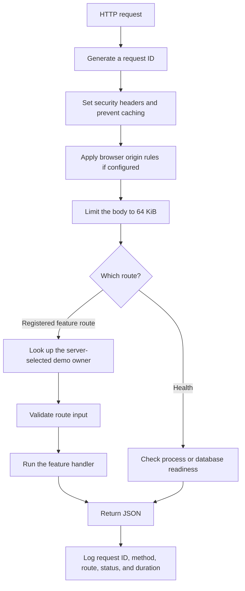

# Shared HTTP behavior

Gate 8 prepares the request handling that feature routes will share. The running application still exposes only `/health/live` and `/health/ready`. Account and category endpoints arrive in Gate 9. Example routes in `tests/http.test.ts` exist only inside tests.

## Follow a request



Errors use the same response format wherever they occur. Browser preflight requests, which ask permission to send a later request, can finish before owner lookup and route handling.

## Request IDs, logs, and headers

Every request gets a new server-generated ID. Responses include it in `X-Request-Id`; error bodies and request logs use that same ID. An incoming `X-Request-Id` does not replace it.

Each request produces one JSON log entry with `requestId`, `method`, `path`, `status`, and `durationMs`. `path` is the route template, such as `/api/v1/accounts/:id`. Unknown routes use `[unmatched]`. Logs do not include actual resource IDs, query strings, request bodies, cookies, authorization headers, or exception messages.

Hono's secure-header middleware supplies browser protections, including `X-Content-Type-Options: nosniff`. Responses use `Cache-Control: no-store`. Request bodies are limited to 65,536 bytes before JSON parsing or owner lookup, including streamed bodies without a declared length.

## Error responses and validation

Errors follow this shape:

```json
{
  "error": {
    "code": "VALIDATION_ERROR",
    "message": "Request values are invalid.",
    "status": 422,
    "requestId": "server-generated-request-id",
    "details": [{ "path": "name", "message": "Invalid value." }]
  }
}
```

`details` is optional. It identifies fields without repeating submitted values. `$` means the whole input, such as an object containing unexpected fields. Unexpected failures return a generic message instead of SQL, credentials, or stack traces.

| Status | Current purpose |
| --- | --- |
| `400` | Malformed JSON. |
| `404` | Unknown route. Feature routes will also use this for missing or other-owner records. |
| `413` | Body exceeds 64 KiB. |
| `415` | A JSON-reading handler received a content type other than `application/json`. |
| `422` | Values do not match the route's schema or pagination/sorting rules. |
| `500` | Unexpected failure. |
| `503` | Readiness failure, failed owner lookup, or missing demo owner. |

Feature handlers use `readJson()` with an explicit `mutationObject()` schema. That schema rejects unknown fields, including `ownerId`. The shared error helper also supports `409` for conflicts in later feature gates.

## Demo owner

When feature routes are registered, the app looks up the fixed `DEMO_OWNER_ID` shared with the seed data and puts it in the request context as `ownerId`. It never takes the owner from a header, query value, or request body. Each request checks the database rather than keeping a cached owner lookup.

A missing seed user returns `503` with code `DEMO_OWNER_MISSING`. Run `bun run db:seed` locally to create it. A failed database lookup returns a sanitized `SERVICE_UNAVAILABLE` error. Health checks work independently of the demo owner.

This is a single-user demo convention. It does not authenticate callers. Later feature queries must still filter records by the owner ID supplied by this context.

## Pagination and sorting

`parsePagination()` returns `page`, `limit`, and the calculated `offset`. Defaults are page `1` and limit `25`; the largest limit is `100`. Invalid, repeated, fractional, or unsafe numeric values are rejected.

`parseSort()` accepts only the sort keys listed by that feature, with direction `asc` or `desc`. Handlers must map those keys to known database columns and add an ID tie-breaker for stable ordering. These helpers do not construct SQL or execute queries.

## Optional browser access

CORS, or cross-origin resource sharing, tells browsers which website origins may read API responses. It is disabled by default. Curl and server-side clients do not need it.

To allow a local browser app, add this to `.env.local` and restart the API:

```dotenv
CORS_ORIGINS=http://localhost:5173,http://127.0.0.1:5173
```

An origin is the protocol, host, and optional port. Values must match exactly, with no paths, trailing slashes, credentials, or wildcards. An empty value disables CORS. The optional production Compose example forwards this setting too.

Allowed browser origins can send JSON requests and read `X-Request-Id` and `Location`. Cookie credentials are not enabled. CORS does not authenticate callers or prevent non-browser requests.

## Files and checks

| File | Purpose |
| --- | --- |
| [src/app.ts](../src/app.ts) | Assemble middleware, health routes, optional feature routes, and error handling. |
| [src/lib/http.ts](../src/lib/http.ts) | Define request context and the shared error response. |
| [src/lib/validation.ts](../src/lib/validation.ts) | Parse JSON, validate input, and parse pagination/sorting. |
| [src/lib/demo-identity.ts](../src/lib/demo-identity.ts) | Keep the fixed demo identity shared without loading seed fixtures into the API. |
| [src/lib/demo-owner.ts](../src/lib/demo-owner.ts) | Select and verify the demo owner. |
| [tests/http.test.ts](../tests/http.test.ts) | Exercise request behavior through test-only routes. |
| [tests/integration/owner-context.test.ts](../tests/integration/owner-context.test.ts) | Verify the HTTP owner context against real PostgreSQL and seeded data. |

Run `bun run check` for local checks and `bun run test:integration` for the database-backed checks.
