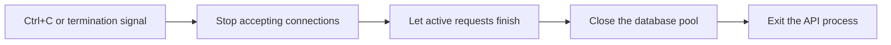
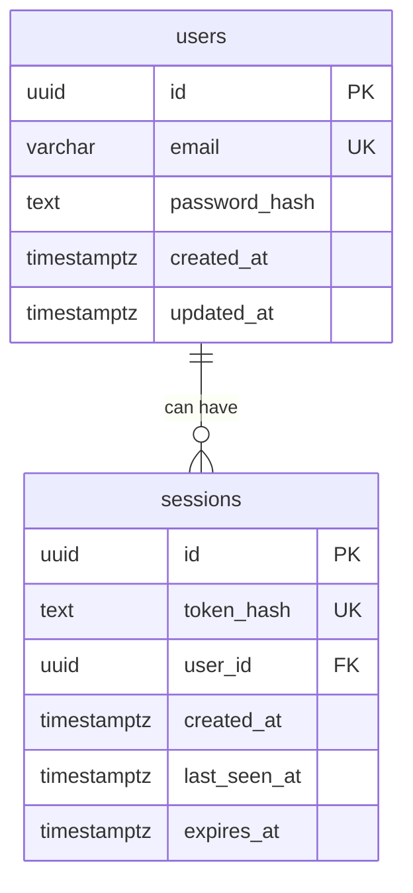
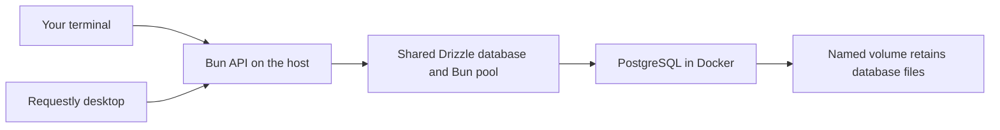

# Setup and development reference

Run Bun 1.3.14 and developer tools on the host. Docker provides PostgreSQL. Local development uses HTTP and needs no certificates. The API listens on the loopback address, so only this machine can connect. The production image and Compose stack remain unverified; use the host commands here for development.

## First-time setup

Check that Bun prints `1.3.14` and Docker Compose is available:

```sh
bun --version
docker compose version
```

Install the locked dependencies before creating private environment files:

```sh
bun install --frozen-lockfile
```

For an existing checkout with private environment files, follow the [package-manager limitation](#environment-files) before running package commands.

Create the local file if it does not already exist:

```sh
test -f .env.local || cp .env.example .env.local
```

Choose a unique database password before first startup. Keep real environment files out of Git. When changing an existing setup, preserve its password unless you also intend to change the database role's password.

## Configuration

`.env.example` is the template. `src/config.ts` validates the values Bun supplies; it does not read files or choose connection targets. Invalid settings stop startup with field names rather than submitted values.

| Setting | What to supply |
| --- | --- |
| `APP_ENV` | `local`, `test`, or `production`. |
| `API_PORT` | A decimal port from `1` to `65535`, without leading zeros. The local template uses `3000`. |
| `API_ORIGIN` | The exact public API origin, such as `http://127.0.0.1:3000`, without a path or trailing slash. Production requires HTTPS. |
| `CORS_ORIGINS` | An optional comma-separated browser allowlist for cross-origin resource sharing (CORS). Empty disables it. See [origin behavior](api.md#origins-and-browser-access). |
| `POSTGRES_HOST` | The supplied database hostname. Host commands use `127.0.0.1`. |
| `POSTGRES_PORT` | A decimal port using the same validation as `API_PORT`. Select the published port below. |
| `POSTGRES_USER`, `POSTGRES_DB` | Nonblank names for the selected database identity. |
| `POSTGRES_PASSWORD` | A nonblank password. Configuration preserves its characters rather than trimming it. |

Use separate credentials and these database identities:

| File | `APP_ENV` | Host PostgreSQL port | Database | User |
| --- | --- | --- | --- | --- |
| `.env.local` | `local` | 5433 | `finance_tracker_local` | `finance` |
| `.env.test` | `test` | 5435 | `finance_tracker_test` | `finance_test` |
| `.env.production` | `production` | 5434 | `finance_tracker_production` | `finance_production` |

The usual test API port is `3002`, with `API_ORIGIN=http://127.0.0.1:3002`. For production, supply the actual public HTTPS origin. It may differ from the API's internal address behind a deployment proxy. Production Compose explicitly uses `db:5432` inside its API container; host database tools use the published production port.

### Environment files

`bunfig.toml` sets `env = false`. Application commands select files explicitly: `dev` loads `.env.local`, while checks and builds use no environment files. Test configuration uses invented values. Commands are directly visible in `package.json`.

Bun 1.3.14's package manager ignores the runtime environment-file controls and reads default files such as `.env.local` and `.env.production`. Run dependency installation in a checkout without private environment files. For an existing checkout, keep those files outside it during package commands and restore them afterward. A clean temporary installation directory containing `package.json`, `bun.lock`, and `bunfig.toml` also avoids exposing application credentials to package commands. See the [upstream Bun issue](https://github.com/oven-sh/bun/issues/31450) and [runtime environment settings](https://bun.sh/docs/runtime/environment-variables).

For database commands, Bun parses the selected file and supplies its values to Docker Compose. Compose receives `--env-file /dev/null` so it does not independently parse another environment file. Unit tests do not load private files.

## Start and stop

Start PostgreSQL, then the API:

```sh
bun run db:up
bun run db:push
bun run dev
```

`db:up` returns after PostgreSQL is ready and leaves its container running in the background. `dev` stays in your terminal and restarts the API when source files change. Startup opens one database connection before listening. Local/test APIs bind to loopback; production mode binds to all interfaces inside its container.

The shared Bun SQL pool permits five connections. Connection attempts and PostgreSQL statements have five-second timeouts; idle connections close after 30 seconds. The options live in `src/db/client.ts`. See the [API guide](api.md#health-requests) for liveness and readiness behavior.

Press `Ctrl+C` in the API terminal to stop accepting connections, finish active requests, and close the pool. Shutdown forces exit after five seconds if cleanup stalls. Fatal process errors use the same path with a nonzero exit status. PostgreSQL keeps running.



To follow database logs or stop its container while preserving data:

```sh
bun run db:logs
bun run db:down
```

Pressing `Ctrl+C` during `db:logs` only stops following the logs. For the separate test database, use `bun run db:test:up`, `bun run db:test:logs`, and `bun run db:test:down`. Local and test databases can run together because their project names, volumes, and ports differ.

## Schema and database tools

`src/db/schema.ts` defines the current database structure. It contains `users`, used by [registration](api.md#register-a-user), and `sessions`, ready for the later login feature. Finance tables come later.



Each user has a generated UUID, a unique email of at most 254 characters, a password hash, and timestamps that include a time zone. Every field is required. The database rejects empty emails and emails with uppercase letters or surrounding spaces. Registration trims and lowercases email, validates its format, and hashes the password before insertion. The timestamps default to the insertion time; future update handlers must set `updated_at` explicitly.

One user can have several sessions, such as separate logins on two devices. Each session has its own generated UUID and a unique credential hash. The foreign key requires an existing user. Deleting a user directly from the database also deletes that user's sessions; there is no user-deletion API.

`token_hash` is for the SHA-256 hash of the session credential that the later login endpoint will put in an HttpOnly cookie. The raw credential must never be stored here. Login will generate the credential; this schema change does not create sessions or cookies. Writes require an approved Origin, with an explicit browser allowlist and SameSite cookies, as explained in the [API guide](api.md#origins-and-browser-access).

`created_at` records session creation, `last_seen_at` records the latest accepted use, and `expires_at` is the absolute expiry time. The first two default to insertion time; login must supply the absolute deadline. Later session validation will enforce idle and absolute expiry and update `last_seen_at`. Timestamps alone do not enforce expiry or delete rows. The unique credential index supports session lookup, while separate indexes on `user_id`, `last_seen_at`, and `expires_at` support revoking a user's sessions and cleaning up idle or expired rows.

| Command | Purpose |
| --- | --- |
| `bun run db:push` | Compare the schema with the local database and apply changes. |
| `bun run db:test:push` | Apply the same schema to the isolated test database. |
| `bun run db:studio` | Open Drizzle's database editor, bound to `127.0.0.1`, using local settings. |

Start the selected database before pushing. After editing the schema, run the matching push command again. Drizzle applies differences directly without generating migration files. Review any data-loss prompt before accepting it; these commands do not force destructive changes. See the [Drizzle push guide](https://orm.drizzle.team/docs/drizzle-kit-push).

`drizzle.config.ts` uses the existing configuration validator and checks `DATABASE_TASK_MODE`, which each command sets explicitly. Local tasks require `APP_ENV=local`, `127.0.0.1:5433`, and `finance_tracker_local`. Test tasks require `APP_ENV=test`, `127.0.0.1:5435`, and `finance_tracker_test`. A mismatch stops the tool before connecting. Production tasks are not enabled yet. Credentials are passed as separate options, so passwords do not need URL encoding.

Drizzle Kit 0.31.11 uses the development dependency `pg` for these tools. The API continues to use Drizzle with Bun SQL; it does not use a second connection pool or load Drizzle Kit.

### Integration test setup

`tests/integration/setup.ts` provides `createTestDatabase()`. It validates the supplied settings and requires the exact test mode, host, port, and database listed above before creating a database object. It never loads an environment file or falls back to local settings. Tests must use this helper before making writes or deleting their fixtures, and close the returned database's `$client` afterward.

To run registration tests:

```sh
bun run db:test:up
bun run db:test:push
bun run test:integration
```

Unit tests run without private environment files or PostgreSQL. `test:integration` explicitly loads `.env.test` and runs the registration suite serially against the guarded test database. It covers validation, actual password hashes, concurrent duplicate emails, safe errors, and the bounded limiter. Tests supply a trusted connection-address fixture and delete only their own users afterward. Stop the test container with `bun run db:test:down` when finished; its volume remains.

## Check and build

| Command | Purpose |
| --- | --- |
| `bun run typecheck` | Check source and tests with TypeScript. |
| `bun run lint` | Check source and configuration with ESLint. |
| `bun run test` | Run Bun unit tests without PostgreSQL. |
| `bun run test:integration` | Run registration tests against the prepared test PostgreSQL database. |
| `bun run build` | Bundle the server into `dist/server.js`. |
| `bun run check` | Run type checking, lint, tests, and build in order. |

The project pins TypeScript 6.0.3 and typescript-eslint 8.72.1, whose supported TypeScript range ends below 6.1.0. Bun's type package matches runtime version 1.3.14. Check compatibility when updating these packages together and include `bun.lock` with dependency changes.

After stopping the development API, run the built bundle with local settings:

```sh
bun run build
bun --env-file=.env.local dist/server.js
```

`bun run start` uses settings supplied by its caller. A host production-mode run can explicitly load `.env.production` with `bun --env-file=.env.production run start`; it needs the production database and a public HTTPS `API_ORIGIN`. This command does not validate the retained production image or authorize public deployment.

## Database storage



| Compose file | Project | Named volume |
| --- | --- | --- |
| `compose.yaml` | `finance-tracker-fresh-local` | `finance-tracker-fresh-local_postgres_data` |
| `compose.test.yaml` | `finance-tracker-fresh-test` | `finance-tracker-fresh-test_postgres_data` |
| `compose.production.yaml` | `finance-tracker-fresh-production` | `finance-tracker-fresh-production_postgres_data` |

Compose combines the explicit project name and `postgres_data` key to name each volume. Commands pass `-p` so an inherited `COMPOSE_PROJECT_NAME` cannot select a different project. An explicit global volume name would bypass this project boundary. See [Compose volume names](https://docs.docker.com/reference/compose-file/volumes/#name).

PostgreSQL 18 stores files under `/var/lib/postgresql/18/docker`; the volume mounts its parent `/var/lib/postgresql`. Preserve that image layout when changing Compose. See the [PostgreSQL image documentation](https://hub.docker.com/_/postgres).

`db:down` keeps the volume, and a later `db:up` reuses its files. PostgreSQL uses `POSTGRES_USER`, `POSTGRES_PASSWORD`, and `POSTGRES_DB` to initialize an empty volume. Editing those values afterward does not change identities already stored in that volume. These separate project names leave older volumes untouched.
