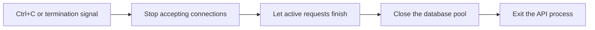
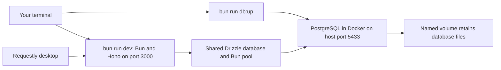

# Run the API and PostgreSQL locally

Run Bun 1.3.14 on the host. Docker provides PostgreSQL separately. Startup requires PostgreSQL; the liveness endpoint itself makes no database query.

## Start and stop the API

Start PostgreSQL first, then run the API in your terminal:

```sh
bun run db:up
bun run dev
```

Keep that terminal open while using the API. Press `Ctrl+C` there to stop it. The API stops accepting connections, lets active requests finish, then closes the database pool. It forces exit if shutdown exceeds five seconds. Stopping the API leaves PostgreSQL running.

In Requestly desktop:

| Request | Behavior |
| --- | --- |
| `GET http://127.0.0.1:3000/health/live` | Returns `200` with `{"status":"ok"}` without querying PostgreSQL. |
| `GET http://127.0.0.1:3000/health/ready` | Runs `SELECT 1` through Drizzle. Returns `200` with `{"status":"ok"}` on success or `503` with `{"status":"unavailable"}` on failure. |

Readiness uses the pool's existing five-second connection and statement timeouts. It has no separate deadline for waiting for a pool slot. Database errors do not appear in its response.



Fatal process errors use this same cleanup path with a nonzero exit status. PostgreSQL has a separate lifecycle, so it remains available for another API start.

## Choose the database environment

Real environment files are private and ignored by Git. `.env.example` contains the local template and the test/production settings to change when making those files.

| File | `APP_ENV` | Host PostgreSQL port | Database | User |
| --- | --- | --- | --- | --- |
| `.env.local` | `local` | 5433 | `finance_tracker_local` | `finance` |
| `.env.test` | `test` | 5435 | `finance_tracker_test` | `finance_test` |
| `.env.production` | `production` | 5434 | `finance_tracker_production` | `finance_production` |

Set `POSTGRES_HOST=127.0.0.1` for host commands. Give each environment a different password. Keep the existing local password when editing the database name. If a file is missing, copy `.env.example` to the appropriate filename, change the values above, and replace its example password before startup.

The production Compose file explicitly sets its API container's database address to `db:5432`. Host commands use port 5434. Its API image setup will be validated in the production phase; the commands here start only the local or test PostgreSQL service.

Bun parses the explicitly selected file and supplies the environment to Docker Compose. Compose receives `--env-file /dev/null` so it does not independently load another `.env` file. See [project notes](discoveries.md#environment-files) for the separate Bun package-install limitation.

## Start and stop PostgreSQL

```sh
bun run db:up
```

The command starts PostgreSQL in the background and returns after the server reports ready. It does not start the API. To follow its logs:

```sh
bun run db:logs
```

Pressing `Ctrl+C` stops following the logs; PostgreSQL keeps running. To stop and remove the local container while keeping its data:

```sh
bun run db:down
```

Use the corresponding commands for the separate test database:

```sh
bun run db:test:up
bun run db:test:logs
bun run db:test:down
```

Local and test databases can run together because their project names, volumes, and host ports differ. Database setup commands are in `package.json`, so you can inspect exactly which Compose file and environment each command selects.

## Understand storage and connections



The API and database currently have separate lifecycles. Stopping the API leaves PostgreSQL running. The liveness route makes no database query.

| Compose file | Project | Named volume |
| --- | --- | --- |
| `compose.yaml` | `finance-tracker-fresh-local` | `finance-tracker-fresh-local_postgres_data` |
| `compose.test.yaml` | `finance-tracker-fresh-test` | `finance-tracker-fresh-test_postgres_data` |
| `compose.production.yaml` | `finance-tracker-fresh-production` | `finance-tracker-fresh-production_postgres_data` |

Compose creates the volume name by combining the project name and `postgres_data` key. Commands pass `-p` explicitly so a shell's `COMPOSE_PROJECT_NAME` cannot select an older project accidentally. PostgreSQL 18 mounts that volume at `/var/lib/postgresql`.

`db:down` keeps the named volume. A later `db:up` creates a new container using the same database files. These fresh project names leave older volumes separate.

PostgreSQL uses `POSTGRES_USER`, `POSTGRES_PASSWORD`, and `POSTGRES_DB` to initialize an empty volume. Editing those values afterward does not change users, passwords, or databases already stored in that volume.
