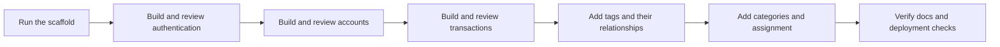
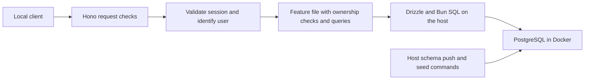
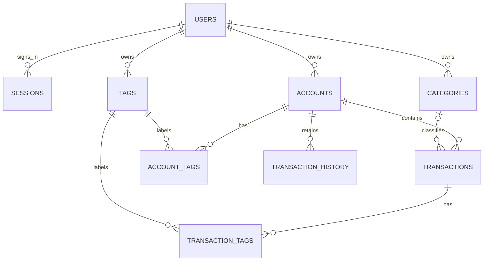
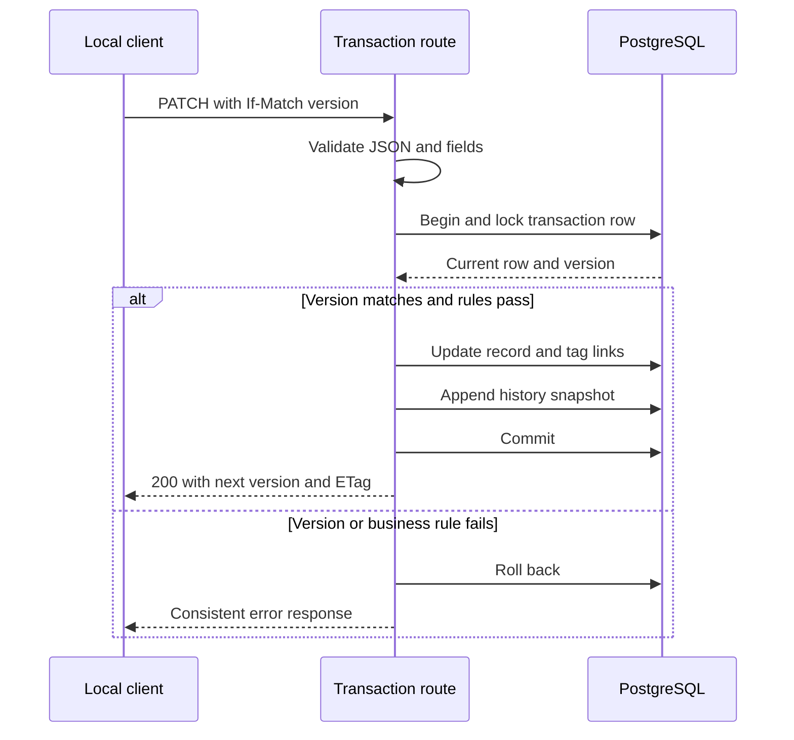
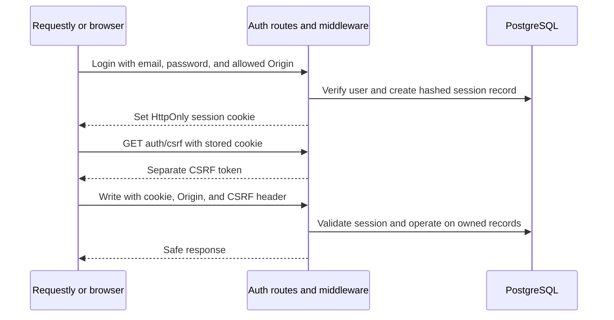

# Finance tracker architecture and implementation todos

This implementation contract follows the original [project brief](../../docs/archive/new_start.md) and the user decisions below. Phases 1, 2, 3A, 3B, 3C, 5A, and 5B are complete. Later phases remain subject to their individual approval gates.

## Spec summary

Build a personal finance API with Bun 1.3.14, Hono, PostgreSQL, Drizzle, and Valibot. Run Bun and developer tools on the host. Use Docker for PostgreSQL and retain a separate production API image. Keep each feature's validation, handlers, and queries together.

Use `drizzle-kit push` for every database schema change. Keep `src/db/schema.ts` as the schema definition. Do not create migration files or use `drizzle-kit generate` or `drizzle-kit migrate`.

The first version supports email/password login with server-side sessions, user-owned accounts, income and expense transactions, categories, shared tags for accounts and transactions, filtered search, account balances, and transaction change history. It provides repeatable development data and beginner-friendly setup and API guides, including a Requestly desktop walkthrough.

Build authentication immediately after the scaffold and before finance features. Each user can access only their own data. Keep development on a trusted local machine and treat the production image as a local deployment-check artifact. Public deployment is a separate decision. The proposed initial finance limits remain three two-decimal currencies, flat categories, and no bank connections or transfers.

The permanent rules already supplied by the user are in [PROJECT_MAP.md](../../PROJECT_MAP.md), R1–R12. Details such as exact expiry times and endpoint names remain proposals for review. Each phase needs approval before work starts and ends with a review gate. Approval of one phase does not authorize all later phases. The user approved phases 1, 2, 3A, 3B, and 3C. Phase 3 was split before implementation into settings in 3A, the connection in 3B, and readiness/shutdown in 3C to keep each review small. The user removed the local HTTPS phase before implementation. Completed work is recorded below; phase 5B is complete, with 5C retaining a separate approval gate.

### Build one feature at a time

Build the application in the order the user wants to learn it. Finish authentication before accounts, then transactions, tags, and categories. A feature takes several small commits. Add its schema, endpoints, and required middleware as separate steps when useful. Repeated edits to `src/db/schema.ts` and existing handlers are expected.

The schema diagram and full API contract below describe the intended finished application. They are a reference for later decisions, not a request to create everything during setup. Do not add empty feature files, unused relationship tables, nullable columns for future features, or tests against routes that do not exist yet. Introduce shared HTTP checks for the first auth endpoints, then session middleware when the current-user endpoint needs it.

| Work | Phases | Schema introduced in these phases |
| --- | --- | --- |
| Scaffold | 1–3C | No application tables. Establish Bun, fresh PostgreSQL storage, validated settings, and connection lifecycle. |
| Authentication | 5A–14 | Add request checks, then `users`, registration, `sessions`, login, middleware, CSRF, logout, password change, and session cleanup. Review the Requestly and browser flows before finance work. |
| Accounts | 15–19 | Add only owned `accounts`, then create/detail, list/search, edit/archive, and deletion in separate commits. |
| Transactions | 20–27 | Add owned transactions and history without tag/category fields, then creation, corrections, deletion, search, balances, summaries, and seeds. |
| Tags | 28–32 | Add the owned tag catalog, then its account and transaction relationships and filters. |
| Categories | 33–36 | Add the owned category catalog, then assignment and filtering separately. |
| Final checks | 37–41 | Verify accumulated guides, image, production Compose, and CI in separate commits. No speculative feature tables. |



Every review should name the changed files, show a request through the current code, explain the new schema or query, and provide the checks and suggested commit. Later features extend the working API rather than require a rewrite or database reset. The setup exception to the file-count limit is not permission to implement domain features early.

### Sources and precedence

Use the user's instructions and `AGENTS.md` first, then this approved contract. The reference guides explain principles; their sample frameworks and packages do not replace the requested stack.

| Source                                                   | Relevant section                                                                                                                  |
| -------------------------------------------------------- | --------------------------------------------------------------------------------------------------------------------------------- |
| [Project brief](../../docs/archive/new_start.md)         | Stack, coding style, scripts, testing, deliverable, and future authentication, lines 1–45.                                        |
| [Database guide](../../docs/archive/database_design.md)  | Foundations through schema review, lines 13–220; Personal Finance Tracker, lines 449–503.                                         |
| [API guide](../../docs/archive/API_design.md)            | HTTP Methods through Idempotency Keys, lines 39–353; Data Validation through Async Logging, lines 407–559.                        |
| [Validation guide](../../docs/archive/API_validation.md) | Where to Validate, lines 28–38; Valibot, lines 123–164; unknown fields and checklist, lines 210–261.                              |
| [Error guide](../../docs/archive/api_error_handling.md)  | Golden Rules and response shape, lines 15–68; Hono example, lines 128–181; validation errors and process failures, lines 243–295. |
| `~/.opencode/docs/design_questions.md`                   | Data through operations, lines 19–140. The answers appear in Design rationale below.                                              |
| `~/.opencode/system_architecture.md`                     | Ledger vs. Journal, lines 5–8; Approval Gates & Todo Granularity, lines 75–86.                                                    |

The user approved the listed sections of the two large project guides for this planning session. Unrelated database recipes and global UX performance guides were not needed. Resolve inaccuracies in examples through official documentation, such as using Valibot's strict object validation instead of copying Zod examples.

## S1. Runtime and code boundaries

Use one Hono application and one PostgreSQL database per environment. Use Drizzle's Bun SQL adapter with Bun's connection pool if a stable package release supports Bun 1.3.14. Check that compatibility during initial setup. If a different driver or prerelease is necessary, present the concrete compatibility issue before changing this choice.

Keep configuration separate from startup. `src/config.ts` receives values and validates them with Valibot. `src/app.ts` assembles Hono routes using an explicitly supplied database connection. `src/server.ts` loads the validated settings, opens the connection, starts Bun, and handles shutdown. Importing a feature or constructing the application must not start a server, connect to PostgreSQL, or read environment files.

The eventual layout is small and flat. Create these files only when their phase needs them:

```text
src/
  config.ts
  app.ts
  server.ts
  db/
    client.ts
    schema.ts
  http.ts
  session.ts
  features/
    auth.ts
    accounts.ts
    categories.ts
    tags.ts
    transactions.ts
scripts/
  seed.ts
tests/
  unit/
  integration/
docs/
  setup.md
  auth.md
  api.md
  data-model.md
  testing.md
  operations.md
drizzle.config.ts
bunfig.toml
```

`src/http.ts` holds shared JSON parsing and error behavior. Add a separate shared file only when a concrete shared need appears. Small named validation schemas or value-conversion functions may stay beside the routes they serve. Do not add a generic route factory, base repository, dependency-injection container, or feature-specific helper chain. Keep database transactions visible inside the responsible handler.



The API and developer commands use the same database settings. Docker supplies database storage and isolation. This follows PROJECT_MAP R1–R4 and the database guide's normalization and constraint sections, lines 90–132.

## S2. Environments and fresh Docker storage

The old volume `hono-drizzle-local_postgres_data` existed during the earlier inspection, with no containers present. Recheck that inventory before startup. The retained Compose names differ from that older name, but the restart should have clearly new names regardless. See [discoveries.md](../../docs/discoveries.md).

Use these proposed identities consistently:

| Environment       | Compose file and project                                      | Expected named volume                            | Host database port                        | Database                     |
| ----------------- | ------------------------------------------------------------- | ------------------------------------------------ | ----------------------------------------- | ---------------------------- |
| Local             | `compose.yaml`, `finance-tracker-fresh-local`                 | `finance-tracker-fresh-local_postgres_data`      | 5433                                      | `finance_tracker_local`      |
| Integration tests | `compose.test.yaml`, `finance-tracker-fresh-test`             | `finance-tracker-fresh-test_postgres_data`       | 5435                                      | `finance_tracker_test`       |
| Production check  | `compose.production.yaml`, `finance-tracker-fresh-production` | `finance-tracker-fresh-production_postgres_data` | 5434 for host schema pushes | `finance_tracker_production` |

Set the top-level `name:` in each file and pass the matching `-p` argument in package commands. Keep `postgres_data` as the Compose volume key. Do not set a global `volumes.postgres_data.name`, `external: true`, a host data-directory mount, or `container_name`. The project name must remain part of the resolved volume identity. CLI `-p` overrides an inherited `COMPOSE_PROJECT_NAME`. See the official [project-name precedence](https://docs.docker.com/compose/how-tos/project-name/) and [volume naming rules](https://docs.docker.com/reference/compose-file/volumes/).

Keep `postgres:18.6-bookworm` and `/var/lib/postgresql` unless verification shows a concrete problem. The official [PostgreSQL image documentation](https://hub.docker.com/_/postgres) lists the retained tag and explains the PostgreSQL 18 data-directory layout. Changing the mount to the PostgreSQL 17 path would be a mistake.

Give each environment its own database name, credentials, and loopback-only published port. Separate names protect storage; separate ports prevent address conflicts. Check both before startup. In production Compose, the API connects to `db:5432`; host schema push commands use `127.0.0.1:5434`. Pass that container address explicitly in Compose, not through configuration guessing.

Keep `.env.local`, `.env.production`, and `.env.test` ignored. Track `.env.example` with clear local, production, and test examples. Preserve the existing local password. Generate separate production and test credentials when those files are created. Never include real credentials in the plan, README, logs, or Git.

Set `env = false` in `bunfig.toml`. Use Bun's `--env-file` for local tools, including Docker commands. Pass `--env-file /dev/null` to Compose so it uses the environment Bun supplied instead of parsing another file. The following illustrates the eventual `package.json` commands:

```json
{
  "dev": "bun --env-file=.env.local --watch src/server.ts",
  "db:up": "bun --env-file=.env.local exec 'docker compose --env-file /dev/null -p finance-tracker-fresh-local -f compose.yaml up -d --wait'",
  "db:down": "bun --env-file=.env.local exec 'docker compose --env-file /dev/null -p finance-tracker-fresh-local -f compose.yaml down'",
  "db:logs": "bun --env-file=.env.local exec 'docker compose --env-file /dev/null -p finance-tracker-fresh-local -f compose.yaml logs -f db'",
  "db:push": "DATABASE_TASK_MODE=local bun --env-file=.env.local run --bun drizzle-kit push",
  "db:test:push": "DATABASE_TASK_MODE=test bun --env-file=.env.test run --bun drizzle-kit push",
  "db:production:push": "DATABASE_TASK_MODE=production bun --env-file=.env.production run --bun drizzle-kit push",
  "db:studio": "DATABASE_TASK_MODE=local bun --env-file=.env.local run --bun drizzle-kit studio --host 127.0.0.1",
  "db:seed": "bun --env-file=.env.local scripts/seed.ts",
  "test": "bun --no-env-file test tests/unit"
}
```

These are proposed commands, not commands available today. Verify them against the installed versions during their owning phase. Each push reads `src/db/schema.ts`, compares it with the selected live database, and applies the required schema changes without generating migration files. Push commands therefore require an available database and explicit connection settings. See the official [Drizzle push documentation](https://orm.drizzle.team/docs/drizzle-kit-push).

Provide corresponding `db:test:up`, `db:test:down`, `test:integration`, `build`, `start`, `typecheck`, `lint`, and `check` commands. Add explicit production build, up, down, and host push commands in the production phase. Use `bun run --bun` for installed tools so they execute with Bun. Keep orchestration directly in `package.json`; `scripts/seed.ts` contains seed behavior, not command wrappers.

Normal down commands preserve volumes. Do not add a general `db:reset`, volume prune, or automatic `down -v` command. Document any future data reset as a separate, explicitly requested operation.

Keep configuration small and add validation when a feature first uses a setting. The scaffold validates only `APP_ENV` and `API_PORT`; Bun loads the explicitly selected environment file. No duplicate server mode argument is required. Add basic required database fields and port validation with the connection, then exact browser-origin validation with request middleware. Avoid custom hostname rules and password-placeholder lists. Database tasks still need guards against unintended writes: Drizzle commands set `DATABASE_TASK_MODE` explicitly, and test setup checks the allowlisted target as described in S7. Do not silently fall back to a development database. Parse credentials as connection options or safely encode them in a URL.

## S3. Data model and money rules

This section describes the completed finance model. S8 describes the two auth tables, which arrive first. Accounts start as one owned finance table. Transactions initially have no `category_id` or tag links, and their request schemas reject `categoryId` and `tagIds` until those features arrive. Each later push preserves existing users, sessions, and finance data. The completed model has two auth tables and seven finance tables.

Use generated UUID primary keys for standalone records. UUIDs avoid JavaScript integer-size issues and make client-facing identifiers consistent. They do not provide authorization. Use composite primary keys for tag relationships. Store SQL columns in `snake_case` and API fields in `camelCase`.

| Table                 | Main fields and rules                                                                                                                                                                                                                                                |
| --------------------- | -------------------------------------------------------------------------------------------------------------------------------------------------------------------------------------------------------------------------------------------------------------------- |
| `accounts` | `id`, immutable `user_id`, trimmed `name`, `type`, `currency`, immutable `opening_balance`, `is_archived`, and timestamps. Types are `checking`, `savings`, `cash`, `credit`, and `investment`. Investment means a cash balance, without holdings or market prices. |
| `categories` | `id`, immutable `user_id`, trimmed `name`, immutable income/expense `kind`, and timestamps. Normalized names are unique within a user's category kind. There are no global categories. |
| `tags` | `id`, immutable `user_id`, trimmed `name`, and timestamps. Normalized names are unique per user. A user's tag can label their accounts and transactions. |
| `account_tags` | `user_id`, `account_id`, and `tag_id`, with a composite account/tag primary key and same-owner foreign keys. Account deletion cascades to links; tag deletion is restricted while linked. |
| `transactions` | `id`, immutable `user_id` and `account_id`, nullable `category_id`, nonzero signed `amount`, optional description, occurrence time, version, and timestamps. Version starts at 1. |
| `transaction_tags` | `user_id`, `transaction_id`, and `tag_id`, with a composite transaction/tag primary key and same-owner foreign keys. Transaction deletion cascades to links; tag deletion is restricted while linked. |
| `transaction_history` | `id`, immutable `user_id`, original transaction ID, account ID, version, operation, JSON snapshot, recorded time, and request ID. Unique transaction/version pairs. History survives transaction deletion. |



The transaction ID in history deliberately has no foreign key to `transactions`, so a deleted transaction's history survives. Its account reference uses `RESTRICT`, so deleting a previously used account cannot erase that relationship. Category and tag IDs and names in the history snapshot are historical values, not live foreign keys.

Take `user_id` only from the validated session. Reject client-supplied owner fields. Every read, write, aggregate, search, history lookup, and link change is scoped to that user. Return `404` for another user's resource or referenced account/tag/category, including history after deletion. Look up the owned transaction before reporting an ETag/version error. A cursor never grants access to the row it names.

Use composite foreign keys to enforce same-owner relationships even if handler validation misses a case. Add `UNIQUE (user_id, id)` to a referenced finance table when its first same-owner relationship needs that key. For example, the transaction schema step extends accounts with that key so `(user_id, account_id)` can reference `(user_id, id)`. Tag links later reference both owned parents. Add the category equivalent only when assignment arrives. Ownership is immutable, and there is no user-deletion or ownership-transfer endpoint in this version.

Money uses PostgreSQL `NUMERIC(18,2)` and decimal strings in JSON. For example, `"-24.50"` is a payment and `"1500.00"` is income. Accept exactly two fractional digits and at most sixteen integer digits. Reject leading zeros except the single zero before the decimal point, exponent notation, commas, numeric JSON values, negative zero, and zero transaction amounts. Opening balances may be zero. Never convert money to JavaScript `number`. Use PostgreSQL arithmetic for totals and integer cents with `bigint` for any necessary application arithmetic. Serialize values as strings.

Initially allow `USD`, `EUR`, and `GBP`, all with two fractional digits. Default a newly created account to `USD`. Transactions inherit the account currency and do not accept a second currency field. Do not sum different currencies into one total. Other currency scales, exchange rates, and transfers need a later design review.

An account balance is `openingBalance + SUM(current transaction amounts)`. Return `"0.00"` for an empty sum. Debt appears as a negative balance, including on credit accounts. Do not store a second mutable balance. Income and expense totals describe signed cash movements, not accounting profit or investment returns. Aggregate results may exceed an individual amount's input limit and must still remain exact strings.

Validate names at 1–100 characters after trimming, descriptions at 2,000 characters, and tag arrays at 20 distinct UUIDs. A category may be absent. When present, its kind must match the amount sign. A category's kind is immutable so renaming it cannot invalidate past transaction rules. The database enforces nonzero amounts, supported account types and currencies, positive versions, required fields, valid references, and name uniqueness. The handler enforces the category/amount relationship inside its database transaction because a simple row `CHECK` cannot inspect another table.

Store instants as `TIMESTAMPTZ`. Require valid RFC 3339 timestamps with an explicit offset and return UTC timestamps. `occurredAt` means when money moved; `createdAt` means when the application saved it. Date filters use an inclusive `from` and exclusive `to`, with `from < to`.

Add indexes with the feature that uses them, starting with `user_id`: transaction account/date and date-only lists, category lookups, reverse tag lookups, and transaction/account history reads. For example, use `(user_id, account_id, occurred_at DESC, id DESC)` for an account register. Scope normalized tag/category uniqueness to the user. Add more indexes only after examining actual query plans.

This applies PROJECT_MAP R3 and R5 and the database guide's Relationships and Keys, Constraints, Time and History, and Finance Tracker sections, lines 90–117, 189–201, and 449–503.

## S4. Mutations, history, and concurrent requests

This is an editable personal tracker. Transaction changes must leave a visible history rather than silently replace financial facts. It is not a tamper-proof accounting ledger.

Create the transaction, tags, and version-1 history snapshot in one database transaction. For a patch, lock the current row, check the expected version, validate references, update the row and links, and append the next history snapshot before committing. For deletion, append a final snapshot at the next version and remove the current row and links in one database transaction. Snapshots include the amount, account and category information, description, occurrence time, tag IDs and names, and version. There is no endpoint to change or delete history.

Initially, snapshots contain only the transaction fields that exist. Add tag and category information when those features are implemented. History readers must continue to accept earlier snapshots with those fields absent. Present absent tags as an empty list and an absent category as `null` without rewriting stored history. Do not add placeholder fields before the corresponding feature.

Return an `ETag` such as `"3"` for a transaction representation. Require `If-Match: "3"` on transaction patches and deletes, including tag replacement. Missing headers return `428 PRECONDITION_REQUIRED`; malformed headers return `400 INVALID_INPUT`; a stale version returns `412 VERSION_MISMATCH`. A missing transaction returns `404`. A retry of a successful delete may therefore return `404`, but it cannot delete anything else or add another history entry.



Lock the account during transaction creation and account archival so those requests cannot race. Archiving blocks new transactions; existing transactions may still be corrected. An account's currency and opening balance are immutable, which avoids rewriting the meaning of earlier amounts. Account and tag metadata use last accepted write wins; money and transaction tag changes use version checks. Lock multiple referenced records in a consistent ID order when necessary and let database constraints settle reference-deletion races.

Allow account deletion only when it has no current transactions and no history. Otherwise return `409 RESOURCE_IN_USE` and suggest archival. A category or tag in current use cannot be deleted. Remove a tag through the owning account or transaction first. History snapshots preserve earlier labels after metadata is renamed or unused labels are removed. History reads return `404` only when neither a current transaction nor retained history exists.

Creating another transaction with the same payload creates another record. Automatic retries of `POST /transactions` are not supported in this first version. Document that behavior beside the create example. Persistent idempotency keys, bulk import, and external payment retries are deferred because no integration or background writer is in scope.

## S5. API contract, search, and bounded reads

The route and filter tables describe the finished API. Each phase implements only its stated routes and fields. Documentation examples must show the API available at that phase. For example, the first transaction request contains an account, amount, description, and occurrence time; the complete example below applies after tags and categories have been added.

Use `/api/v1` and plural resource names. Successful individual responses use `{ "data": ... }`. Lists use `{ "data": [], "pagination": { ... } }`. Finance-resource creates return `201` with a `Location` header; reads and patches return `200`; successful deletion returns `204` with no body. Registration returns `201` without a `Location` because no public user-detail URL is provided.

| Routes                                        | Behavior                                                                                                     |
| --------------------------------------------- | ------------------------------------------------------------------------------------------------------------ |
| `GET /health/live`, `GET /health/ready`       | Process health and a short, bounded database check. Ready returns `503` if the database is unavailable.      |
| `GET, POST /api/v1/accounts`                  | List and create accounts. Creation may include `tagIds` once tag assignment is implemented.                  |
| `GET, PATCH, DELETE /api/v1/accounts/:id`     | Read, rename, archive/unarchive, replace tags, or delete an unused account.                                  |
| `GET /api/v1/accounts/:id/balance`            | Return the account's exact current balance and currency.                                                     |
| `GET, POST /api/v1/categories`                | List and create flat income or expense categories.                                                           |
| `GET, PATCH, DELETE /api/v1/categories/:id`   | Read, rename, or remove an unused category. Kind cannot change.                                              |
| `GET, POST /api/v1/tags`                      | List and create tags shared by account and transaction features.                                             |
| `GET, PATCH, DELETE /api/v1/tags/:id`         | Read, rename, or remove an unused tag.                                                                       |
| `GET, POST /api/v1/transactions`              | Search and create transactions. Creation may include `tagIds`.                                               |
| `GET, PATCH, DELETE /api/v1/transactions/:id` | Read, correct, replace tags, or delete with retained history. Account cannot change.                         |
| `GET /api/v1/transactions/:id/history`        | Read version-ordered history, including after the current transaction was deleted.                           |
| `GET /api/v1/transactions/summary`            | Return income, expense magnitude, and signed net movement grouped by currency using the transaction filters. |

Register fixed paths such as `/transactions/summary` before `/:id` and test their routing. Do not add redundant nested transaction CRUD endpoints. Use `accountId` as a transaction-list filter instead.

Example create request:

```http
POST /api/v1/transactions
Content-Type: application/json
Origin: http://127.0.0.1:3000
X-CSRF-Token: <value from the authenticated CSRF endpoint>

{
  "accountId": "62a9b052-bb8a-49f8-935e-76f56b02e2db",
  "categoryId": "1c81834c-6b6b-4332-8ce0-ddcdb3f72cef",
  "amount": "-24.50",
  "description": "Weekly groceries",
  "occurredAt": "2026-10-23T18:30:00Z",
  "tagIds": []
}
```

Reject unknown body and query fields, empty patches, client-supplied protected fields, invalid IDs, duplicate singleton query parameters, and malformed query values. Use Valibot `strictObject` schemas. Parse only explicit `true` and `false` for booleans. Never rely on JavaScript truthiness for the string `"false"`. `null` clears the optional category or description; omitting a property leaves it unchanged. An empty `tagIds` array removes all current tag links.

| Resource            | Supported query fields                                                                                       |
| ------------------- | ------------------------------------------------------------------------------------------------------------ |
| Accounts            | `q`, repeated `tagId`, `archived`, `page`, `limit`.                                                          |
| Categories          | `q`, `kind`, `page`, `limit`.                                                                                |
| Tags                | `q`, `page`, `limit`.                                                                                        |
| Transactions        | `q`, `accountId`, `categoryId`, repeated `tagId`, `from`, `to`, `minAmount`, `maxAmount`, `limit`, `cursor`. |
| Transaction summary | The transaction filters except pagination fields.                                                            |
| History             | `page`, `limit`, ordered by version descending.                                                              |

All supplied filter types combine with AND. Multiple `tagId` values mean the record must have every requested tag. Limit tag filters to 20 distinct IDs. Account tags filter accounts; they do not silently become transaction tags. `q` matches account names or transaction descriptions and directly assigned tag names, as appropriate. Limit `q` to 100 characters after trimming. Treat SQL pattern characters `%` and `_` literally, escape them, and parameterize all input. Use `EXISTS` for tag filtering so multiple matching tags cannot duplicate a record or inflate a sum.

Small catalog and history lists use page/limit pagination, default 25, maximum 100, with a stable name/ID or version order. Reject catalog pages that would skip more than 10,000 rows. Transactions use an opaque cursor containing the last `occurredAt` and UUID, ordered by both descending. Fetch `limit + 1` rows to decide whether there is another page. Validate decoded cursor shape and length before SQL. A cursor is navigation data, not permission. Filters must stay the same between pages. Concurrent edits may move records between pages; pagination is not a frozen snapshot.

The transaction summary applies filters before aggregation and ignores pagination. Without date bounds it summarizes the whole matching dataset. It is different from an account balance, which includes the opening balance. Return expense magnitude as a positive decimal string and net as a signed decimal string. Do not join tag collections directly into sums.

This follows PROJECT_MAP R3 and R5 and the API guide's Naming, Filtering, Field Naming, and Versioning sections, lines 112–231 and 262–314.

## S6. Errors, security, and operational limits

Use one error response shape, including router, parsing, validation, and database failures:

```json
{
  "error": {
    "code": "INVALID_INPUT",
    "message": "The amount must be a decimal string with two fractional digits.",
    "status": 400,
    "requestId": "4d598d39-dc7a-4ca5-aab6-509ad69080d1",
    "timestamp": "2026-10-23T18:30:00.000Z",
    "details": [{ "path": "amount", "message": "Use a value such as -24.50." }]
  }
}
```

Generate a server request ID and return it in the response header and error body. Error details contain field paths and safe messages, never submitted values. Use `400` for invalid input, `404` for missing resources, `409` for duplicate names or reference conflicts, `413` for oversized bodies, `415` for unsupported body types, and `500` for unexpected failures. Apply the version statuses from S4. Handle non-JSON `Accept` requests with `406`, while accepting absent `Accept` and `*/*`. Reject unsupported methods on known resources with `405` and an `Allow` header. Expected database conflicts need narrow PostgreSQL-code mapping, including Drizzle's wrapped error cause when applicable; all unknown failures remain generic. On Bun 1.3.14, the PostgreSQL SQLSTATE identifier is in the driver's `errno`, reached through `cause` when Drizzle wraps it. The driver's `code` instead names the Bun error type. The 3B timeout smoke check confirmed this distinction.

Limit JSON bodies to 64 KiB before parsing, including chunked requests. Require `application/json` for JSON writes, allowing its charset parameter. Limit the full URL to 8 KiB before query decoding. Use parameterized queries and allowlisted orderings. Limit the database pool to five connections and use five-second connection and statement timeouts. Readiness runs a simple `SELECT 1` through Drizzle and returns 200 or 503. At the user's request, do not add a separate readiness deadline, reservation handling, cancellation, or queue tracking. The existing timeouts do not impose a deadline while waiting for a pool slot.

Bind the local API to `127.0.0.1` and use HTTP for local development. Require HTTPS before public deployment. S8 defines cookie, origin, and CSRF checks. Disable CORS by default; Requestly desktop does not need browser CORS permissions. If a separate browser origin is configured later, use exact origins with credentials enabled, explicit methods/headers, and exposed `ETag`/`Location` headers. Never use a wildcard origin with credentials. CORS is a browser sharing policy and does not authenticate a caller. Every unsafe request, including from Requestly, supplies an allowed `Origin`; authenticated writes also supply the CSRF header. Test missing and rejected origins and preflights.

Treat API descriptions and names as plain data. Any future UI must escape them when rendering. Add Hono's secure headers. Use `Cache-Control: no-store` for financial and history responses. Do not trust forwarded client IP headers until a trusted reverse proxy is configured. Host commands and Docker published ports remain loopback-only. Production containers may listen on `0.0.0.0` internally while their host port stays loopback-only.

Log request ID, method, route template, response status, and elapsed time. Do not log request or response bodies, database credentials, raw SQL parameters, full query strings, or `Authorization`, `Cookie`, `Set-Cookie`, and `X-CSRF-Token` values. Redact driver error details before logging; financial descriptions and submitted values can appear in raw database errors. Do not expose raw error messages or stacks to clients in any environment.

Use a single shutdown path for SIGINT, SIGTERM, and fatal process errors. Stop accepting new work, allow a bounded drain, close the pool, and exit nonzero for a fatal error. Keep liveness independent of database availability. Do not retry writes automatically or run schema pushes on every API startup.

S8 adds authentication and ownership now. Passkeys, external providers, email verification and delivery, forgotten-password recovery, multi-factor authentication, shared finance records, and public hosting remain outside this first local learning build. Registration email is an unverified login identifier. Public service use needs a separate review of those lifecycle requirements, distributed throttling, trusted proxy configuration, and deployment operations. Completed login endpoints alone do not authorize publication.

The official PostgreSQL image creates `POSTGRES_USER` as a superuser. Using it locally is a development convenience, not a production privilege model. Public deployment also requires a role limited to application operations, backup/restore validation, secure secret delivery, and trusted TLS termination. The current production Compose file alone does not meet that boundary.

This applies PROJECT_MAP R2–R4 and the error guide's Golden Rules, Response Shape, and Error Handling Checklist, lines 15–68 and 284–295, plus the API guide's Security section, lines 474–493.

## S7. Validation, seeds, and documentation

Use Bun's test runner for unit and integration tests. Unit tests cover business rules such as signed amounts, category compatibility, canonical money strings, invalid dates, empty patches, version requirements, and environment mismatches. Keep feature validation importable without opening database connections. Use Hono request tests for application-owned parsing, status, and error behavior.

Integration tests run on the host against only the fresh test PostgreSQL project. Before schema pushes, cleanup, or test writes, check `APP_ENV=test`, the expected database name, loopback host, and test port. Reuse those checks in test setup. For concurrent CI jobs, derive the exact allowed target from the trusted job identifier rather than accepting arbitrary target settings. Push the schema before the suite; clean only the allowlisted test database. Use serial execution for tests sharing tables. Never use `.env.local` as the integration-test fallback.

Integration coverage must test behavior the application owns: bad credentials and expired/revoked sessions fail, cross-user reads and references fail, a bad tag rolls back a transaction and its history, a stale writer cannot overwrite a correction, category sign validation holds during updates, archival races cannot admit a new transaction after the archive commits, history survives deletion, and tag filters cannot double-count balances or summaries. Do not add insert/select tests whose only assertion is that the ORM works. Database health and volume persistence are setup checks, not a reason to mock PostgreSQL internals.

The seed command requires local mode and the configured local database name. It must not truncate tables or run automatically at startup. Give seed-owned rows stable UUIDs and use one database transaction. On a repeat run, leave existing rows untouched. Insert missing fixtures only when they do not conflict with existing names or stable IDs; otherwise fail with a clear message rather than overwrite user edits. Include each account type, positive and negative amounts, an opening balance, an uncategorized entry, both tag relationship types, multiple dates, and at least one correction history example. Keep expected balances in the seed guide. Keep the command guard and seed function in the same file. Tests can supply the guarded test connection directly to that function; the executable command must still reject test and production modes.

Start seeds with accounts and transactions once those features work. Require an explicit existing `SEED_USER_ID` and attach every fixture to that user; never create or overwrite login passwords or live sessions in the finance seed. Use two real test users in isolation tests. Add tag fixtures with tag assignment and category fixtures with category assignment. Tests and cleanup setup must refer only to tables already implemented. Add guide sections, request examples, and relevant diagrams in each feature phase; the final documentation phase verifies those guides rather than writing the first explanation of earlier work.

The README will link short guides for setup, authentication, API use, the data model, tests, and operations. Explain exact money, deletion/history, archive behavior, search examples, schema pushes, seed reruns, and environment selection beside runnable commands. Include a request-flow diagram, an entity diagram, and a setup diagram. Add one complete create-account/create-category/create-tag/create-transaction/search/balance/history walkthrough. Describe `.env.production` as a local deployment check, not permission to publish. Begin manual examples with Requestly login, cookie reuse, and CSRF acquisition.

## S8. Email/password sessions and Requestly

### Auth scope and code layout

Use the same PostgreSQL database for users, sessions, and finance data. Authentication identifies the caller; ownership checks decide which records that caller may use. All normal users have the same capabilities over their own records. No administrator role or shared household is needed.

Keep credential schemas, route handlers, and auth queries in `src/features/auth.ts`. Introduce `src/session.ts` when session validation is needed across routes. It contains the concrete session and CSRF middleware used by auth and finance features. This is shared request behavior permitted by PROJECT_MAP R3, not a controller/service/repository chain.

Use `Bun.password`, Web Crypto, Node's constant-time comparison where needed, and Hono's cookie helpers. Keep the session lifecycle explicit for this learning exercise. Do not implement password hashing, random-number generation, encryption, JWT signing, or cookie parsing from scratch. This small session design has no access/refresh-token protocol. Broader identity-provider functionality is deferred.

### Tables and lookups

Add the tables in separate auth schema commits. No finance tables exist yet.

| Table | Fields and constraints |
| --- | --- |
| `users` | UUID `id`, normalized `email`, `password_hash`, `created_at`, and `updated_at`. Email is unique. There is no public endpoint for reading another user's identity or deleting a user. |
| `sessions` | UUID `id`, unique `token_hash`, `user_id` referencing users, independent `csrf_token`, `created_at`, `last_seen_at`, and `expires_at`. Index user lookup and expiry cleanup. A user deletion through later administrative tooling cascades to sessions, while finance references restrict deletion. |

The client receives a 32-byte cryptographically random session credential, encoded as base64url. Store only its SHA-256 hash for lookup, never the raw credential. The CSRF value is a separate random token, stored with the session so an authenticated client can fetch it again. A CSRF token alone cannot authenticate a request. Do not log either value or return the session credential in JSON.

Store email after trimming and lowercasing for this application's login policy. Bound it to 254 characters and validate its format. Do not apply provider-specific transformations such as removing dots or `+` suffixes. Names and email uniqueness do not imply verified email ownership.

### Passwords and bounded auth attempts

Accept passwords of 15–128 Unicode code points, including spaces, without trimming or silently truncating. Reject locally listed common passwords and keep the blocklist small and documented for this local exercise. Use asynchronous Argon2id hashing through `Bun.password.hash` and verification through `Bun.password.verify`. Start with `memoryCost: 19456` and `timeCost: 2`. A synthetic check on Bun 1.3.14 confirmed `m=19456,t=2,p=1`; measure actual hashing cost during implementation. Keep hashes out of all response schemas.

Registration returns `201` with only user ID and email, without automatically logging in. Duplicate normalized email returns `409 ACCOUNT_NOT_AVAILABLE`. This local registration response can reveal that an email is already registered; public signup and recovery need a separately designed anti-enumeration flow. Login returns the same `401 INVALID_CREDENTIALS` for an unknown email or wrong password and performs a comparable dummy password verification for unknown users.

Add bounded throttling with the first credential endpoint. Proposed single-process limits are 5 registrations per peer IP per hour, 10 failed logins per normalized email per 15 minutes, and 30 login attempts per peer IP per 15 minutes. Limit simultaneous password-hash work to 2 operations and return `429` with `Retry-After` when capacity is exceeded. Limit password-change attempts too. The in-memory limiter has a fixed maximum number of entries, expiry cleanup, and a defined refusal when full. Do not introduce Redis for this local exercise. Restarting the process clears this protection; public or multi-instance hosting requires a shared limiter.

Get the peer address from Bun's connection information, not untrusted forwarded headers. Tests supply a trusted peer-address fixture explicitly. Do not log limiter keys or submitted emails/passwords. Implement and test the limiter inside the auth feature while it is the only feature needing it.

Password policy and storage references: [OWASP authentication guidance](https://cheatsheetseries.owasp.org/cheatsheets/Authentication_Cheat_Sheet.html#implement-proper-password-strength-controls), [OWASP Argon2id guidance](https://cheatsheetseries.owasp.org/cheatsheets/Password_Storage_Cheat_Sheet.html#argon2id), and [Bun password APIs](https://bun.sh/docs/runtime/hashing).

### Cookies and session lifecycle

Login creates a fresh independent session credential, ignoring any client-supplied credential for session creation. Cookie-only authentication accepts no session ID from request bodies, query parameters, or Bearer headers. This keeps session fixation and credential exchange rules explicit.

Use the cookie name `session` in all environments. For local/test HTTP:

```http
Set-Cookie: session=<opaque credential>; HttpOnly; SameSite=Lax; Path=/; Max-Age=604800
```

Production adds `Secure` and requires an HTTPS `API_ORIGIN`. Derive the Secure option from the validated application mode, without an independent switch that can disable it in production. Keep HttpOnly, SameSite, origin checks, and CSRF protection in every environment. Do not use the `__Host-` prefix for the local HTTP cookie because that prefix requires Secure.

Omit `Domain`. Clear the same cookie with matching attributes and `Max-Age=0`. Proposed server deadlines are a 30-minute idle timeout and a 7-day absolute lifetime. Cookie persistence never extends the server deadline. Reject expired or revoked sessions before a handler runs. For this small application, update `last_seen_at` through a conditional database operation on successful validation; no session cache is needed. A failed or unavailable session store fails closed. Already authorized requests may finish after a concurrent logout; revocation applies to subsequent validation.

Logout deletes the current session and clears its cookie. Password change verifies the current password, hashes the new password, and atomically updates the user and removes all their sessions, including the current one. Require login again. Login and password change lock the user row before committing, rechecking that the password hash has not changed since verification so an old-password login cannot create a session after a concurrent password change.

Expired rows may remain briefly but never authenticate. Add explicit local/test/production session-cleanup commands that delete only rows past an idle or absolute deadline. Bound their work; do not add a worker or delete finance data. Test expiry with supplied time values rather than long sleeps.

Local development and browser tests use HTTP on loopback, without certificates or trust-store changes. Auth and finance walkthroughs use `http://127.0.0.1:3000` consistently. Do not alternate `localhost` and `127.0.0.1` when reusing host-only cookies. Public deployment requires HTTPS termination and a separate deployment review; it is not part of the local certificate-free workflow.

Session references: [OWASP session storage and lifecycle](https://cheatsheetseries.owasp.org/cheatsheets/Session_Management_Cheat_Sheet.html) and [Hono cookie options and prefix rules](https://hono.dev/docs/helpers/cookie).

### Origin and CSRF rules

CSRF means cross-site request forgery, where another website tries to make a browser use its existing login for an unwanted action. Require a valid synchronizer token in `X-CSRF-Token` for every authenticated `POST`, `PATCH`, `PUT`, and `DELETE`, including logout and password change. Compare it against the current session's independent CSRF value with a constant-time comparison after checking lengths. Missing or mismatched tokens return `403 CSRF_REJECTED`.

Every unsafe request also supplies an `Origin` exactly matching `API_ORIGIN` or an explicitly configured trusted browser origin. Missing, malformed, `null`, and unapproved origins return `403 ORIGIN_REJECTED`. Registration and login have no authenticated session yet; protect them with that required origin check, strict JSON content type, and auth throttling. Do not bypass origin checks for missing headers or a client claiming to be Requestly. Requestly can explicitly send the configured Origin. Origin checks never substitute for credentials or ownership checks.

`GET /auth/csrf` requires a valid session and returns `{ "data": { "csrfToken": "..." } }` in a no-store JSON response. A later browser can read that token to send in a header while its session cookie remains HttpOnly. `SameSite=Lax` adds protection, but does not replace the server token check. Public health checks and preflight `OPTIONS` do not require a session; they perform no finance writes. Check session ownership before returning resource-specific version errors.

Reference: [OWASP synchronizer-token and origin guidance](https://cheatsheetseries.owasp.org/cheatsheets/Cross-Site_Request_Forgery_Prevention_Cheat_Sheet.html). Begin with a same-origin browser deployment model; a separate browser frontend would need explicit credentialed CORS settings from S6.

### Auth endpoints and middleware order

All routes below use `/api/v1`. Credential routes accept strict JSON and reject extra fields. No response exposes a password hash, raw session credential, or another user's data.

| Route | Behavior |
| --- | --- |
| `POST /auth/register` | Validate email/password, apply origin/throttle checks, hash the password, and create the user. No automatic session. |
| `POST /auth/login` | Verify credentials and issue the cookie. Return the signed-in user's ID/email. |
| `GET /auth/me` | Validate the cookie session and return only that user's public identity. Missing, invalid, or expired sessions return `401 UNAUTHENTICATED` and clear an unusable cookie. |
| `GET /auth/csrf` | Return the CSRF value for the valid session. |
| `POST /auth/logout` | Require session, origin, and CSRF checks; delete the current session, clear its cookie, and return `204`. |
| `POST /auth/password` | Require session, origin, CSRF, and current password; update the password, revoke all sessions, clear the cookie, and return `204`. |

Apply cross-cutting checks in this order: safe request IDs/logging and limits, allowed-origin/preflight handling, session validation for protected routes, CSRF checks for authenticated writes, then feature input/ownership checks and SQL. Register public health and register/login paths explicitly so mounting finance middleware cannot accidentally make public auth routes unusable. Unsupported methods do not create a route around authentication.



### Requestly and auth acceptance

Use Requestly desktop as the manual client. Keep the session in its cookie jar. A post-response script may store the separate CSRF token and harmless resource IDs, but the walkthrough must not depend on copying the session credential to collection/environment variables. Use the Cookies panel and actual network headers to verify handling in the installed build. Documentation describes desktop cookie capture, but exact UI and SameSite behavior must be checked rather than inferred from another client. See [Requestly cookie inspection](https://requestly.com/features/devtools/) and [post-response scripts](https://requestly.com/features/pre-post-request-scripts/).

Add a secret-free Requestly collection under `requests/` incrementally. Auth examples use `baseUrl`, a matching `Origin`, and user-entered local test credentials. Store no real passwords, cookies, CSRF values, or user data in tracked collection/environment files. Follow Requestly's current export format rather than inventing a schema.

After the CSRF endpoint exists, its Requestly post-response script can capture the separate value:

```js
const body = rq.response.json();
rq.environment.set("csrfToken", body.data.csrfToken);
```

Subsequent unsafe requests use `X-CSRF-Token: {{csrfToken}}` and `Origin: {{apiOrigin}}`. The cookie jar adds the session cookie. Keep `apiOrigin` equal to the configured API origin for this same-origin walkthrough. Registration/login need the Origin header but no session-bound CSRF value yet.

Every auth phase includes its own tests. Before accounts begin, verify registration, generic login failures, cookie flags, idle/absolute expiry, CSRF rejection, current-session logout, password-change revocation, concurrent old-password login, and redaction. Confirm a second user's session survives another user's logout/password change. Run real-browser cookie/CSRF checks with a test-only page and Bun's runner using browser automation as a library; Requestly tests alone cannot prove browser cookie enforcement. No product frontend is added.

Password recovery, email verification, passkeys, and external providers can extend this design later. Do not add their tables, nullable fields, fake mail delivery, or unfinished endpoints now.


## Design rationale

These answers follow `~/.opencode/docs/design_questions.md`, sections 1–9, lines 19–140. Related questions are grouped where one decision answers them.

The user also set a learning requirement for maintainability. Build authentication, accounts, transactions, tags, and categories in order, with each schema extension followed by the relevant endpoints, middleware, tests, and examples. This keeps each review small enough to follow a request through the actual implementation. Extra schema pushes and edits to existing files are an accepted part of that workflow.

| Questions                                                                     | Status and decision                                                                                                                                                                                                                                                                                                                                    |
| ----------------------------------------------------------------------------- | ------------------------------------------------------------------------------------------------------------------------------------------------------------------------------------------------------------------------------------------------------------------------------------------------------------------------------------------------------ |
| What are the common reads, joins, searches, and aggregates?                   | Relevant. Account registers, date-filtered transaction lists, category and tag searches, balances, and currency-grouped summaries drive S3 and S5. Direct indexes and `EXISTS` filters avoid duplicate rows.                                                                                                                                           |
| What is the read/write ratio, size, and hot path?                             | Relevant, with capacity deferred. Expect a small personal dataset and more reads than writes. No measured size or traffic target exists. Transaction pagination is bounded now; add capacity targets after a representative dataset and usage exist.                                                                                                   |
| How does data grow and when can it be removed?                                | Relevant. Current transactions can change; history only grows. Financial history remains after deletion. Remove unused reference data, archive used accounts, and document backups. There is no scheduled purge.                                                                                                                                       |
| What validates writes and what must be atomic?                                | Relevant. Valibot validates input; database constraints protect all writers. Money/category checks, tag links, versions, and history commit together. This prevents a valid-looking partial correction.                                                                                                                                                |
| What happens when writers collide?                                            | Relevant. Lock financial rows and require transaction versions. Account creation/archive checks share an account lock. Ordinary label renames use the last accepted write to avoid versioning every catalog.                                                                                                                                           |
| Are there bulk writes, side effects, retries, or offline queues?              | Deferred. The first version has single-record writes and no external effects. POST retries can duplicate data and must be explicit. Add persistent idempotency and bounded batch policies with imports or integrations.                                                                                                                                |
| Are history, audit, lineage, restore, or point-in-time reads needed?          | Relevant. Versioned snapshots trace changes from local requests, including deletion. They support inspecting revisions, not tamper-proof auditing or automatic restoration. Seeds are identified in their snapshots. Point-in-time balances and undo are deferred.                                                                                     |
| Are soft deletion or event sourcing needed?                                   | Not relevant to this version. Current records plus append-only history meet the correction need without event replay or a deleted-row filter in every query.                                                                                                                                                                                           |
| Are there legal retention or regulatory requirements?                         | Deferred. This is a local personal tracker. No regulatory scope was supplied. Review retention and privacy obligations before offering it as a service.                                                                                                                                                                                                |
| What states, transitions, guards, or timeouts exist? | Relevant. Sessions become valid after login, expire by idle/absolute deadlines, and are revoked on logout or password change. Account archival blocks new transactions. Corrections/deletions retain history. There are no pending payments or background retries. |
| Who owns records, and who can read or write fields? | Relevant. Each signed-in user owns their finance data. Require a valid session and scope every operation to that user, including history and aggregates. Same-owner foreign keys protect links. No shared ownership, roles, or ownership transfer is included. |
| What input, derived data, encryption, and rate limits matter? | Relevant. Use HTTPS for credentials/cookies, hashed passwords and session credentials, explicit expiry, bounded auth attempts, origin checks, CSRF protection, and redacted logs. Cross-user references return 404. Public deployment roles and distributed throttling remain a separate operational review. |
| Are caching, denormalization, lazy loading, jobs, or latency targets needed?  | Relevant. Use PostgreSQL as the source of truth and bounded lists. Calculate balances rather than cache them. No worker or cache is justified by the stated use. Measure query plans and representative timings without inventing response-time guarantees.                                                                                            |
| What integrations, failure modes, consistency, and synchronization exist? | Relevant. PostgreSQL is the only runtime external dependency. Bun and Hono supply maintained password and cookie primitives. No email provider, bank connection, external identity provider, event bus, or automatic write retry is required. Requestly desktop is the manual client. |
| What frontend source of truth, live state, forms, and offline behavior exist? | Not relevant. No frontend is requested. The API exposes pagination, versions, and recoverable errors for a later client; it does not prescribe a UI store or optimistic update library.                                                                                                                                                                |
| What schema updates, recovery, tests, logs, alerts, and runbooks are required? | Relevant. The user chose Drizzle pushes for all schema changes. Track schema definitions in Git and compare them with the selected live database through `drizzle-kit push`. Environment checks, business-focused tests, redacted logs, bounded shutdown, and a backup/restore guide are included. Recovery uses a reviewed corrective push or a database backup; reverting code alone does not restore removed data. Never drop volumes to undo a release. Production alerting is deferred until hosting exists. |

## Approval and commit workflow

Phases 1, 2, 3A, 3B, 3C, 5A, and 5B are complete. Phase 3C is approved. Phase 4 was removed at the user's request; phase 5B is complete and awaiting review; 5C requires its own approval. Continue only one approved phase at a time. The user reviews and makes every Git commit.

Each phase is one observable step in the current feature. Expected files are a scope estimate that includes tests and guide edits, not permission to create an absent file early. The scaffold has eight planned files; later phases target two to seven and may reach nine with dependency/configuration work. Before implementation, split a phase that would reach ten files or mix separate behaviors. Phase 5B is the documented exception for short settings call-site, test, and current-guide updates; it contains only the origin/CORS policy. Split within the same feature and update phase references before proceeding.

Add each endpoint's validation and queries together. Introduce middleware when a real current endpoint needs it. A schema step may precede that feature's first endpoint, but cannot create the rest of the application schema. Repeated additive pushes and handler edits are intentional. No feature begins before the previous feature's review gates have passed.

Every gate report must include the changed files, one request traced through current code, any new schema/query rule, actual check results, and the suggested commit. Add tests, guide sections, and secret-free Requestly examples with the endpoint or behavior they explain; include `requests/finance.json` among the phase's existing guide/example edits when finance requests first appear. Do not defer explanations or cross-user tests to the end. `docs/testing.md` begins with integration setup and grows with each new test command.

Run type checking, lint, build, and relevant Bun tests once available. Database changes run meaningful integration checks; schema-only steps inspect push results and preservation of existing rows without writing generic ORM insert/select tests. Scope references below include the preserved constraints in PROJECT_MAP R1–R12 and the source sections cited in S1–S8.

### Phase 1. Run the smallest Bun and Hono scaffold

Expected files, 8: `package.json`, `bun.lock`, `bunfig.toml`, `tsconfig.json`, `eslint.config.js`, `src/app.ts`, `src/server.ts`, `README.md`.

- [x] Add Bun 1.3.14, Hono, TypeScript, Bun types, and lint dependencies with a frozen lockfile and automatic environment loading disabled.
- [x] Add only a loopback liveness app/server and direct dev, build, typecheck, lint, and check commands.
- [x] Explain the current two-file request flow and verify installation, build, and the liveness response.

Acceptance: S1–S2; PROJECT_MAP R1–R4, R7–R10. No database client, auth feature, finance schema, or future test stubs exist. This setup commit is expected to fit eight tracked files; split it if the real diff is harder to review.

Validation: clean frozen-lockfile installation, type checking, ESLint, and build passed on Bun 1.3.14. The development command and built bundle both returned HTTP 200 with the documented JSON. Dependency installation used a clean temporary directory because of the pinned package-manager environment-file limitation. The active project docs now describe the scaffold and current decisions without archived-brief dependencies.

Suggested commit: `chore: scaffold a minimal Bun Hono application`

PAUSE — user must approve before continuing to next batch.

### Phase 2. Isolate fresh PostgreSQL storage

Expected files, 6: `compose.yaml`, `compose.test.yaml`, `compose.production.yaml`, `.env.example`, `package.json`, `docs/setup.md`.

- [x] Set the fresh local/production Compose names and add only the PostgreSQL test service, retaining the PostgreSQL 18 mount.
- [x] Document and create ignored environment files with distinct database identities and credentials; preserve the existing local password.
- [x] Add explicit local/test up, down, and logs commands and verify resolved names against the current Docker inventory.
- [x] Check local health and persistence across container recreation using a disposable marker, then remove only that marker and document the storage flow.

Acceptance: S2; PROJECT_MAP R2, R4, R7–R10. No application tables or API image start. Existing volumes remain untouched. Also review the ignored environment files without printing secrets; the total review stays below ten files.

Validation: all three Compose configurations resolve to separate project, volume, database, and loopback-port identities, including with an inherited old project name. Local PostgreSQL passed health and password-authenticated SQL checks. A marker survived container recreation and was removed; no application tables remain. Old volume metadata is unchanged. The verification stopped its local container, leaving its data volume available for the user. The API was not started.

Suggested commit: `chore: isolate fresh finance database environments`

PAUSE — user must approve before continuing to next batch.

### Phase 3A. Validate the scaffold's supplied settings

Expected files, 9: `package.json`, `bun.lock`, `src/config.ts`, `src/server.ts`, `tests/unit/config.test.ts`, `tsconfig.json`, `README.md`, `PROJECT_MAP.md`, and this plan.

- [x] Add stable Valibot and a small schema for supplied `APP_ENV` and `API_PORT`, without reading files.
- [x] Use `APP_ENV` for the server mode and the validated numeric API port at startup, without a duplicate command-line mode argument.
- [x] Add Bun configuration tests and include those tests in TypeScript checks.
- [x] Document environment selection and current startup commands.

Acceptance: S1–S2, S6; PROJECT_MAP R1–R4, R6–R10. Missing or invalid `APP_ENV` and `API_PORT` fail without echoing supplied values. Keep database validation and connections for 3B, and readiness for 3C; origin validation arrives with HTTP middleware. This split keeps type-checking and current documentation inside a nine-file review.

Validation: a clean frozen-lockfile installation passed with Valibot 1.5.0 on Bun 1.3.14. After the user requested a smaller schema, type checking, ESLint, all 16 remaining tests, and the build passed. The built entry point rejected invalid `APP_ENV` with exit code 1 before listening. Tests use invented settings and need no database. No development API or database container was started during this step.

Suggested commit: `feat: validate supplied application settings`

PAUSE — user must approve before continuing to next batch.

### Phase 3B. Connect the scaffold to PostgreSQL

Expected files, 9: `package.json`, `bun.lock`, `src/config.ts`, `src/db/client.ts`, `src/server.ts`, `tests/unit/config.test.ts`, `README.md`, `PROJECT_MAP.md`, and this plan.

- [x] Add basic required database fields and reuse the existing port validation, without custom hostname or password rules.
- [x] Verify and install stable Drizzle with Bun's PostgreSQL pool, limited to five connections with connection and query timeouts.
- [x] Explicitly open the connection during server startup and fail safely before listening when PostgreSQL is unavailable.
- [x] Test configuration failures, smoke-check the driver against the isolated test database, and document the startup flow without adding tables.

Acceptance: S1–S2, S6; PROJECT_MAP R1–R4, R6–R10. Use Bun 1.3.14 and a compatible stable Drizzle release. Importing modules starts no server and opens no connection. Preserve the user-controlled API and existing database volumes. Keep readiness and graceful shutdown for 3C.

Validation: stable Drizzle 0.45.4 installed with a consistent frozen lockfile on Bun 1.3.14. Type checking, ESLint, all 22 configuration tests, and the build passed. The adapter connected to the allowlisted test database with the expected user and five-connection limit. PostgreSQL cancelled a slow query after five seconds, and the pool remained usable. Incorrect credentials failed both direct connection and API startup; startup printed only the safe message and exited before listening. Imports completed without startup. The test schema remains empty. The verification stopped its test container and preserved its named volume; no development API was started.

Suggested commit: `feat: connect the API scaffold to PostgreSQL`

PAUSE — user must approve before continuing to next batch.

### Phase 3C. Add readiness and graceful shutdown

Expected files, 8: `src/db/client.ts`, `src/app.ts`, `src/server.ts`, `tests/unit/lifecycle.test.ts`, `README.md`, `docs/setup.md`, `PROJECT_MAP.md`, and this plan.

- [x] Pass the database into the app and add a simple Drizzle `SELECT 1` readiness check while keeping liveness independent of database availability.
- [x] Add one bounded signal/fatal-error shutdown path that drains the server and closes its pool.
- [x] Test readiness failures and cleanup, document the request and connection lifecycle, and run an isolated database smoke check.

Acceptance: S1–S2, S6; PROJECT_MAP R1–R4, R6–R10. Readiness returns 200 on query success and a safe 503 on failure, using the existing driver timeouts without a separate deadline. Importing modules opens no connection and starts no server. No application tables or extra layers. Keep the user's development server under their control and keep each review within nine files.

Validation: type checking, ESLint, all 25 Bun tests, and the build passed. The simple readiness query returned 200 against the isolated test database and a safe 503 after its pool closed; liveness remained 200. Temporary test API processes exited with status 0 for SIGINT/SIGTERM and status 1 for uncaught exceptions/unhandled rejections, without printing the synthetic error secret. The development API was left under user control. All test API processes exited, and the verification stopped its PostgreSQL container while preserving its volume. At the user's request, strict readiness deadlines and cancellation/reservation handling were removed.

Suggested commit: `feat: add readiness and graceful database shutdown`

PAUSE — user must approve before continuing to next batch.

### Phase 4. Removed: local HTTPS

The user removed this phase before implementation. Local development stays on HTTP with no local certificates. Keep later phase numbers unchanged so existing references remain useful. The environment-specific cookie policy is in S8.

### Phase 5A. Add common errors and JSON request handling

Expected files, 9: `src/http.ts`, `src/app.ts`, `tests/unit/http.test.ts`, `tests/unit/lifecycle.test.ts`, `docs/api.md`, `README.md`, `docs/setup.md`, `PROJECT_MAP.md`, and this plan.

- [x] Add one safe error shape for router, readiness, parsing, and unexpected failures, with server-generated request IDs.
- [x] Use Hono's body-limit middleware for the 64 KiB request limit and `c.req.json()` with small content-type/parsing error handling. Do not add a custom stream reader.
- [x] Add the current API's URL limit, method errors, secure headers, and no-store responses without adding auth routes.
- [x] Test malformed and oversized input, method/router failures, redacted errors, and unchanged successful health checks; explain the request flow.

Acceptance: S5–S6, S8; PROJECT_MAP R3, R6–R8, R11. No schema, credentials, origins, or auth placeholders are introduced. Keep the readiness query simple. Origin settings, CORS/preflight, content negotiation, and request logging follow in 5B. Use shared code for concrete HTTP behavior rather than controller/service layers.

Validation: type checking, ESLint, all 40 Bun tests, and build passed on Bun 1.3.14. The user requested framework helpers, so the custom reader was replaced with Hono's body-limit middleware and `c.req.json()`. Tests cover server-generated IDs, router/method errors, safe unexpected errors, URL and body limits, declared and streamed input, malformed JSON, and unchanged successful health responses. Tests use Hono directly; no API process or database container was started. The review contains nine files, including current docs and this plan.

Suggested commit: `feat: add common API errors and JSON request handling`

PAUSE — user must approve before continuing to next batch.

### Phase 5B. Add origin checks and browser access policy

Expected files, 12: `src/config.ts`, `.env.example`, `src/http.ts`, `src/app.ts`, `src/server.ts`, `tests/unit/config.test.ts`, `tests/unit/http.test.ts`, `tests/unit/lifecycle.test.ts`, `docs/api.md`, `README.md`, `PROJECT_MAP.md`, and this plan. This review is a narrow exception to the nine-file estimate: the existing app factory, its startup call, and its health tests all need the same settings passed explicitly, and the README settings table must stay current. Keep those call-site edits short and include current documentation rather than postponing it. Do not add response negotiation or logging in this review.

- [x] Add explicit API_ORIGIN and browser-origin validation; local/test remain on HTTP and production requires an HTTPS API_ORIGIN.
- [x] Pass the HTTP settings through startup and the app factory without reading environment files in middleware.
- [x] Apply exact origin checks for unsafe requests and use Hono's credentialed CORS middleware for all preflight handling, with CORS disabled by default. Do not add a custom preflight rejection check.
- [x] Test missing/null/rejected origins, preflights, health behavior, and safe errors; document Requestly's Origin header.

Acceptance: S5–S6, S8; PROJECT_MAP R3–R4, R6–R8, R11–R12. Public health still works and no credential endpoint exists. Use the existing error shape and framework helpers. No route factory, session placeholder, local certificates, new dependencies, or development-server lifecycle changes. This single-policy review includes the small settings, wiring, tests, and guide edits together.

Validation: type checking, ESLint, all 66 Bun tests, and the build passed. Tests cover exact origin configuration, HTTPS enforcement for the production origin, unsafe-request rejection, default-disabled CORS, allowed credentialed browser requests, safe errors, and preflights. Ignored local/test files received API_ORIGIN using their existing API ports; other settings were preserved. Both files passed supplied-value configuration checks without connecting to PostgreSQL. No API or database container was started. The single-policy review contains 12 files, including short constructor/test wiring and current docs.

Suggested commit: `feat: enforce request origins and browser access policy`

PAUSE — user must approve before continuing to next batch.

### Phase 5C. Add JSON response negotiation and safe request logging

Expected files, 5: `src/http.ts`, `tests/unit/http.test.ts`, `docs/api.md`, `PROJECT_MAP.md`, and this plan.

- [ ] Add JSON content negotiation while accepting absent Accept and wildcard requests.
- [ ] Log only the request ID, method, registered route template, status, and elapsed time.
- [ ] Test unsupported response types and confirm that headers, bodies, concrete IDs, and query strings do not enter logs; update the HTTP guide.

Acceptance: S5–S6, S8; PROJECT_MAP R3, R6–R8, R11–R12. Reuse Hono helpers and the common error response. No auth endpoints, schema, origin-setting changes, or custom protocol parser.

Suggested commit: `feat: negotiate JSON responses and log safe request metadata`

PAUSE — user must approve before continuing to next batch.

### Phase 6. Define only users and the push commands

Expected files, 6: `src/db/schema.ts`, `drizzle.config.ts`, `package.json`, `tests/integration/setup.ts`, `docs/data-model.md`, `docs/testing.md`.

- [ ] Add only the users table with normalized unique email and password-hash storage.
- [ ] Add explicit local/test push and loopback Studio commands and guarded integration-test setup before any schema/test writes.
- [ ] Push users to local/test databases, inspect constraints, and verify a repeat push preserves existing user fixtures.
- [ ] Document the one-table diagram and test-target guard.

Acceptance: S2, S7–S8; PROJECT_MAP R1–R4, R6, R8–R11. No sessions or finance tables. Use only drizzle-kit push, without migration files. Schema changes and cleanup cannot fall back to the local database during tests.

Suggested commit: `feat: define users with guarded Drizzle pushes`

PAUSE — user must approve before continuing to next batch.

### Phase 7. Register users with hashed passwords

Expected files, 7: `src/features/auth.ts`, `src/app.ts`, `tests/unit/auth.test.ts`, `tests/integration/auth.test.ts`, `docs/auth.md`, `requests/auth.json`, `requests/environment.example.json`.

- [ ] Add strict email/password validation, the documented password blocklist, and bounded registration/hash-work throttling inside the auth feature.
- [ ] Add POST /auth/register with Bun Argon2id hashing and safe duplicate-email handling, without automatic login.
- [ ] Test normalization, password bounds/preservation, duplicate races, throttle limits, and response/log redaction.
- [ ] Document registration and its current email-ownership/enumeration limits, and add the first secret-free Requestly request and environment example.

Acceptance: S6–S8; PROJECT_MAP R1, R3, R6–R8, R10–R11. Apply JSON, origin, and rate checks before credential work; use the S8 local HTTP cookie policy. No password or hash appears in responses. There is still no sessions table or login implementation.

Suggested commit: `feat: register users with Argon2id passwords`

PAUSE — user must approve before continuing to next batch.

### Phase 8. Define server-side sessions

Expected files, 2: `src/db/schema.ts`, `docs/data-model.md`.

- [ ] Add only the sessions table and S8 lookup/expiry indexes, including a hashed session credential and separate CSRF value.
- [ ] Push the extension to local/test databases while preserving registered users.
- [ ] Explain the user/session relationship, deadline fields, and distinction between a session credential and CSRF token.

Acceptance: S3, S8; PROJECT_MAP R3, R8–R11. Only users and sessions exist. No finance tables or refresh-token system. The CSRF value is generated with session creation in the next phase, not a placeholder for a future auth model.

Suggested commit: `feat: define hashed server-side sessions`

PAUSE — user must approve before continuing to next batch.

### Phase 9. Log in and issue the session cookie

Expected files, 4: `src/features/auth.ts`, `tests/integration/auth.test.ts`, `tests/unit/auth.test.ts`, `docs/auth.md`.

- [ ] Add login throttling and generic credential failures with comparable verification work for unknown users.
- [ ] Add POST /auth/login with fresh random credentials, hash-only session storage, and the S8 HttpOnly cookie, with Secure required in production and omitted for local/test HTTP.
- [ ] Lock/recheck the user password hash before session creation; test local/production cookie flags, stored hashes, bad credentials, and an ignored preexisting session ID.
- [ ] Document the Set-Cookie response and Requestly's intended cookie reuse without an environment-variable session token.

Acceptance: S6–S8; PROJECT_MAP R3, R6–R8, R10–R12. No protected finance endpoint exists. Login cannot return the session credential in JSON, reuse a supplied ID, or disclose whether an email exists through its error message.

Suggested commit: `feat: log in with secure cookie sessions`

PAUSE — user must approve before continuing to next batch.

### Phase 10. Validate sessions through the current-user endpoint

Expected files, 4: `src/session.ts`, `src/features/auth.ts`, `tests/integration/session.test.ts`, `docs/auth.md`.

- [ ] Introduce concrete session middleware that checks cookie shape, hashed lookup, idle/absolute expiry, and current user; update last_seen_at conditionally.
- [ ] Add GET /auth/me using that middleware and returning only the current user's public identity.
- [ ] Test missing, malformed, expired, revoked, and unavailable sessions, boundary times, and user identity separation; clear unusable cookies.

Acceptance: S6–S8; PROJECT_MAP R3, R6–R8, R10–R11. Middleware is introduced for a real endpoint and exported for later finance routes. No global auth mount blocks registration, login, health, or preflight. All session-store failures fail closed.

Suggested commit: `feat: validate sessions and expose the current user`

PAUSE — user must approve before continuing to next batch.

### Phase 11. Protect authenticated writes and log out

Expected files, 4: `src/session.ts`, `src/features/auth.ts`, `tests/integration/session.test.ts`, `docs/auth.md`.

- [ ] Add GET /auth/csrf for the current session's independent token and require constant-time CSRF checks on authenticated writes.
- [ ] Add POST /auth/logout with required Origin/CSRF/session checks, current-session deletion, and matching cookie removal.
- [ ] Test missing/wrong CSRF, cross-session token reuse, rejected origins, revoked-cookie replay, and another session remaining valid.

Acceptance: S6–S8; PROJECT_MAP R3, R6–R8, R10–R12. Logout is the first protected write and cannot be mounted before its CSRF check. The session credential stays HttpOnly. No missing-Origin exemption is added for Requestly.

Suggested commit: `feat: enforce CSRF checks and revoke the current session`

PAUSE — user must approve before continuing to next batch.

### Phase 12. Change passwords and revoke old sessions

Expected files, 3: `src/features/auth.ts`, `tests/integration/auth.test.ts`, `docs/auth.md`.

- [ ] Add POST /auth/password with current-password verification, normal password limits, origin/CSRF checks, and bounded attempts.
- [ ] Update the password and revoke every session for that user atomically, with user-row locking and hash rechecks shared with the existing login transaction.
- [ ] Test wrong current password, all-device revocation, another user remaining signed in, and old-password login racing with the change.

Acceptance: S4, S7–S8; PROJECT_MAP R3–R4, R6–R8, R10–R11. Require fresh login after success. Recovery by email remains deferred.

Suggested commit: `feat: change passwords and revoke previous sessions`

PAUSE — user must approve before continuing to next batch.

### Phase 13. Clean up expired session records explicitly

Expected files, 3: `package.json`, `tests/integration/session.test.ts`, `docs/auth.md`.

- [ ] Add bounded local, test, and production cleanup commands directly in package.json using the explicitly selected database and idle/absolute cutoff.
- [ ] Test that expired sessions are removed while live sessions and users are untouched, without fixtures for any not-yet-created finance table.
- [ ] Document manual cleanup and explain that expired rows already fail authentication before removal.

Acceptance: S2, S7–S8; PROJECT_MAP R2–R4, R6–R8, R10–R11. No scheduled worker or broad database reset. Reuse the existing validated settings and driver; cleanup does not implement a second configuration loader.

Suggested commit: `chore: clean up expired sessions with explicit commands`

PAUSE — user must approve before continuing to next batch.

### Phase 14. Walk through authentication in Requestly and a browser

Expected files, 6: `requests/auth.json`, `requests/environment.example.json`, `docs/auth.md`, `tests/browser/auth.test.ts`, `package.json`, `bun.lock`.

- [ ] Verify the Requestly collection built with each auth endpoint now covers register, login, me, CSRF, logout, and password change in the current export format.
- [ ] Document the local HTTP base URL, explicit Origin, cookie jar, and a script for the separate CSRF token; verify actual outgoing Cookie headers in the installed desktop build.
- [ ] Add Bun-run browser checks with browser automation as a library for HttpOnly cookie behavior and rejected cross-site writes; verify production Secure attributes in the endpoint tests.
- [ ] Run the auth acceptance flow with two users and reconcile the guide with actual cookie/expiry behavior.

Acceptance: S7–S8; PROJECT_MAP R1–R2, R6–R8, R10–R12. No product frontend or finance tables. Earlier auth phases already have unit/integration tests. The browser check uses the guarded test database and local HTTP origin, without an auth bypass or certificate setup.

Suggested commit: `test: verify auth with Requestly and browser cookies`

PAUSE — user must approve before continuing to next batch.

### Phase 15. Add only the owned accounts table

Expected files, 2: `src/db/schema.ts`, `docs/data-model.md`.

- [ ] Add accounts with immutable session-derived user_id and the S3 money/type/currency constraints.
- [ ] Add the user-scoped indexes needed by current account reads, then push while preserving users and sessions.
- [ ] Explain the user/account relationship and exact opening-balance representation.

Acceptance: S3, S8; PROJECT_MAP R3, R5, R8–R11. There is one finance table plus two auth tables. No transaction, tag, or category placeholders. Ownership cannot be transferred by an API field.

Suggested commit: `feat: define user-owned accounts`

PAUSE — user must approve before continuing to next batch.

### Phase 16. Create accounts and read owned details

Expected files, 5: `src/features/accounts.ts`, `src/app.ts`, `tests/unit/accounts.test.ts`, `tests/integration/accounts.test.ts`, `docs/api.md`.

- [ ] Add strict account-create/detail schemas, handlers, and queries together, applying existing session/CSRF middleware.
- [ ] Set ownership from the authenticated context and return 404 for another user's account.
- [ ] Test exact opening balances, currency/type rules, rejected owner fields, unauthenticated access, missing CSRF, and cross-user detail access.
- [ ] Add a Requestly-authenticated create/detail example and trace its actual middleware/query path.

Acceptance: S1, S3, S5, S8; PROJECT_MAP R3, R5–R8, R10–R12. Reuse auth/HTTP code already reviewed. No account list, editing, tags, or categories yet. A valid session is necessary but never sufficient to access another user's ID.

Suggested commit: `feat: create accounts and read owned details`

PAUSE — user must approve before continuing to next batch.

### Phase 17. List and search owned accounts

Expected files, 4: `src/features/accounts.ts`, `tests/unit/accounts.test.ts`, `tests/integration/accounts.test.ts`, `docs/api.md`.

- [ ] Add bounded account lists with name search, archive filtering, and stable name/ID ordering.
- [ ] Keep every search/count query scoped to the current user and validate singleton query parameters.
- [ ] Test bounds, literal pattern characters, filters, and another user's records being absent from results; document the current URLs.

Acceptance: S3, S5, S8; PROJECT_MAP R3, R5–R8, R10–R11. No editing/deletion is bundled into this commit. Names and cursors do not provide cross-user access. Run focused account tests and available checks.

Suggested commit: `feat: list and search owned accounts`

PAUSE — user must approve before continuing to next batch.

### Phase 18. Rename and archive owned accounts

Expected files, 3: `src/features/accounts.ts`, `tests/integration/accounts.test.ts`, `docs/api.md`.

- [ ] Add name/archive patches with strict empty-patch and immutable money/currency/owner rejection.
- [ ] Apply the owned-row lock/update path that later transaction creation will coordinate with.
- [ ] Test archive/unarchive, cross-user writes, missing CSRF, protected fields, and safe errors; extend the lifecycle examples.

Acceptance: S3–S4, S8; PROJECT_MAP R3, R5–R8, R10–R11. No transaction lookup is added before that table exists. Account metadata uses last accepted write, and ownership stays immutable.

Suggested commit: `feat: rename and archive owned accounts`

PAUSE — user must approve before continuing to next batch.

### Phase 19. Delete an unused owned account

Expected files, 3: `src/features/accounts.ts`, `tests/integration/accounts.test.ts`, `docs/api.md`.

- [ ] Add account deletion for the current accounts-only finance schema using the existing owner/session/CSRF checks.
- [ ] Test owned deletion, repeated/missing IDs, and another user's account remaining intact.
- [ ] Document the current deletion behavior and the reference restrictions that will arrive with transactions.

Acceptance: S3–S5, S8; PROJECT_MAP R3, R5–R8, R10–R11. Do not query future tables or install generic cascade helpers. This is a separate deletion commit that leaves the completed accounts feature usable.

Suggested commit: `feat: delete unused owned accounts`

PAUSE — user must approve before continuing to next batch.

### Phase 20. Add owned transaction and history tables

Expected files, 4: `src/db/schema.ts`, `src/features/accounts.ts`, `tests/integration/accounts.test.ts`, `docs/data-model.md`.

- [ ] Add transactions/history with user_id, same-owner account foreign keys, exact signed amounts, versions, and the initial feature indexes; add the required composite reference key to accounts now.
- [ ] Push while preserving existing accounts, users, and sessions; omit all tag/category fields.
- [ ] Extend account deletion to map current/history reference conflicts to RESOURCE_IN_USE and test that application rule.
- [ ] Document the three-finance-table diagram and history survival after current-record removal.

Acceptance: S3–S4, S8; PROJECT_MAP R3, R5–R6, R8–R11. Three finance tables plus two auth tables exist. Cross-owner references fail at the database boundary as well as in handlers. No endpoint implementation for future features.

Suggested commit: `feat: define owned transactions and retained history`

PAUSE — user must approve before continuing to next batch.

### Phase 21. Create transactions and read owned details

Expected files, 5: `src/features/transactions.ts`, `src/app.ts`, `tests/unit/transactions.test.ts`, `tests/integration/transactions.test.ts`, `docs/api.md`.

- [ ] Add transaction-create/detail schemas and routes with the existing session/CSRF middleware.
- [ ] Lock the owned active account and atomically insert the transaction plus initial history with the authenticated owner.
- [ ] Test signed amounts, timestamps, archived/missing/foreign accounts, rejected owner/tag/category fields, and snapshot-failure rollback.
- [ ] Return version/ETag and document a current-field-only request, including the lack of automatic POST retries.

Acceptance: S3–S5, S7–S8; PROJECT_MAP R3, R5–R8, R10–R12. No current transaction can commit without its history. Foreign account IDs return 404. Earlier auth/account walkthroughs still work.

Suggested commit: `feat: create owned transactions with initial history`

PAUSE — user must approve before continuing to next batch.

### Phase 22. Correct transactions and inspect history

Expected files, 3: `src/features/transactions.ts`, `tests/integration/transactions.test.ts`, `docs/api.md`.

- [ ] Add transaction patches with required If-Match, owned-row locking, and an appended snapshot.
- [ ] Add the bounded owner-scoped history endpoint for the current transaction model.
- [ ] Test stale/concurrent patches, hash-free errors, snapshot rollback, and foreign IDs returning 404 before version errors; document corrections.

Acceptance: S3–S4, S7–S8; PROJECT_MAP R3, R5–R8, R10–R11. Money, description, and occurrence time can change; account/user cannot. Tag/category patches remain unknown fields. No delete endpoint is bundled here.

Suggested commit: `feat: correct transactions with version checks and history`

PAUSE — user must approve before continuing to next batch.

### Phase 23. Delete transactions while retaining owned history

Expected files, 4: `src/features/transactions.ts`, `tests/integration/transactions.test.ts`, `tests/integration/accounts.test.ts`, `docs/api.md`.

- [ ] Add version-checked transaction deletion with its final snapshot and atomic current-row removal.
- [ ] Keep history readable only by its owner after deletion and keep used-account deletion restricted.
- [ ] Test patch/delete races, history-write rollback, cross-user deleted-history access, and transaction creation versus account archival.

Acceptance: S3–S4, S7–S8; PROJECT_MAP R3, R5–R8, R10–R11. Deletion cannot erase audit snapshots or allow a foreign user to inspect them. Revoked sessions/CSRF failures cannot reach the mutation. Run focused transaction/account integration tests.

Suggested commit: `feat: delete transactions and preserve owned history`

PAUSE — user must approve before continuing to next batch.

### Phase 24. Browse and filter owned transactions

Expected files, 4: `src/features/transactions.ts`, `tests/unit/transactions.test.ts`, `tests/integration/transactions.test.ts`, `docs/api.md`.

- [ ] Add bounded occurrence-time/ID cursor lists and description, account, date, and signed-amount filters.
- [ ] Apply current-user scope to every query, validating foreign account filters and cursor shape without trusting cursor ownership.
- [ ] Test tied timestamps, bounds, literal matching, filter intersections, and a cursor copied from another user; document current search URLs.

Acceptance: S3, S5, S7–S8; PROJECT_MAP R3, R5–R8, R10–R11. No tag/category filters. A foreign account filter returns 404 and a foreign cursor cannot expose records. Lists are not frozen snapshots under concurrent edits.

Suggested commit: `feat: browse and filter owned transactions`

PAUSE — user must approve before continuing to next batch.

### Phase 25. Calculate exact owned account balances

Expected files, 3: `src/features/accounts.ts`, `tests/integration/accounts.test.ts`, `docs/api.md`.

- [ ] Add the balance endpoint using owned-account opening balance and exact current-transaction sums.
- [ ] Return currency and defined empty totals without storing a mutable balance.
- [ ] Test fractions, debt, corrections/deletion, and foreign accounts or movements being excluded; extend the account walkthrough.

Acceptance: S3–S5, S8; PROJECT_MAP R3, R5–R8, R10–R11. 0.10 plus 0.20 is exactly 0.30 as decimal strings. Ownership is checked before aggregation, including empty accounts. History is not counted twice.

Suggested commit: `feat: calculate exact owned account balances`

PAUSE — user must approve before continuing to next batch.

### Phase 26. Summarize the implemented transaction filters

Expected files, 3: `src/features/transactions.ts`, `tests/integration/transactions.test.ts`, `docs/api.md`.

- [ ] Add the fixed summary route before /:id using only current transaction filters.
- [ ] Return income, positive expense magnitude, and signed net totals separately per currency and user.
- [ ] Test route ordering, filters, empty results, cross-user exclusion, and pagination independence; record representative query plans.

Acceptance: S3, S5, S7–S8; PROJECT_MAP R3, R5–R8, R10–R11. Opening balances are not movement totals and different currencies never mix. No generic reporting layer or unmeasured capacity claim.

Suggested commit: `feat: summarize owned transaction movements`

PAUSE — user must approve before continuing to next batch.

### Phase 27. Seed accounts and transactions for an explicit user

Expected files, 4: `scripts/seed.ts`, `package.json`, `tests/integration/seed.test.ts`, `docs/setup.md`.

- [ ] Add the local-only guarded seed command requiring an existing SEED_USER_ID; never create/reset login credentials.
- [ ] Insert stable owned account/transaction/history fixtures atomically while preserving existing user edits and failing safely on conflicts.
- [ ] Test mode/owner refusal, repeat runs, preserved edits, and another user's data; document expected balances and IDs.

Acceptance: S2–S4, S7–S8; PROJECT_MAP R4–R12. Only current auth and three finance tables are used. No sessions, passwords, tag/category placeholders, truncation, or production seeding.

Suggested commit: `feat: seed finance examples for an explicit local user`

PAUSE — user must approve before continuing to next batch.

### Phase 28. Define tags and create an owned tag

Expected files, 6: `src/db/schema.ts`, `src/features/tags.ts`, `src/app.ts`, `tests/integration/tags.test.ts`, `docs/data-model.md`, `docs/api.md`.

- [ ] Add only owned tags with per-user normalized name uniqueness and push without changing existing records.
- [ ] Add authenticated/CSRF-protected tag create and owner-scoped detail routes.
- [ ] Test normalization, same name across users, duplicate names within one user, foreign detail IDs, and rejected owner fields; document the catalog.

Acceptance: S3, S5, S8; PROJECT_MAP R3, R5–R11. Four finance tables plus two auth tables. No tag links or account/transaction tag arrays yet. Schema and the first small tag request are one bounded feature step.

Suggested commit: `feat: define and create owned tags`

PAUSE — user must approve before continuing to next batch.

### Phase 29. List rename and delete unlinked tags

Expected files, 3: `src/features/tags.ts`, `tests/integration/tags.test.ts`, `docs/api.md`.

- [ ] Add bounded owned tag lists, rename, and current unlinked-tag deletion using existing validation/middleware patterns.
- [ ] Test query limits, duplicate rename, empty patches, cross-user writes, and deletion.
- [ ] Extend the Requestly walkthrough with these catalog requests, keeping future link semantics out of current code.

Acceptance: S3–S5, S8; PROJECT_MAP R3, R5–R8, R10–R12. This small metadata catalog uses already reviewed patterns and one feature file. If it becomes large, split deletion into the next gate before implementing links.

Suggested commit: `feat: manage the owned tag catalog`

PAUSE — user must approve before continuing to next batch.

### Phase 30. Attach owned tags to owned accounts

Expected files, 7: `src/db/schema.ts`, `src/features/accounts.ts`, `src/features/tags.ts`, `tests/integration/account-tags.test.ts`, `scripts/seed.ts`, `docs/api.md`, `docs/data-model.md`.

- [ ] Add account_tags with same-owner foreign keys and a reverse lookup index; add the required composite reference key to tags, then push.
- [ ] Add account tag reads and atomic replacement under the owned-account lock; restrict deletion of linked tags.
- [ ] Test missing/foreign/duplicate tags, clearing, rollback, and scoped deletion conflicts; add owned seed links and current diagrams.

Acceptance: S3–S5, S7–S8; PROJECT_MAP R3, R5–R12. Five finance tables plus two auth tables. Accounts without tags still work. Transaction code has no tag dependency yet. Avoid per-account query loops.

Suggested commit: `feat: label owned accounts with owned tags`

PAUSE — user must approve before continuing to next batch.

### Phase 31. Attach owned tags to owned transactions

Expected files, 7: `src/db/schema.ts`, `src/features/transactions.ts`, `src/features/tags.ts`, `tests/integration/transaction-tags.test.ts`, `scripts/seed.ts`, `docs/api.md`, `docs/data-model.md`.

- [ ] Add transaction_tags with same-owner references and a reverse index; add the required composite reference key to transactions, then push without rewriting old history.
- [ ] Add tag reads and version-checked tag replacement in the existing transaction/snapshot write; restrict linked-tag deletion.
- [ ] Test foreign tags, stale edits, rollback, clearing, old snapshots, and deletion history; extend owned seeds and examples.

Acceptance: S3–S5, S7–S8; PROJECT_MAP R3, R5–R12. Six finance tables plus two auth tables. Money and tag edits share one transaction version. Missing old snapshot fields remain readable without a history backfill.

Suggested commit: `feat: label owned transactions with versioned tags`

PAUSE — user must approve before continuing to next batch.

### Phase 32. Search owned records and summaries by tags

Expected files, 4: `src/features/accounts.ts`, `src/features/transactions.ts`, `tests/integration/tag-search.test.ts`, `docs/api.md`.

- [ ] Add direct tag-name and all-requested-tag conditions to the existing owned account/transaction searches.
- [ ] Apply the same transaction filters to summaries using duplicate-free EXISTS-style conditions.
- [ ] Test intersections, foreign tags, multiple matches, tag renames, and unchanged exact sums; document repeated tagId URLs.

Acceptance: S3, S5, S7–S8; PROJECT_MAP R3, R5–R8, R10–R11. Foreign reference filters return 404; they do not reveal whether the tag exists. Account tags and transaction tags remain separate meanings. Finish tags before starting categories.

Suggested commit: `feat: filter owned records and totals by tags`

PAUSE — user must approve before continuing to next batch.

### Phase 33. Define categories and create an owned category

Expected files, 6: `src/db/schema.ts`, `src/features/categories.ts`, `src/app.ts`, `tests/integration/categories.test.ts`, `docs/api.md`, `docs/data-model.md`.

- [ ] Add only owned categories with stable income/expense kinds and per-user kind/name uniqueness, then push.
- [ ] Add category create/detail routes with existing session/CSRF/ownership checks.
- [ ] Test normalized duplicates, names reused by other users or kinds, missing/foreign IDs, and protected fields; document the current catalog.

Acceptance: S3, S5, S8; PROJECT_MAP R3, R5–R11. Seven finance tables plus two auth tables now exist. Transactions still have no category_id. No global category records or foreign-owner defaults.

Suggested commit: `feat: define and create owned categories`

PAUSE — user must approve before continuing to next batch.

### Phase 34. List rename and delete unused categories

Expected files, 4: `src/features/categories.ts`, `tests/integration/categories.test.ts`, `scripts/seed.ts`, `docs/api.md`.

- [ ] Add bounded owned category lists, renaming, and current unreferenced deletion.
- [ ] Reject kind/owner changes and test empty patches, duplicates, cross-user writes, and list bounds.
- [ ] Add owned catalog seed fixtures and Requestly examples before transaction assignment is implemented.

Acceptance: S3–S5, S7–S8; PROJECT_MAP R3, R5–R12. Categories work independently. Their immutable kind preserves the sign rule that the next phase will enforce. Split catalog deletion if the implementation exceeds a small metadata change.

Suggested commit: `feat: manage the owned category catalog`

PAUSE — user must approve before continuing to next batch.

### Phase 35. Assign owned categories to transactions

Expected files, 7: `src/db/schema.ts`, `src/features/transactions.ts`, `src/features/categories.ts`, `tests/integration/transaction-categories.test.ts`, `scripts/seed.ts`, `docs/api.md`, `docs/data-model.md`.

- [ ] Add nullable category_id with its same-owner foreign key and user/category index, adding the required category reference key now; push while preserving uncategorized rows.
- [ ] Add optional assignment/clearing and sign checks to transaction create/patch; restrict deletion of categories in use.
- [ ] Extend snapshots without rewriting earlier history and test foreign categories, sign-changing amount-only patches, deletion races, and rollback.
- [ ] Extend owned seed assignments and current examples/diagrams.

Acceptance: S3–S5, S7–S8; PROJECT_MAP R3, R5–R12. No category search or summary change is bundled here. Existing sessions, accounts, tags, transactions, and old snapshots remain usable after the additive push.

Suggested commit: `feat: categorize owned transactions safely`

PAUSE — user must approve before continuing to next batch.

### Phase 36. Filter transactions and summaries by category

Expected files, 3: `src/features/transactions.ts`, `tests/integration/transaction-categories.test.ts`, `docs/api.md`.

- [ ] Add owner-validated category filters to existing transaction lists and summaries.
- [ ] Test category intersections with dates, amounts, and tags, including foreign references and duplicate-free sums.
- [ ] Run the accumulated authenticated walkthrough and reconcile the completed model with S3.

Acceptance: S3, S5, S7–S8; PROJECT_MAP R3, R5–R8, R10–R12. All finance features are now present in the requested order. This query extension changes no schema and preserves the existing cursor/summary rules.

Suggested commit: `feat: filter owned transactions and totals by category`

PAUSE — user must approve before continuing to next batch.

### Phase 37. Verify the guides and Requestly collection built along the way

Expected files, 9: `README.md`, `docs/setup.md`, `docs/auth.md`, `docs/api.md`, `docs/testing.md`, `docs/data-model.md`, `requests/auth.json`, `requests/finance.json`, `requests/environment.example.json`.

- [ ] Replay registration/login/CSRF and the complete owned-finance walkthrough, correcting stale examples and commands.
- [ ] Verify the existing Requestly exports contain no live credentials or cookies and demonstrate the explicit Origin and CSRF flow.
- [ ] Check diagram/link accuracy, current schema/push instructions, and two-user test instructions without adding future auth features.

Acceptance: S1–S8; PROJECT_MAP R7–R12. Docs and collection requests were added during their owning phases; this is a consistency pass. If more than nine files need changes, split the review. Do not postpone first explanations until this phase.

Suggested commit: `docs: verify the authenticated finance API walkthrough`

PAUSE — user must approve before continuing to next batch.

### Phase 38. Build the production API image

Expected files, 4: `Dockerfile`, `.dockerignore`, `package.json`, `docs/operations.md`.

- [ ] Reconcile the retained image with the real Bun 1.3.14 build, nonroot runtime, production dependencies, and startup arguments.
- [ ] Keep environment files, Requestly secrets, and test fixtures out of image layers. HTTPS termination for public hosting remains a separate deployment decision.
- [ ] Build the image and document its supplied settings and port behavior without starting a production stack.

Acceptance: S1–S2, S6, S8; PROJECT_MAP R1–R4, R7–R8, R11. This phase changes packaging only. No schema push, seed, public deployment, or certificate-authority modification occurs during the build.

Suggested commit: `chore: build the production Bun API image`

PAUSE — user must approve before continuing to next batch.

### Phase 39. Smoke-test the isolated production stack and recovery steps

Expected files, 3: `compose.production.yaml`, `package.json`, `docs/operations.md`.

- [ ] Reconcile the fresh production identity, explicit database addresses, HTTP health check, and loopback publication. This image check requires no local certificates.
- [ ] Add explicit host production push/start commands; start the database, push, then run image health and database connectivity checks. Production auth over HTTPS belongs to the separate deployment review; do not relax production cookies for this HTTP image check.
- [ ] Validate backup/restore to a separate scratch database and document schema-push recovery and the remaining public-service prerequisites.

Acceptance: S2, S6–S8; PROJECT_MAP R2–R4, R7–R12. No shared local/test volume, embedded secrets, automatic startup push, or global TLS-verification bypass. This is a local deployment check, not publication.

Suggested commit: `chore: verify production Compose and database recovery`

PAUSE — user must approve before continuing to next batch.

### Phase 40. Automate host checks and database tests

Expected files, 3: `.github/workflows/ci.yaml`, `package.json`, `docs/testing.md`.

- [ ] Add CI with pinned Bun, frozen dependencies, type checking, lint, build, and unit tests.
- [ ] Push schema and run host integration/browser tests with per-job PostgreSQL identities, the local HTTP test origin, and guarded cleanup.
- [ ] Verify two-user isolation checks run and no workflow uses real environment files or prunes unrelated volumes.

Acceptance: S1–S2, S7–S8; PROJECT_MAP R1–R2, R4, R6–R12. Only PostgreSQL runs in Docker for development/integration tests. The existing Bun test runner drives the tests. Keep image automation for the next commit.

Suggested commit: `ci: verify host Bun checks and isolated database tests`

PAUSE — user must approve before continuing to next batch.

### Phase 41. Automate the image check and reconcile project truth

Expected files, 3: `.github/workflows/ci.yaml`, `PROJECT_MAP.md`, `docs/discoveries.md`.

- [ ] Add the existing production image build/health smoke flow to CI after the host checks, with isolated resources and loopback HTTP health checks.
- [ ] Run the complete checks and report unresolved failures without marking incomplete phases done.
- [ ] Reconcile the ledger and discoveries with implemented auth, ownership, push-only schema changes, and the actual completion state.

Acceptance: S1–S8; PROJECT_MAP R1–R12. No public deployment, future auth-provider work, or extra feature tables. All cleanup is scoped to this run. The user still makes the commits.

Suggested commit: `ci: verify the image and record the completed architecture`

PAUSE — user must approve before continuing to next batch.

## Incremental-build audit

Reviewed after adding authentication on 2026-10-28. This is a review of the proposed work, not a claim that application tests have run or that implementation is approved.

| Check | Result and correction |
| --- | --- |
| Does phase 1 stay a scaffold? | Yes. It contains eight expected setup files and only a liveness request. Auth/database feature files wait for their own phases. |
| Does auth precede all finance features? | Yes. HTTP request checks precede registration; local HTTPS was removed at the user's request. Users arrive before registration; sessions before login; session middleware with the real current-user endpoint; CSRF middleware with logout, the first authenticated write. |
| Are auth concerns separate commits? | Yes. Password change and expired-session cleanup are separate gates. Requestly/browser verification follows working auth, with route tests and examples already added earlier. |
| Is schema growth feature-driven? | Yes. Users at 6, sessions at 8, accounts at 15, transactions/history at 20, tags at 28, account tag links at 30, transaction tag links at 31, categories at 33, and category assignment at 35. Composite reference keys arrive when their relationship first needs them. |
| Do finance features finish in learning order? | Yes. Accounts finish at 19, transactions at 27, tags at 32, and categories at 36. Later features extend the existing endpoints and snapshots without resets or speculative fields. |
| Were broad original phases reduced? | Yes. Account list/search, editing/archival, and deletion now have separate commits. Transaction corrections and deletion are separate; category assignment and filtering are separate; image build, stack checks, and CI are separate. |
| Do tests and middleware use current features only? | Yes. Test setup checks the selected database before writes. Session-cleanup tests use only users/sessions. Finance endpoint phases include ownership checks and foreign-user failure tests; schema-only phases inspect current constraints without testing future routes. No delayed global ownership retrofit. |
| Does Requestly grow with the API? | Yes. The first collection request accompanies registration, then the collection grows with endpoints. Cookie reuse and a separate CSRF variable replace manual session-credential extraction. Real-browser tests check browser behavior separately. |
| Is each review bounded? | Earlier reviews fit nine tracked files or fewer. Phase 5B is a documented 12-file exception for one origin/CORS policy, including short settings call-site changes, their tests, and accurate docs. Response negotiation and logging are separate in 5C. Other phases keep the nine-file target and their own gates. |
| Are repetitive catalogs still reviewable? | Tag/category catalog updates reuse the already explained account patterns in one feature file. If list/rename/delete becomes more than a small metadata diff, split that phase before adding links. A low file count alone does not prove a commit is small. |
| Is push-only schema management preserved? | Yes. Local, test, production-check, and CI workflows use explicit Drizzle pushes. There is no migration directory, generate/migrate script, automatic startup push, or volume reset. |
| Is approval preserved? | Yes. Phase 3 is split into 3A/3B/3C, phase 4 is removed, and phase 5 is split into 5A/5B/5C, leaving 44 review gates. Phases 1, 2, 3A, 3B, 3C, 5A, and 5B are complete; 5C and phases 6–41 require their own approval. |

Structural checks confirmed consecutive phase numbers, matching feature order, 44 approval gates after splitting phases 3 and 5 and removing phase 4, valid JSON snippets, and existing local links. The auth primitive check used an invented password and verified the proposed Argon2id settings on Bun 1.3.14. Phase 1 type checks, lint, build, and HTTP smoke checks have passed. Phase 2 configuration, database health, and persistence checks have passed without changing older volumes. Phases 3A and 3B passed configuration tests, type checks, lint, and build within nine-file diffs. Phase 3B also passed isolated connection, timeout, and startup-failure checks. Phase 3C passed readiness success/failure checks and normal/fatal shutdown checks. Phase 5A passed common-error and JSON-reader tests, type checking, lint, and build. Phase 5B passed origin/CORS policy tests, configuration checks, type checking, lint, and build. Response negotiation, logging, feature, and browser end-to-end checks remain for their own phases.

Before each implementation gate, re-estimate the actual diff. Except for the documented settings-wiring exception in 5B, split a phase if it would exceed nine tracked files, introduce a second independent behavior, or require too much new code to explain in one request walkthrough. This rule applies even when a phase has only three todos.

## Ledger proposal

The accompanying PROJECT_MAP records the user's confirmed stack, working rules, feature learning sequence, email/password cookie-session choice, Requestly preference, push-only schema workflow, missing implementation, and known boundaries. The proposed expiry values, rate limits, schema details, and endpoint names become current truth only when approved and implemented. Do not copy this todo list into the ledger.

## RELAY

Status: Phase 5B is complete and awaiting review. Phase 5C is pending approval. Local development remains on HTTP.

Handoff note: Review the origin/CORS policy and let the user make the suggested commit. Startup now requires an exact API_ORIGIN; local/test private files have it, and CORS remains disabled by default. Requestly write requests need the explicit Origin header. No API process or database container was started. The next step is only JSON response negotiation and safe request logging in 5C; keep the readiness query and body handling simple.

Architectural drift risks: bundling auth into the scaffold; creating future finance tables early; authenticating without enforcing ownership; missing ownership on deleted history or aggregates; accepting cross-user tag/category links; storing raw session credentials or putting them in Requestly variables; bypassing CSRF/origin checks for desktop clients; disabling production Secure cookies to make an HTTP image check authenticate; generating migration files; reusing old volumes; adding service/repository layers; converting money to numbers; rewriting old snapshots during schema extension; exceeding a small reviewable diff.

User action: Review phase 5B, make its suggested commit, and approve 5C when ready. The agent must stop at each phase gate so the user can inspect the diff.

Suggested next specialist and prompt: Continue with the architect skill. "Implement only phase 5C of `sessions/001_fresh_start/01-architect-todos.md`. Add JSON response negotiation and safe request metadata logging using Hono helpers, preserve the user-controlled development server, explain the request flow, suggest the commit, and stop at the approval gate."
